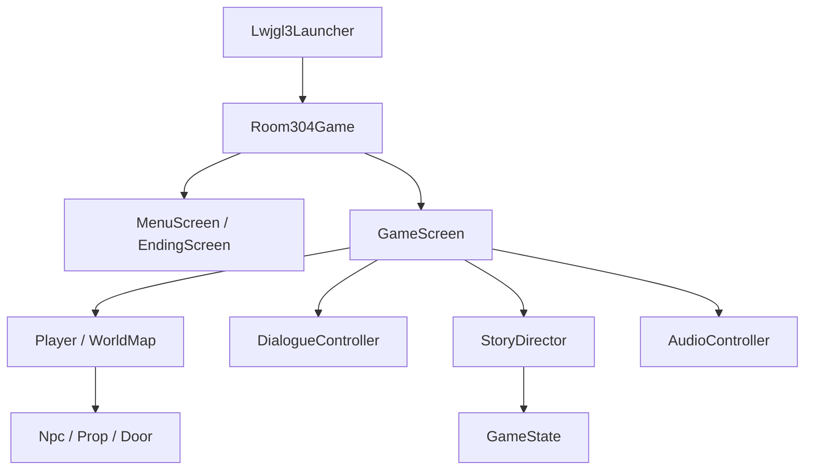

# Room304 — Tài liệu thiết kế phần mềm (SDD)

**Phiên bản:** 0.1 · **Ngày:** 08/10/2026 · **Trạng thái:** kế hoạch thiết kế cho bản game đầu tiên.

SDD thống nhất cách tổ chức chương trình, dữ liệu và việc ghép các phần của nhóm. Các lớp, phương thức và file dữ liệu được đề xuất bên dưới sẽ được triển khai dần; chúng chưa phải toàn bộ mã nguồn đang có.

## 1. Căn cứ và hiện trạng

| Căn cứ | Vai trò |
|---|---|
| [README — môi trường chung](../../README.md#moi-truong-phat-trien-chung) | Phiên bản phần mềm và cách build/run. |
| [Kế hoạch kỹ thuật Java](ke-hoach-ky-thuat-java.md) | Nguồn lực, phạm vi và lộ trình tám tuần. |
| [Cốt truyện v0.2](demo-cot-truyen-can-phong-304.md) | Sự thật của vụ cháy, nhân vật và kết thúc. |
| [Kịch bản hội thoại v0.2](kich-ban-hoi-thoai-phong-304.md) | Mở màn, mã cảnh, câu thoại và điều kiện tương tác. |
| [Quy trình làm việc nhóm](../../CONTRIBUTING.md) | Nhánh công việc, review và tích hợp. |

Mã nguồn hiện tại có `Room304Game` kế thừa `ApplicationAdapter`, hiển thị logo libGDX; launcher mở cửa sổ 640 × 480. Các hệ thống di chuyển, bản đồ, hội thoại, trạng thái truyện và ending sẽ được xây theo SDD này. Những dòng trạng thái trước khởi tạo trong kế hoạch kỹ thuật cũ không đại diện cho mã hiện tại.

Giữ môi trường đã thống nhất: **Oracle JDK 21.0.11**, **libGDX/FreeType 1.14.2**, **LWJGL 3.4.3**, **Gradle Wrapper 9.8.0**; IntelliJ và Git theo README. Hưng phụ trách tích hợp. Nhóm có 5 người, 8–9 tuần, khoảng 3–4 giờ/người/tuần; thiết kế ưu tiên các phần nhỏ có thể ghép và chơi thử sớm.

## 2. Phạm vi bản đầu tiên

- Windows, Java, pixel 2D nhìn từ trên xuống; một người điều khiển Linh.
- Bốn bản đồ nhỏ: phòng 304, hành lang, lớp học hiện tại và phòng bảo vệ. Mở màn/cổng/cầu thang dùng lại các bản đồ này.
- Di chuyển, va chạm, tương tác đồ vật/NPC/cửa; đọc hội thoại có lựa chọn và xem ghi chú manh mối.
- Trang, Đức, Hùng và bà Năm đứng ở vị trí theo tiến độ. Nga xuất hiện bằng các hiệu ứng đơn giản.
- Hai kết thúc bắt buộc: **A — Đủ cả ba mươi ba**, **B — Căn phòng tiếp tục đóng**.
- Menu, tạm dừng, âm lượng, màn hình ending, chơi lại; chữ tiếng Việt và phụ đề đầy đủ.

Kết thúc C, lưu lượt chơi ra file và các hoạt ảnh bổ sung nằm sau mốc A/B hoàn chỉnh. Bản đầu không cần chiến đấu, AI đi theo, vật lý Box2D, mạng hoặc một ngôn ngữ viết kịch bản riêng.

## 3. Kiến trúc và trách nhiệm

Đề xuất chuyển `Room304Game` sang kế thừa `Game`, dùng ba màn hình: `MenuScreen`, `GameScreen`, `EndingScreen`. Mở màn, hộp thoại, ghi chú và tạm dừng là các chế độ/khung hiển thị trong `GameScreen`. Cách tổ chức `Game` và `Screen` có trong [hướng dẫn libGDX](https://libgdx.com/wiki/start/simple-game-extended).



| Thành phần | Trách nhiệm và ranh giới |
|---|---|
| `Room304Game` | Khởi động, đổi màn hình, sở hữu tài nguyên dùng chung và cấu hình âm lượng. |
| `MenuScreen`, `EndingScreen` | Nhận lựa chọn bắt đầu/chơi lại/thoát; hiển thị kết quả đã có. |
| `GameScreen` | Điều phối input, cập nhật, vẽ và các bước truyện; giữ một lượt chơi xuyên suốt việc chuyển phòng. |
| `Player` | Tọa độ, hướng nhìn, sprite và vùng va chạm ở chân. |
| `WorldMap` | Nạp phòng, vật cản, điểm xuất hiện, tìm đối tượng trong tầm; dựng lại hình ảnh từ tiến độ. |
| `Interactable` | Giao diện cung cấp ID và vùng tương tác; `Npc`, `Prop`, `Door` là các loại đối tượng. |
| `DialogueController` | Hiện người nói/nội dung/lựa chọn, phân trang và báo khi đoạn thoại kết thúc. |
| `StoryDirector` | Chọn thoại theo manh mối, kiểm tra điều kiện và áp dụng kết quả vào `GameState`. |
| `GameState` | Dữ liệu của một lượt: phòng, đồ, manh mối, mốc truyện, vị trí sổ và ending. |
| `AudioController` | Phát/dừng nền, hiệu ứng và băng; tạm dừng âm thanh, điều chỉnh âm lượng. |

`StoryDirector` và `GameState` giữ logic truyện bằng Java, không phụ thuộc việc vẽ hay thiết bị âm thanh. NPC không giữ một bản tiến độ riêng. Các lớp dữ liệu nhỏ như `DialogueLine`, `DialogueChoice`, `StoryStep` chỉ chứa thông tin để các module trao đổi.

Code đặt dưới `game/core/src/main/java/com/room304/`: màn hình trong `screen/`, nhân vật/bản đồ/đối tượng trong `world/`, hiển thị và dữ liệu thoại trong `dialogue/`, tiến độ/điều kiện trong `story/`, âm thanh trong `audio/`. `Room304Game` ở package gốc; launcher giữ trong module `lwjgl3`. Chỉ tạo lớp khi tới mốc sử dụng.

### Hợp đồng ghép các module

Đây là các thao tác cần cung cấp; chữ ký cuối cùng được thống nhất khi triển khai phần đầu.

| Module / thao tác | Đầu vào → kết quả |
|---|---|
| `WorldMap.isBlocked(feetBounds)` | Hình chữ nhật ở chân → có chạm vật cản hay không. |
| `WorldMap.findTarget(position, facing)` | Vị trí/hướng Linh → tối đa một đối tượng trong tầm, hoặc không có. |
| `StoryDirector.interact(targetId)` | ID đối tượng → một `StoryStep`; chọn nội dung, chưa cấp đồ ngay. |
| `DialogueController.open(dialogueId, onFinished)` | ID nội dung và callback → hiện thoại; báo lựa chọn khi hoàn tất. |
| `StoryDirector.complete(step, choiceId)` | Bước vừa hoàn tất, lựa chọn nếu có → cập nhật trạng thái và trả bước tiếp theo. |
| `GameScreen.enterRoom(roomId, spawnId)` | Phòng/điểm xuất hiện đã kiểm tra → thay bản đồ, giữ nguyên `GameState`. |

`StoryStep` mô tả một việc: hiện hội thoại, chạy cảnh ngắn, chuyển phòng, hiện ending hoặc trở lại khám phá. `GameScreen` thực hiện việc đó; `StoryDirector.complete` là nơi áp dụng kết quả logic. Với thoại không có lựa chọn, callback trả `choiceId = null`; callback chỉ chạy một lần. JSON không tự gọi code hoặc thay đổi trạng thái.

Director giữ bước đang hoạt động. `complete` chỉ chấp nhận đúng bước đó và áp dụng một lần cho mỗi lần chạy bước; callback trùng hoặc của bước đã huỷ bị bỏ qua. Tương tác lại có thể tạo bước mới với cùng ID hội thoại, nên không cấm mở lại cả ID vĩnh viễn.

Ví dụ: E trước ảnh → tìm ID `class_photo` → chọn biến thể `C1-02` → đọc hết → nhận manh mối ảnh một lần → trở lại khám phá. Nếu xem lại, Director chọn câu nhắc ngắn; không cấp thêm đồ hoặc chạy lại chuông.

## 4. Input và một vòng cập nhật

`GameMode` chỉ điều khiển thao tác hiện tại: `EXPLORE`, `DIALOGUE`, `CUTSCENE`, `PAUSED`. Phòng và tiến độ truyện là dữ liệu riêng; đổi phòng không có nghĩa bắt đầu lại cảnh truyện.

1. Nhận input của chế độ hiện tại. WASD/mũi tên di chuyển; E tương tác; Enter/E chuyển thoại; mũi tên chọn câu trả lời; Esc tạm dừng; Tab mở/đóng ghi chú khi khám phá.
2. Nếu đang khám phá, cập nhật vị trí bằng tốc độ × thời gian khung hình; chuẩn hoá hướng đi chéo để tốc độ bằng đi thẳng. Kiểm tra vùng chân theo trục X rồi Y với bước di chuyển nhỏ.
3. E chỉ xử lý lần nhấn mới, chọn đối tượng gần nhất trong vùng phía trước khoảng một ô. Không tương tác qua tường hoặc chọn đồng thời hai đối tượng.
4. Khi mở thoại/cảnh/chuyển phòng, kết thúc nhánh input của khung hình đó. Phím E vừa mở thoại không được bỏ qua câu đầu; giữ phím không nhận trùng đồ hoặc đi qua nhiều câu.
5. Hoàn tất bước truyện → cập nhật tiến độ → áp dụng bước tiếp theo → làm mới hình/NPC/mục tiêu theo trạng thái.
6. Vẽ bản đồ, đối tượng/nhân vật theo vị trí chân, hiệu ứng, rồi hộp thoại/phụ đề/mục tiêu/ghi chú.

Esc lưu chế độ trước khi tạm dừng. Khi tiếp tục, trở lại đúng chế độ đó; timer cảnh và âm thanh cũng dừng/tiếp tục tương ứng. Ghi chú là khung trong lúc khám phá, chặn di chuyển/tương tác trong thời gian đang mở. Các phần có chữ chờ người chơi bấm tiếp, không tự hết giờ.

## 5. Bản đồ, đồ họa và UI

| Quy ước | Thiết kế ban đầu |
|---|---|
| ID phòng | `ROOM_304`, `HALLWAY`, `CLASSROOM`, `GUARD_ROOM`. |
| Bản đồ | TMX orthogonal hữu hạn; ô 32 × 32; dùng cùng bộ tileset. Phòng mẫu có thể dùng hình chữ nhật trước. |
| Nhân vật | Sprite Linh 32 × 48, vùng chân nhỏ hơn sprite; NPC đứng yên theo cảnh. |
| Tọa độ | Một đơn vị thế giới bằng một pixel; trục Y hướng lên sau khi nạp qua libGDX. |
| Hiển thị | `FitViewport` 640 × 480; cập nhật khi resize, giữ tỷ lệ. Sprite dùng lọc nearest. |
| Hộp thoại | Tên người nói + chữ xuống dòng/phân trang + lựa chọn. Font có đủ dấu tiếng Việt. |
| Mục tiêu/ghi chú | Mục tiêu ngắn; ghi chú được dựng từ tập manh mối đã nhận. |

`FitViewport` và xử lý resize theo [tài liệu viewport](https://libgdx.com/wiki/graphics/viewports). Nạp TMX bằng `TmxMapLoader`, vẽ bằng `OrthogonalTiledMapRenderer`; libGDX hỗ trợ layer và thuộc tính của đối tượng theo [tài liệu bản đồ](https://libgdx.com/wiki/graphics/2d/tile-maps).

Quy ước layer: `ground` cho nền; `decor` cho đồ trang trí; `collisions` chứa hình chữ nhật vật cản; `interactables` chứa `id`, `type`; `spawns` chứa các điểm có tên; `doors` chứa `id`, `targetRoom`, `spawnId`. ID duy nhất trong phòng; các tham chiếu phải tồn tại. Không lật tọa độ TMX lần nữa sau khi loader đã chuyển đổi.

Cửa chuyển phòng khi nhấn E. Điểm xuất hiện ở ngoài vùng cửa/vật cản để không chuyển ngược lập tức. Đổi phòng giải phóng tài nguyên riêng của phòng cũ, đặt Linh tại điểm hợp lệ và dựng lại đối tượng theo cùng `GameState`. Mất ID, phòng đích hoặc spawn phải báo rõ file và tên bị lỗi, không tự đặt Linh vào góc `(0,0)`.

## 6. Dữ liệu một lượt chơi

`GameState` được tạo khi bắt đầu/chơi lại và giữ nguyên đối tượng đó khi chuyển phòng. Dùng `enum` cho tên cố định, `EnumSet` cho tập đã thu được; một ID chỉ xuất hiện một lần trong tập. Vị trí và hướng Linh thuộc `Player`, không lưu thêm một bản tọa độ trong mỗi NPC hoặc bản đồ.

| Dữ liệu | Giá trị / ý nghĩa |
|---|---|
| `roomId` | Một trong bốn `RoomId`; cập nhật khi chuyển phòng thành công. |
| `bookLocation` | `TABLE_304`, `CARRIED`, `LOCKED_CABINET`, `FINAL_TABLE`. |
| `items` | `CABINET_KEY`, `CASSETTE`, `BATTERY_PACK`: đồ đã nhận và còn sử dụng được. |
| `clues` | `CLASS_PHOTO`, `ALTERED_REGISTER`, `EVACUATION_AND_REPORT`, `CASSETTE_CONTENT`, `SIGNED_ADDENDUM`. |
| `events` | `OPENING_DONE`, `LOOP_CONFIRMED`, `DUC_MET`, `RETREAT_TRIAL_DONE`, `HUNG_INTRO_DONE`, `RECORDER_CHECKED`, `HUNG_CONFESSION_DONE`, `FINAL_WARNING_DONE`; thêm `DUC_PHOTO_SEEN` cho thoại tuỳ chọn. |
| `ending` | `NONE`, `A`, `B`. Chưa có C trong bản bắt buộc. |

Lượt mới: sổ `TABLE_304`, các tập rỗng, ending `NONE`. Nếu chạy mở màn, bắt đầu ở `HALLWAY` trong chế độ dàn cảnh rồi chuyển vào `ROOM_304`; nếu bỏ qua, bắt đầu tại `ROOM_304`, chỉ ghi `OPENING_DONE` và tới thoại vào phòng. Điểm xuất hiện lấy từ bản đồ; Linh chỉ được điều khiển sau đoạn vào phòng.

Sổ là vật đặc biệt quản lý bằng `bookLocation`, không đồng thời thêm `hasBook` vào kho đồ. Nhận chìa/băng/pin không nhận trùng; dùng băng hoặc pin không xoá quyền sử dụng về sau. Dàn cảnh thể hiện lắp pin, lấy băng lại sau phát để mang đối chiếu. Chìa được giữ tới phần kết B mới trả bà Năm.

**Thông tin suy ra:** đã nghe băng = có `CASSETTE_CONTENT`; có xác nhận = có `SIGNED_ADDENDUM`; tủ khoá = sổ `LOCKED_CABINET`. Ký ức đang giữ người khi đã có `ALTERED_REGISTER`, sổ chưa được khoá và ending còn `NONE`. Không tạo thêm các boolean cùng nghĩa rồi cập nhật ở nhiều nơi.

`StoryDirector` là nơi ghi đồ/manh mối/mốc truyện/vị trí sổ/ending. `GameScreen` cập nhật phòng sau khi nạp và đặt nhân vật thành công. Đối tượng ở bản đồ chỉ đọc tiến độ để biết có hiện hay không, dùng thoại nào và còn đồ để nhận hay không.

## 7. Luồng truyện và điều kiện kết thúc

| Tương tác / mốc | Điều kiện và kết quả logic khi hoàn tất |
|---|---|
| Mở màn `C0-01..03` | Hoàn tất/bỏ qua → `OPENING_DONE`; chưa có manh mối. |
| Vào phòng `C1-01` | Chỉ nối từ luồng bắt đầu lượt/mở màn; xong mới trả quyền di chuyển. `enterRoom` quay lại 304 không mở lại đoạn này. |
| Xem ảnh `C1-02` / cùng Đức `C4-01` | Nhận `CLASS_PHOTO`; ảnh chỉ xác nhận sĩ số lớp, chưa chứng minh đi học hôm cháy. |
| Mở đúng sổ `C1-04` | Lần đầu → chạy chuông/ghế/bóng; sổ `TABLE_304 → CARRIED`, nhận `ALTERED_REGISTER`. Xem lại dùng câu nhắc. |
| Cầu thang `C2-01` | Trước khi mở sổ: nhắc hoàn thành việc chụp ảnh. Sau mở: vòng lặp có dàn cảnh một lần → `LOOP_CONFIRMED`. |
| Gặp Đức `C2-02` | Sau vòng lặp → `DUC_MET`. Cửa bảo vệ hiện khi có cả hai mốc; đọc nội san là tuỳ chọn. |
| Nhận chìa `C3-01` | Nhận `CABINET_KEY` một lần. Chưa tự mở kết thúc B. |
| Thử khoá `C3-02` | Có chìa, sổ đang mang → `LOCKED_CABINET`, `RETREAT_TRIAL_DONE`. Hiện tượng tạm ngừng; chưa phải ending. |
| Gặp Hùng `C3-03` | Sau `RETREAT_TRIAL_DONE`, hoàn tất đoạn gặp → `HUNG_INTRO_DONE`; chưa thú nhận. Trước mốc này Hùng chỉ nhắc việc chụp tư liệu, không nói về lần thử khoá chưa xảy ra. |
| Quyết định `C3-04` | Đã thử khoá + đã gặp Hùng + sổ `LOCKED_CABINET`. Rút lui → B; tiếp tục đã xác nhận → sổ `CARRIED`. “Chưa mở” không đổi tiến độ. |
| Bản ghi `C3-05` | Nhận `EVACUATION_AND_REPORT`; gồm cả 32 người ở cổng và báo cáo “đủ”. Nếu đã nghe băng, dùng biến thể lời thoại tương ứng. |
| Tìm băng `C4-02` | Đọc nhãn/kiểm kê → nhận `CASSETTE`; không bắt xem bóng chỉ đường trước. |
| Kiểm tra máy / xin pin | Có băng, thiếu pin → `RECORDER_CHECKED`; hỏi bà Năm khi đã biết thiếu nguồn → nhận `BATTERY_PACK`. |
| Phát băng `C4-05` | Có băng + pin → đọc/nghe trọn nội dung → nhận `CASSETTE_CONTENT`. Tắt âm vẫn đạt qua phụ đề. |
| Đối chất `C5-04` | Có nội dung băng → `HUNG_CONFESSION_DONE`; không bắt hỏi hai câu đối chất trước. |
| Bản bổ sung `C5-05` | Có bốn manh mối trước xác nhận + Hùng thú nhận → nhận `SIGNED_ADDENDUM`; nối ngay cảnh cảnh báo. |
| Cảnh báo `C5-06` | Hoàn tất cảnh → `FINAL_WARNING_DONE`; không trả quyền di chuyển giữa nhận xác nhận và cảnh này. |
| Chuẩn bị `C6-01` | Đủ điều kiện → sổ `CARRIED → FINAL_TABLE`, tập hợp nhóm, mở lựa chọn cuối. Thiếu gì nhắc đúng nơi để tìm. |

### Các hàm điều kiện cần dùng chung

`canRetreat(state)` đúng khi: ending `NONE`, có chìa, đã thử khoá và đã gặp Hùng lần đầu. Vì vậy **B sớm nhất ở `C3-04`**; có chìa thôi chưa đủ. Khi chọn rút lui, chạy thao tác cất/khoá hoặc kiểm tra ổ khoá nếu sổ đã ở trong; chỉ chốt `ending = B` sau khi sổ là `LOCKED_CABINET`.

`canPrepareFinal(state)` đúng khi: ở `ROOM_304`, ending `NONE`, đã thử khoá/gặp Hùng, sổ `CARRIED`, có cả năm manh mối, Hùng đã thú nhận và cảnh cảnh báo đã hoàn tất. Khi chuẩn bị thành công, đặt sổ `FINAL_TABLE` rồi mới mở lựa chọn cuối.

`canFinishA(state)` kiểm tra cùng phòng/bộ tư liệu/mốc và ending `NONE`, nhưng yêu cầu sổ là `FINAL_TABLE`. Hai hàm dùng chung phần kiểm tra bằng chứng/mốc; không gọi lại nguyên `canPrepareFinal` để chốt A vì sổ đã được đặt xuống.

**A chỉ xảy ra sau lựa chọn “Chờ Nga tự trả lời”.** Đủ chứng cứ không tự kết thúc lượt. **B vẫn được chọn khi đã điều tra đủ.** Không hiển thị lựa chọn trả lời thay dẫn tới C trong bản A/B.

Các điều kiện này là phương thức Java dùng chung cho lựa chọn, tương tác và kiểm thử; không chép lại một phiên bản trong từng NPC. Những câu nhắc phụ thuộc manh mối thật: có băng chưa nghe khác với đã nghe, ảnh lớp khác với chứng cứ đi học ngày xảy ra cháy.

### Vị trí NPC và cảnh chạy một lần

- Trong `C0-03`, Linh/Trang ở hành lang. Khi bắt đầu khám phá `C1-01`, Trang ở 304; Hùng ở lớp hiện tại; bà Năm ở bảo vệ. Đức xuất hiện tại hành lang sau vòng lặp.
- Những cảnh cùng nhóm ở lần thử và gặp Hùng dùng chuyển cảnh ngắn đặt nhân vật đúng chỗ.
- Sau xác nhận tiếp tục: Trang/Hùng ở lớp hiện tại; bà Năm ở bảo vệ; Đức ở 304.
- Bắt đầu đối chất bằng băng: chuyển Đức tới lớp hiện tại và giữ cậu ở đó qua cảnh cảnh báo, kể cả Linh đi tìm tư liệu còn thiếu.
- Chuẩn bị cuối hoặc rút lui: tập hợp nhóm theo cảnh. Chỉ cho NPC đang cùng phòng tham gia thoại; khi vắng dùng biến thể độc thoại của Linh.

Một bước đang chạy giữ `DIALOGUE`/`CUTSCENE` và không lên lịch lại. Chỉ cấp kết quả, ghi mốc hoàn tất và nối bước kế ở điểm kết thúc đã định. `GameScreen.render(delta)` gọi phần input/cập nhật rồi phần vẽ; các hàm vẽ không cấp đồ hoặc phát sự kiện. Âm thanh chạy theo bước truyện, không phát lại theo mỗi khung hình. Không có bộ đếm bí mật gây hiện tượng trước khi mở sổ.

## 8. Nội dung hội thoại và dữ liệu tài nguyên

Nội dung UTF-8 đặt trong `game/assets/dialogue/room304.json`. Dùng cấu trúc đơn giản `dialogues` → `id`, `lines`, `choices`; đọc bằng công cụ JSON sẵn có của libGDX theo [tài liệu JSON](https://libgdx.com/wiki/utils/reading-and-writing-json). Ví dụ dữ liệu dự kiến:

```json
{
  "dialogues": [
    {
      "id": "C3-04.decision",
      "lines": [
        {"speaker": "TRANG", "text": "Linh, cổng đang mở. Cậu muốn làm gì?"}
      ],
      "choices": [
        {"id": "RETREAT", "text": "Rời trường. Giữ sổ trong tủ."},
        {"id": "CONTINUE", "text": "Ở lại tìm xem Nga đã ở đâu."}
      ]
    }
  ]
}
```

Mã phần đầu `C3-04` khớp kịch bản; hậu tố phân biệt biến thể như `.decision`, `.alone`, `.repeat`. Lựa chọn `CONTINUE` mở đoạn chuẩn bị/hộp xác nhận tiếp theo, chưa mở sổ ngay. Chỉ khi xác nhận mở lại thì Director mới đổi vị trí sổ.

JSON chứa câu chữ; điều kiện hiện lựa chọn/biến thể và tác động nằm trong Director bằng `if`/`switch`. Khi nạp, kiểm tra ID trùng, thiếu nội dung, người nói không hợp lệ, ID thoại không tồn tại và lựa chọn không có xử lý. Báo lỗi kèm file/ID để sửa trước khi chơi. Không cần `goto`, biểu thức điều kiện hay lệnh Java trong JSON.

Tài nguyên dự kiến: `assets/maps/` (bốn TMX), `sprites/`, `tilesets/`, `dialogue/`, `fonts/`, `audio/`. Đường dẫn dùng dấu `/`, chữ không dấu, khớp cả chữ hoa/thường. File bản đồ/hình/font/âm thanh chỉ trở thành yêu cầu nạp khi module tương ứng đã được triển khai; phòng mẫu ban đầu dùng hình tạm.

## 9. Font, âm thanh và vòng đời tài nguyên

- Nạp dữ liệu hội thoại trước, thu thập ký tự tiếng Việt trong toàn bộ nội dung và UI rồi sinh font bằng FreeType. Thử cả “Nguyễn Thu Nga”, chữ có dấu và dấu ngoặc; kiểm tra xuống dòng/phân trang ở cửa sổ 640 × 480 và khi resize.
- `AudioController` dùng hiệu ứng ngắn cho cửa/giấy/chuông/ghế; nền và băng dài phát theo luồng. Mỗi sự kiện phát theo `StoryStep`, không phụ thuộc FPS. Tham khảo [âm thanh ngắn](https://libgdx.com/wiki/audio/sound-effects), [âm thanh dài](https://libgdx.com/wiki/audio/streaming-music) và [FreeType](https://libgdx.com/wiki/extensions/gdx-freetype).
- Mở màn có nền trường bình thường; chỉ sau đúng trang sổ mới dừng nền, phát chuông/ghế/giọng theo thứ tự trong kịch bản. Phụ đề và thay đổi hình ảnh luôn có, kể cả khi âm lượng bằng 0 hoặc chưa thu giọng.
- `Room304Game` sở hữu batch, font, sprite dùng chung, nội dung hội thoại và bộ âm thanh; nạp một lần và giải phóng khi thoát ứng dụng. Cấu hình âm lượng thuộc ứng dụng, giữ khi chơi lại.
- Chọn nạp bản đồ trực tiếp cho bản đầu. `WorldMap` sở hữu map/renderer hiện tại và giải phóng khi thay phòng hoặc kết thúc lượt; các màn hình không giải phóng tài nguyên dùng chung. Không nạp hoặc tạo lại texture/font trong `render()`.
- Khi bỏ màn chơi: dừng âm thanh/cảnh cũ và huỷ callback trước khi mở màn tiếp theo; giải phóng tài nguyên riêng của màn cũ đúng một lần. `setScreen` không tự giải phóng Screen đã bỏ, nên `Room304Game` phải quản lý việc này rõ ràng.

Thiếu dữ liệu quan trọng thì báo lỗi nêu đường dẫn/ID và không cho vào lượt hỏng. Hiệu ứng âm thanh chưa chuẩn bị có thể dùng chế độ im lặng trong bản hình tạm; nội dung băng vẫn được trình bày đầy đủ bằng chữ. Hình/font dùng ngoài nhóm phải ghi nguồn và giấy phép cùng tài nguyên.

## 10. Thứ tự triển khai và phân việc

Không tạo mọi lớp cùng lúc. Mỗi mốc tạo được một phần có thể chơi thử, ghép qua PR nhỏ. Hưng phụ trách tích hợp; các phần chuyên môn bên dưới là đề xuất để nhóm chọn người phụ trách, chưa tự gán cho Minh/Long/Thắng/Lâm.

| Mốc / thời gian tham khảo | Công việc | Sản phẩm và điều kiện hoàn thành |
|---|---|---|
| 1 — tuần 1–2 | Khung màn chơi, một phòng hình tạm, Linh, font và một hội thoại | Đi/va chạm, E nói với Trang, đọc tiếng Việt; phím mở thoại không bỏ dòng đầu. |
| 2 — tuần 2–3 | `GameState`, tương tác ảnh/sổ, chuông, chuyển phòng | Nhận manh mối một lần; mở sổ mới có hiện tượng; quay lại phòng vẫn giữ tiến độ. |
| 3 — tuần 3–4 | Chìa/tủ, băng/pin, đối chất và điều kiện truyện | Chơi từ đầu tới A và B bằng hình tạm; thứ tự manh mối khác vẫn hoàn thành. |
| 4 — tuần 5–6 | Mở màn, bốn TMX, hình chính, âm thanh/phụ đề, menu/ghi chú | Dữ liệu hội thoại tách khỏi code; tắt âm vẫn hiểu; người ngoài nhóm biết mục tiêu. |
| 5 — tuần 7–8 | Kiểm tra nhánh, sửa lỗi, đóng gói Windows | Bản bàn giao chạy trên máy thứ hai; font/bản đồ/audio kèm đủ; hai ending đạt. |
| Dự phòng — tuần 9 | Sửa lỗi còn lại; cân nhắc C nếu A/B ổn định | Không làm chậm bản bàn giao để thêm phần bổ sung. |

Các phần có thể làm song song sau khi thống nhất hợp đồng: **điều khiển/khung game**, **bản đồ/tương tác**, **hội thoại/UI**, **trạng thái truyện/âm thanh**, **hình vẽ/bố trí phòng/chơi thử**. Phần vẽ dùng đúng kích thước và ID; code dùng hình tạm trước. Thay lớp chung hoặc định dạng JSON/TMX cần cập nhật SDD và thông báo trong PR để những phần khác nối lại đúng.

Nếu hết mốc 1 chưa có phòng chơi được, ưu tiên E/hội thoại/manh mối và giảm trang trí. Nếu hết tuần 4 chưa đạt A/B, rút lời thoại tuỳ chọn và hoạt ảnh; giữ bằng chứng băng, lần thử khoá, xác nhận và cảnh báo.

## 11. Kế hoạch kiểm tra và tiêu chí bàn giao

Các trường hợp dưới đây là **kiểm tra cần triển khai/chạy**, chưa phải kết quả đã đạt. Tự động kiểm tra phần điều kiện và chuyển trạng thái thuần Java; chơi thử phần input, va chạm, bố cục, âm thanh và chuyển phòng.

| Mã | Tình huống | Kết quả cần đạt |
|---|---|---|
| T01 | Nhấn giữ E, callback hoàn tất bị gọi hai lần, đang đọc mà nhấn hướng | Chỉ áp dụng kết quả/bước tiếp một lần; không bỏ nhiều dòng; Linh đứng yên. |
| T02 | Xem ảnh sau sổ; lấy băng trước bóng; thú nhận trước bản ghi | Vẫn tìm đủ tư liệu và tới A; câu thoại khớp điều đã biết. |
| T03 | Có cassette nhưng chưa xem nội dung | Không mở đối chất hoặc nhận bản bổ sung. |
| T04 | Lần lượt thiếu manh mối/mốc; đủ tư liệu nhưng sai phòng hoặc chưa đặt sổ `FINAL_TABLE` | Không chốt A. Chỉ cho chuẩn bị tại 304 khi sổ còn `CARRIED` và đủ các điều kiện; sau chuẩn bị mới mở lựa chọn chờ. |
| T05 | Có chìa nhưng chưa thử; đã thử nhưng chưa gặp Hùng; đủ các mốc | Hai trường hợp đầu chưa mở B; trường hợp cuối mở lựa chọn rút lui, chưa tự ending. |
| T06 | Từ chối mở lại sổ; B sớm; B sau điều tra đầy đủ | Từ chối không mất tiến độ; B khoá đúng ngăn; thoại không tiết lộ điều chưa biết. |
| T07 | Đi qua cửa/quay lại, đứng ở cửa, đi chéo/sát tường | Giữ manh mối, không lặp chuông, không xuyên tường/chuyển phòng liên tục. |
| T08 | NPC ở phòng khác; pause giữa cảnh; âm lượng 0 | Dùng đúng biến thể thoại; cảnh dừng/tiếp tục; băng và mục tiêu vẫn hiểu qua chữ. |
| T09 | Từ ending chọn chơi lại | State/đồ/manh mối/NPC/hiệu ứng trở về lượt mới; giữ thiết lập âm lượng. |
| T10 | JSON/TMX thiếu hoặc trùng ID, sai spawn; resize; đóng gói | Lỗi dữ liệu báo rõ; chữ không mất dấu/cắt lựa chọn; bản đóng gói chạy trên máy khác. |

Lệnh chạy từ thư mục gốc repository sau khi chức năng tương ứng đã có:

```powershell
.\game\gradlew.bat -p game build --console=plain --stacktrace
$LASTEXITCODE
```

Khi mã thoát là `0`, chạy:

```powershell
.\game\gradlew.bat -p game :lwjgl3:run
```

Chỉ chạy game khi build trả mã `0`. Build/CI xanh không thay cho các trường hợp chơi thử. Khi thêm kiểm thử tự động, ghi số case đã chạy và kết quả; không coi tác vụ không có test là đã kiểm chứng điều kiện truyện.

**Bàn giao đạt:** A/B chơi được trọn vẹn, không kẹt do thứ tự manh mối; lượt mới xoá tiến độ; chơi được khi tắt tiếng; bản Windows gồm tài nguyên và môi trường chạy phù hợp, đã thử trên máy khác. Cách đóng gói launcher/runtime được thử ở mốc 5 rồi ghi vào README; chưa coi đó là chức năng đã có ở template.

## 12. Những quyết định còn cần chốt khi làm bản mẫu

1. File font và giấy phép; độ lớn chữ đọc được trong hộp thoại.
2. Bộ tileset/sprite, tọa độ vật cản và điểm xuất hiện thực tế của bốn phòng.
3. Người phụ trách từng phần, người chuẩn bị/thu âm, nguồn âm thanh và ghi công.
4. Cách đóng gói Windows đã chạy thành công trên máy khác.

Khi đổi một quyết định ảnh hưởng module khác, cập nhật mục tương ứng của SDD, tăng phiên bản tài liệu và ghi lý do ngắn. Cốt truyện và lời thoại chi tiết được chỉnh ở tài liệu nguồn; SDD cập nhật điều kiện/dữ liệu liên quan. Công việc tiếp theo là **mốc 1: một phòng, Linh di chuyển, Trang và một hộp thoại tiếng Việt**.


