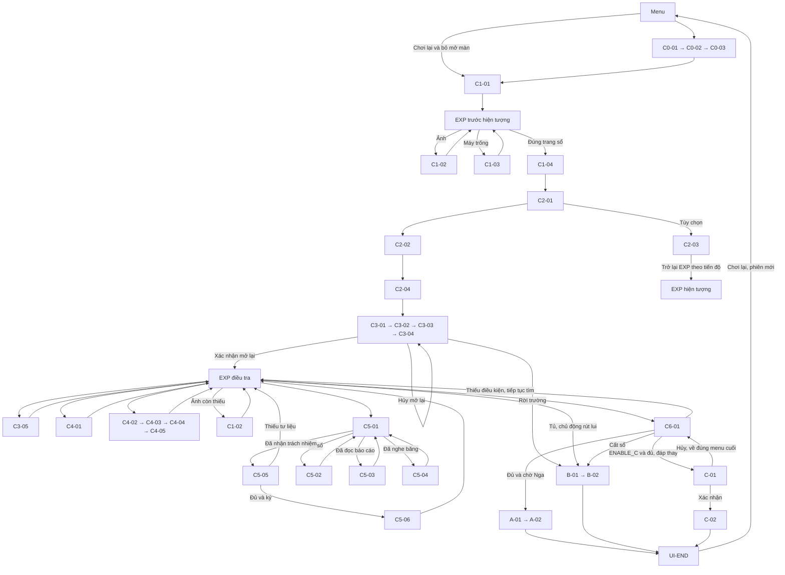

# CĂN PHÒNG 304 — BUỔI ĐIỂM DANH CUỐI CÙNG
## Kịch bản và flow triển khai đầy đủ — bản thiết kế 1.0

## 1. Phạm vi, giả định thiết kế và trải nghiệm mục tiêu

Game chơi đơn, điều khiển Linh, điều tra và kinh dị tâm lý. Bản chính có A/B; C hoàn chỉnh ở mục 8 nhưng mặc định tắt. Không chiến đấu, đuổi bắt, thanh máu, điểm quan hệ, lựa chọn có hạn giờ, lưu phiên hay checkpoint. Bốn khu vực duy nhất: 304, hành lang tầng ba, phòng bảo vệ kèm lối cổng, lớp học hiện tại của Hùng. Sân chỉ hiện qua cửa sổ và âm nền.

Mọi sự kiện hiện tại diễn ra trong năm 2025, mở màn khoảng 16:40; không xác định ngày/tháng. Vụ cháy: 11/09/2015. Nga là chị Đức, học 12A3; Đức bảy tuổi khi chị mất. Ảnh có 33 học sinh chỉ xác nhận sĩ số. Sổ bị sửa và ghi 32 cần sơ tán; bà Năm tận mắt đếm 32 người ngoài sân. Báo cáo ghi chập điện hành lang. Hùng giao Nga ở lại cất tư liệu, báo đủ khi chưa kiểm tra Nga, rồi sửa hồ sơ. Nga chưa ra ngoài rồi quay lại. Băng là vật gốc thu hồi có kiểm kê. Không kết luận Nga chắc chắn được cứu nếu báo sớm. Lời thú nhận không miễn trách nhiệm; không buộc Đức hoặc Nga tha thứ.

**Giả định thiết kế được chốt để dựng:**

- G01: 2D nhìn từ trên xuống, mỗi khu vực một màn hình; cửa nối bản đồ bằng mờ chuyển 0,35 giây. Không dựng tầng dưới hoặc sân riêng.
- G02: NPC được đặt lại bằng cảnh chuyển có lời dẫn cụ thể; không cần AI đi theo. Vị trí theo bảng mục 2. Không gọi thoại của người ở bản đồ khác.
- G03: Máy cassette dùng **4 pin AA 1,5 V**, cực pin in trên khay. Đây là chi tiết bổ sung, không lấy từ nguồn. Không chọn loại pin như câu đố; không hết pin trong phiên.
- G04: Thùng được kiểm kê nhưng còn buộc dây chuyển đồ; chỉ mở lấy băng sau khi nhóm chọn tiếp tục và bà Năm cho xem đồ. Trước đó vẫn xem được nhãn ngoài. Vì vậy băng có thể lấy trước ảnh/bóng và trước bản ghi, nhưng không trước quyết định tiếp tục. Nội san chỉ trở thành tương tác sau khi mở sổ; trước đó chỉ đọc thông báo sửa chữa ở cùng bảng tin.
- G05: Lối xuống trước nhiệm vụ xong được chặn bằng tự nhắc của Linh, không bằng hiện tượng. Lớp Hùng trước lần thử chỉ cho lời nhắc ngoài cửa; cảnh gặp chính thức là C3-03.
- G06: Bản ghi, báo cáo và kiểm kê chỉ hiển thị phần liên quan; các đoạn được chốt đầy đủ ở mục 5. Không chế thêm 32 tên học sinh. Giấy bổ sung ghi năm 2025, không đặt ngày/tháng hiện tại. Chữ ký ghi “Hùng” vì nguồn không cung cấp họ tên đầy đủ.
- G07: Giữ A hướng tới 15–20 phút trên đường chính; đó là mục tiêu cần đo. Đọc mọi câu hỏi, xem lại tài liệu có thể lâu hơn. Không cắt nội dung hoặc tăng tốc chữ để ép thời lượng.
- G08: Bỏ qua mở màn chỉ có trong cùng lần chạy ứng dụng sau khi đã hoàn tất một ending. Đây là cờ giao diện trong RAM; không lưu game. “Chơi lại” hỏi xem hoặc bỏ mở màn, luôn khởi tạo phiên mới.
- G09: Lời gọi cuối B là đoạn cắt cảnh ngoài điều khiển, cho thấy việc khóa chỉ tạm ngừng. Không đặt lại vòng lặp trong phiên đã kết thúc. Ở C, thay tên là chữ của hiện tượng; ảnh chụp và giấy bổ sung không tự đổi.

**Điều khiển và nhịp chung:** WASD/↑↓←→ di chuyển chỉ khi EXP; E tương tác chỉ khi EXP và trong tầm. Enter tiếp tục chữ hoặc xác nhận lựa chọn; ↑/↓ chọn nút; N mở/đóng ghi chú chỉ khi EXP; Esc tạm dừng, từ tạm dừng Esc trở lại. E không chuyển thoại, Enter không tương tác thế giới. Chỉ nhận cạnh nhấn mới sau khi nhả phím; khi đổi chế độ xóa đầu vào cũ. Giữ phím không bỏ thoại. Lựa chọn đầu tiên chỉ được tô viền, không tự chọn; xác nhận cần Enter mới. Đọc tài liệu nhiều trang dùng Enter tới trang sau, trang cuối Enter đóng; ghi chú dùng ↑/↓ chọn và Enter mở. Không đặt một lần bấm làm cả đóng hộp và mở đồ vật.

**MIX-01:** khi có thoại/phụ đề cốt truyện, nền xuống 25% mức người dùng chọn, hiệu ứng trang trí xuống 40%; khôi phục trong 0,25 giây sau hộp cuối. Âm trên băng chỉ chạy trong nhịp đang hiển thị, không chạy sang câu kế khi người chơi chưa bấm. Hết âm vẫn giữ chữ. Hiệu ứng tự động ghi thời gian trong bảng không đóng hộp chữ đang đọc; âm cần hiểu có phụ đề và hình. Không nhấp nháy nhanh; đổi sáng trong 0,2–0,4 giây, vẫn thấy đường. Trước C1-04 không có hiện tượng theo thời gian chờ.

**Quy ước đọc bảng:** EXP = khám phá tự do ở vị trí cuối; OBJ = bộ chọn mục tiêu tại mục 5; CHOICE = bảng lựa chọn của cảnh hiện tại; RETURN-HUNG = C5-01-MENU; END = màn kết thúc UI-END. Một dòng “@tài liệu” trong bảng đã được chuyển thành tham chiếu chuỗi có nội dung trọn vẹn ở mục 5. Nhãn khối là điểm vào duy nhất, chạy các hàng từ trên xuống. Dòng cuối chỉ rõ khối kế; điều kiện nhánh loại trừ nhau hoặc có thứ tự ưu tiên. Không phát tất cả biến thể trong một lượt.

## 2. Bản đồ, đối tượng và vị trí nhân vật

| Khu vực | Bố cục và tương tác | Lối đi |
|---|---|---|
| MAP-304 | Cửa dưới; bàn giáo viên phía trên với sổ; ảnh trên tường trái; máy trên bàn phụ phải; thùng dưới máy; tủ ngăn dưới góc trên phải; bàn cuối gần cửa sổ phải. Đường đi rộng tối thiểu hai ô nhân vật. | Cửa ra hành lang luôn đi qua được khi đang khám phá; không khóa cửa 304 để tạo vòng lặp. |
| MAP-HALL | 304 giữa; lớp Hùng bên trái; cầu thang đầu trái; bảng tin và khay phấn gần 304; mảng tường cuối phải thành cửa bảo vệ ở C2-04. | Bình thường: cầu thang dẫn thẳng tới phòng bảo vệ bằng cắt cảnh. Hiện tượng: cầu thang trả về vạch phấn; cửa bảo vệ bất thường chỉ mở sau C2-04. |
| MAP-GUARD | Bàn giấy bên trái, bà Năm cạnh bảng chìa, ngăn pin dưới bàn; lối cổng ở dưới, ngưỡng ngoài cổng vẫn trong bản đồ này. | Khi hiện tượng: cổng trả về cửa 304, chỉ một chuyển ngắn + nhắc; không ending. Sau khóa: cổng mở, nhưng chỉ B-01/A-02 mới hoàn tất rời trường. |
| MAP-HUNG | Hùng bên bàn sách giữa; bàn đối chiếu bên phải; Trang đứng cạnh bàn; lối vào dưới. | Nối hành lang; dùng cùng bản đồ khi đối chất và ký. |

| Giai đoạn npc_stage | Linh | Trang | Đức | Bà Năm | Hùng | Nga |
|---|---|---|---|---|---|---|
| INTRO | Theo C0 | Cạnh Linh | Chưa hiện | Không hiện | Chỉ qua tin nhắn | Không hiện |
| INITIAL | Tự đi 304/hành lang | 304 gần bàn phụ | Chưa hiện | Chưa hiện | Sau cửa lớp, chưa tương tác | Không hiện |
| LOOP | Linh đi; Trang được đặt cùng khi đổi 304/hành lang | Cách Linh một bước tại cửa vào | Hiện cuối hành lang sau C2-01; chưa theo trước C2-02 | Sau cửa khi C2-04 | Lớp bên cạnh | Bóng theo sự kiện |
| GROUP | Tự đi giữa 304/hành lang/bảo vệ | Cùng bản đồ Linh ở điểm cửa | Cùng bản đồ sau C2-02 | Bảo vệ, rồi cùng nhóm C3-02 | Lớp bên cạnh | Bóng theo sự kiện |
| DECISION | C3-03 rồi cả nhóm trước tủ 304 | Cùng nhóm | Cùng nhóm | Cùng nhóm | Cùng nhóm | Không có bóng; gõ tủ một lần |
| INVESTIGATE | Tự đi bốn vùng | MAP-HUNG | MAP-304 | MAP-GUARD | MAP-HUNG | Chỉ các nhịp chỉ thùng/băng |
| CONFRONT | Tự đi sau đối chất | MAP-HUNG | MAP-HUNG, giữ tới hết cảnh báo | MAP-GUARD | MAP-HUNG | Bóng ở C5-04 |
| READY | Tự đi sau cảnh báo | MAP-HUNG | MAP-HUNG | MAP-GUARD | MAP-HUNG | Chưa ngồi chờ cuối |
| FINAL | Trước bàn giáo viên 304 | Cạnh Linh | Cạnh bàn cuối | Gần tủ | Cạnh bàn giáo viên | Bàn cuối |
| EXIT_A / EXIT_B | Nhóm tại ngưỡng cổng | Cùng nhóm | Cùng nhóm | Cùng nhóm | Cùng nhóm | A tan ở cửa; B không giải thoát |

Tên biển cửa, nhãn đồ và câu chặn nằm trong mục 5. Mọi tương tác định vị bởi biểu tượng E và viền sáng nhẹ, không phụ thuộc âm thanh. Ngoài các đồ đã liệt kê, bàn ghế nền không có tương tác; bàn cuối và cửa sổ có một câu quan sát đã chốt. Không tạo lời thoại ngẫu nhiên.

## 3. Flow tổng thể

Sơ đồ X là hub trước sổ; các mũi tên P/R về X chỉ áp dụng khi chưa đọc sổ. Trong mọi giai đoạn khác, cùng tương tác trả EXP hiện tại, không đặt lại trạng thái. X2 tiếp tục C2-02 nếu chưa gặp Đức, hoặc C2-04 nếu đã gặp; không đưa ngược về X. C6-01 khi hủy C chỉ mở lại bảng chọn cuối, không chạy lại tập hợp và điểm danh.

| Mã đường | Nguồn → đích | Điều kiện và tác dụng |
|---|---|---|
| F01 | C1-01 → EXP → C1-02/C1-03/C1-04 | Tự chọn thứ tự; chỉ C1-04 bật hiện tượng. |
| F02 | C1-04 → EXP → C2-01 | Đi qua cửa vẫn bình thường; chạm lối cầu thang mới thử lặp. |
| F03 | C2-01 → C2-02 → C2-04 | Hai lần thử trong một cảnh; Đức phải đã gặp. Nội san không phải điều kiện. |
| F04 | C3-01 → C3-02 → C3-03 → C3-04 | Giữ chuỗi bắt buộc, kiểm chứng cổng trước khi hiện B. |
| F05 | C3-04 → EXP điều tra | Chỉ khi xác nhận mở lại; hủy giữ sổ trong tủ. |
| F06 | EXP → C3-05/C4-01/C4-02/C1-02 | Không ép thứ tự; C4-01 có thể bỏ. |
| F07 | Máy → C4-03 → bà Năm C4-04 → máy C4-05 | Cần băng; biết loại pin mới xin; nhận băng chưa bằng nghe. |
| F08 | C5-01 → C5-02/C5-03 → C5-01 | Hỏi thêm; cờ thú nhận ưu tiên lời xác nhận mới. |
| F09 | C5-01 → C5-04 → C5-01 | Đã nghe băng, chưa thú nhận; không cần hai câu hỏi trước. |
| F10 | C5-05 thiếu → EXP | Chỉ món thiếu đầu tiên theo bảng; không cấp giấy. |
| F11 | C5-05 đủ → C5-06 → EXP | Một giao dịch liên tục; không được đi giữa ký và cảnh báo. |
| F12 | EXP → C6-01 thiếu → EXP/B-01 | Không tập hợp NPC; A không xuất hiện. |
| F13 | C6-01 đủ → A-01/B-01 | Đủ bộ tư liệu và cảnh báo; chọn chờ mới để Nga đáp. |
| F14 | Tủ sau C3-04 → B-01 | Chìa còn giữ, đã kiểm chứng; khóa thật trước kết thúc. |
| F15 | C6-01 đủ → C-01 → C-02 hoặc menu cuối | Chỉ ENABLE_C; hủy không sửa tên, không mất vật. |

## 4. Kịch bản chi tiết bản A/B

### C0-01 — Màn đen và địa điểm

**Vai trò:** Bắt buộc khi xem mở màn.

**Khu vực và môi trường:** Nền đen rồi nắng hành lang; chỉ chim và tiếng trường xa. Chưa có đường đi.

**Nhân vật, đầu → cuối:** Chưa hiện người; cuối vẫn nền đen.

**Điều kiện vào:** Phiên mới; mọi manh mối false.

**Kích hoạt:** Bắt đầu / xem mở màn.

**Quyền điều khiển:** Khóa di chuyển trong bảng nhịp; Enter chuyển từng lượt. Tại bảng lựa chọn dùng ↑/↓ và Enter; không giới hạn thời gian. Chỉ trả di chuyển khi đích là EXP. Esc tạm dừng và trở lại đúng nhịp; không bỏ nhịp, không đóng tài liệu bắt buộc bằng Esc.

**Mục tiêu trước:** Không hiện mục tiêu.

**Mục tiêu sau:** Không hiện mục tiêu.

**Khối C0-01-MAIN** — Luôn chạy nếu không bỏ mở màn

| Mã nhịp | Loại sự kiện | Nội dung/thoại nguyên văn | Hình ảnh/hành động | Âm thanh/phụ đề | Cách tiếp tục | Thay đổi trạng thái | Nhịp tiếp theo |
| --- | --- | --- | --- | --- | --- | --- | --- |
| C0-01-MAIN-TXT01 | Chữ màn hình | TRƯỜNG THPT AN BÌNH | Chữ giữa khung, đủ tương phản. | Giữ nền hiện tại. | Enter | Không đổi. | C0-01-MAIN-TXT02 |
| C0-01-MAIN-TXT02 | Chữ màn hình | 16:40 — NĂM 2025 | Chữ giữa khung, đủ tương phản. | Giữ nền hiện tại. | Enter | Không đổi. | C0-01-MAIN-TXT03 |
| C0-01-MAIN-TXT03 | Chữ màn hình | Khu nhà cũ sẽ được sửa chữa trong thời gian tới. | Chữ giữa khung, đủ tương phản. | Giữ nền hiện tại. | Enter | Không đổi. | C0-01-MAIN-E04 |
| C0-01-MAIN-E04 | Dàn cảnh | Không thêm chữ ngoài phụ đề đã ghi. | Chữ hiện trong 1 giây, sau đó giữ tới Enter; không giả tiếng người gọi. | Chim và tiếng nói xa không rõ lời. | Enter sau khi đọc | npc_stage=INTRO | C0-02 |

**Lựa chọn:** không có nút quyết định trong cảnh này; Enter đọc tiếp. Các khối điều kiện do trạng thái chọn, không phải câu đố.

**Lối quay lại và tương tác sau:** Không quay lại bằng thế giới; xem lại tin nhắn được từ ghi chú.

**Kết quả, đường ra:** Sang C0-02; chưa bật hiện tượng.

**Tài nguyên:** MAP-HALL, AUD-SCHOOL, UI-DIALOG. **Ước tính:** đọc 8–12 giây; khám phá 0; hiệu ứng 1 giây. Thời gian đọc là dự kiến, không tự đóng chữ.

### C0-02 — Vì sao hai bạn còn ở trường?

**Vai trò:** Bắt buộc khi xem mở màn.

**Khu vực và môi trường:** Nền tối; khung tin nhắn đơn giản; âm trường bình thường.

**Nhân vật, đầu → cuối:** Linh và Trang chưa cần hiện sprite; hai giọng cùng ngữ cảnh mở màn.

**Điều kiện vào:** C0-01 xong.

**Kích hoạt:** Tiếp tục.

**Quyền điều khiển:** Khóa di chuyển trong bảng nhịp; Enter chuyển từng lượt. Tại bảng lựa chọn dùng ↑/↓ và Enter; không giới hạn thời gian. Chỉ trả di chuyển khi đích là EXP. Esc tạm dừng và trở lại đúng nhịp; không bỏ nhịp, không đóng tài liệu bắt buộc bằng Esc.

**Mục tiêu trước:** Không hiện mục tiêu.

**Mục tiêu sau:** Không hiện mục tiêu.

**Khối C0-02-MAIN** — Luôn

| Mã nhịp | Loại sự kiện | Nội dung/thoại nguyên văn | Hình ảnh/hành động | Âm thanh/phụ đề | Cách tiếp tục | Thay đổi trạng thái | Nhịp tiếp theo |
| --- | --- | --- | --- | --- | --- | --- | --- |
| C0-02-MAIN-E01 | Dàn cảnh | Không thêm chữ ngoài phụ đề đã ghi. | Hiện biểu tượng tin nhắn đã nhận. | `C0-02-MAIN-SFX01`: [Tin nhắn đã nhận từ thầy Hùng.] | 0,3 giây rồi giữ phụ đề tới Enter | message_available=true | C0-02-MAIN-T02 |
| C0-02-MAIN-T02 | Tài liệu | Hiện nguyên văn các chuỗi `DOC-MSG-01 đến DOC-MSG-03` tại mục 5. | Mở tài liệu trên nền tối vừa; không che chữ. | Tiếng giấy nhỏ; không đọc chồng lời. | Enter | Không đổi. | C0-02-MAIN-D03 |
| C0-02-MAIN-D03 | Thoại | Trang: Tụi mình chụp xong hôm nay, mai còn chọn ảnh cho bản tin. | Giữ khung; người nói hướng về người nghe. | Nền giảm theo MIX-01; chữ luôn hiển thị. | Enter | Không đổi. | C0-02-MAIN-D04 |
| C0-02-MAIN-D04 | Thoại | Linh: Ừ. Tớ muốn có vài tấm trước khi căn phòng bị dọn hết. | Giữ khung; người nói hướng về người nghe. | Nền giảm theo MIX-01; chữ luôn hiển thị. | Enter | Không đổi. | C0-03 |

**Lựa chọn:** không có nút quyết định trong cảnh này; Enter đọc tiếp. Các khối điều kiện do trạng thái chọn, không phải câu đố.

**Lối quay lại và tương tác sau:** Tin nhắn được đọc lại ở NOTE-MESSAGE, kể cả bỏ mở màn.

**Kết quả, đường ra:** Tin nhận trước khi tới 304; sang C0-03.

**Tài nguyên:** UI-DOC, AUD-MESSAGE. **Ước tính:** đọc 15–25 giây; khám phá 0; hiệu ứng 0,3 giây. Thời gian đọc là dự kiến, không tự đóng chữ.

### C0-03 — Hành lang trước cửa 304

**Vai trò:** Bắt buộc khi xem mở màn.

**Khu vực và môi trường:** Nắng vàng nhạt qua cửa sổ; giấy bảng tin rung do gió. Cửa 304 khép hờ, mở bình thường.

**Nhân vật, đầu → cuối:** Linh gần cửa; Trang sau một bước → cả hai bên trong ngưỡng 304.

**Điều kiện vào:** C0-02 xong.

**Kích hoạt:** Đóng tin nhắn bằng Enter.

**Quyền điều khiển:** Khóa di chuyển trong bảng nhịp; Enter chuyển từng lượt. Tại bảng lựa chọn dùng ↑/↓ và Enter; không giới hạn thời gian. Chỉ trả di chuyển khi đích là EXP. Esc tạm dừng và trở lại đúng nhịp; không bỏ nhịp, không đóng tài liệu bắt buộc bằng Esc.

**Mục tiêu trước:** Không hiện mục tiêu.

**Mục tiêu sau:** Không hiện mục tiêu trước C1-01.

**Khối C0-03-MAIN** — Luôn

| Mã nhịp | Loại sự kiện | Nội dung/thoại nguyên văn | Hình ảnh/hành động | Âm thanh/phụ đề | Cách tiếp tục | Thay đổi trạng thái | Nhịp tiếp theo |
| --- | --- | --- | --- | --- | --- | --- | --- |
| C0-03-MAIN-E01 | Dàn cảnh | Không thêm chữ ngoài phụ đề đã ghi. | Mờ vào hành lang; giữ rõ biển phòng. | Bước chân của hai bạn dừng; chim xa. | 0,5 giây | Không đổi. | C0-03-MAIN-D02 |
| C0-03-MAIN-D02 | Thoại | Trang: Trường vắng nhanh thật. Lúc nãy dưới sân còn đông người mà. | Giữ khung; người nói hướng về người nghe. | Nền giảm theo MIX-01; chữ luôn hiển thị. | Enter | Không đổi. | C0-03-MAIN-D03 |
| C0-03-MAIN-D03 | Thoại | Linh: Mình lên tầng ba lâu hơn tớ tưởng. | Giữ khung; người nói hướng về người nghe. | Nền giảm theo MIX-01; chữ luôn hiển thị. | Enter | Không đổi. | C0-03-MAIN-D04 |
| C0-03-MAIN-D04 | Thoại | Trang: Thầy bảo cứ để nguyên đồ. Cậu đừng thấy món nào lạ rồi tháo ra đấy. | Giữ khung; người nói hướng về người nghe. | Nền giảm theo MIX-01; chữ luôn hiển thị. | Enter | Không đổi. | C0-03-MAIN-D05 |
| C0-03-MAIN-D05 | Thoại | Linh: Tớ mang điện thoại để chụp ảnh, có mang tua vít đâu. | Giữ khung; người nói hướng về người nghe. | Nền giảm theo MIX-01; chữ luôn hiển thị. | Enter | Không đổi. | C0-03-MAIN-D06 |
| C0-03-MAIN-D06 | Thoại | Trang: Tớ nhắc trước cho chắc. | Giữ khung; người nói hướng về người nghe. | Nền giảm theo MIX-01; chữ luôn hiển thị. | Enter | Không đổi. | C0-03-MAIN-E07 |
| C0-03-MAIN-E07 | Dàn cảnh | Không thêm chữ ngoài phụ đề đã ghi. | Linh đẩy cửa, khung cửa thông thoáng. | Bản lề khô, nhỏ. | 0,5 giây | Không đổi. | C0-03-MAIN-D08 |
| C0-03-MAIN-D08 | Thoại | Trang: Đây rồi. Phòng 304. | Giữ khung; người nói hướng về người nghe. | Nền giảm theo MIX-01; chữ luôn hiển thị. | Enter | Không đổi. | C0-03-MAIN-TXT09 |
| C0-03-MAIN-TXT09 | Chữ màn hình | CĂN PHÒNG 304 — BUỔI ĐIỂM DANH CUỐI CÙNG | Chữ giữa khung, đủ tương phản. | Giữ nền hiện tại. | Enter | Không đổi. | C0-03-MAIN-E10 |
| C0-03-MAIN-E10 | Dàn cảnh | Không thêm chữ ngoài phụ đề đã ghi. | Chuyển hai bạn qua cửa; bỏ khung tên sau Enter. | Nền trường giảm nhẹ vì vào phòng. | 0,5 giây | npc_stage=INITIAL | C1-01 |

**Lựa chọn:** không có nút quyết định trong cảnh này; Enter đọc tiếp. Các khối điều kiện do trạng thái chọn, không phải câu đố.

**Lối quay lại và tương tác sau:** Không tự phát lại khi trở về hành lang.

**Kết quả, đường ra:** Cửa mở; C1-01.

**Tài nguyên:** MAP-HALL, CHAR-LINH, CHAR-TRANG, AUD-DOOR, UI-TITLE. **Ước tính:** đọc 20–30 giây; khám phá 0; hiệu ứng 1,5 giây. Thời gian đọc là dự kiến, không tự đóng chữ.

### C1-01 — Vào phòng 304

**Vai trò:** Bắt buộc.

**Khu vực và môi trường:** Nắng cuối chiều, quạt đứng im, sổ trên bàn, máy trống; không âm lạ. Cửa thông hành lang.

**Nhân vật, đầu → cuối:** Linh ở ngưỡng → tự đi; Trang cạnh bàn phụ → giữ tại 304 khi Linh ra ngoài trước sổ.

**Điều kiện vào:** Phiên mới đã xem hoặc bỏ mở màn; register_location=TEACHER_304.

**Kích hoạt:** Vào lần đầu.

**Quyền điều khiển:** Khóa di chuyển trong bảng nhịp; Enter chuyển từng lượt. Tại bảng lựa chọn dùng ↑/↓ và Enter; không giới hạn thời gian. Chỉ trả di chuyển khi đích là EXP. Esc tạm dừng và trở lại đúng nhịp; không bỏ nhịp, không đóng tài liệu bắt buộc bằng Esc.

**Mục tiêu trước:** Không hiện mục tiêu.

**Mục tiêu sau:** OBJ-01: “Chụp lại tư liệu trong phòng 304.”

**Quy tắc nhánh:** MAIN chỉ một lần; EXIT là phản hồi lối đi. Không teleport lặp, không hiện Đức, không mở cửa bảo vệ bất thường, không mở B. Cửa lớp Hùng dùng RE-HUNG-EARLY ở mục 5.

**Khối C1-01-MAIN** — Lần đầu

| Mã nhịp | Loại sự kiện | Nội dung/thoại nguyên văn | Hình ảnh/hành động | Âm thanh/phụ đề | Cách tiếp tục | Thay đổi trạng thái | Nhịp tiếp theo |
| --- | --- | --- | --- | --- | --- | --- | --- |
| C1-01-MAIN-D01 | Thoại | Trang: Chụp ảnh, ghi tên đồ, rồi về. Tớ đã hứa sẽ có mặt ở nhà trước bữa tối. | Giữ khung; người nói hướng về người nghe. | Nền giảm theo MIX-01; chữ luôn hiển thị. | Enter | Không đổi. | C1-01-MAIN-D02 |
| C1-01-MAIN-D02 | Thoại | Linh: Một phòng kho thôi mà. Mười phút là xong. | Giữ khung; người nói hướng về người nghe. | Nền giảm theo MIX-01; chữ luôn hiển thị. | Enter | Không đổi. | C1-01-MAIN-D03 |
| C1-01-MAIN-D03 | Thoại | Trang: Cậu nói câu đó trước mỗi lần tụi mình mất một tiếng. | Giữ khung; người nói hướng về người nghe. | Nền giảm theo MIX-01; chữ luôn hiển thị. | Enter | Không đổi. | C1-01-MAIN-D04 |
| C1-01-MAIN-D04 | Thoại | Linh: Thầy Hùng bảo sổ cũ đang ở trên bàn. Mình chụp cả trang tên lớp nhé. | Giữ khung; người nói hướng về người nghe. | Nền giảm theo MIX-01; chữ luôn hiển thị. | Enter | Không đổi. | C1-01-MAIN-D05 |
| C1-01-MAIN-D05 | Thoại | Trang: Được. Cậu xem sổ, tớ xem còn món nào chưa ghi vào danh sách. | Giữ khung; người nói hướng về người nghe. | Nền giảm theo MIX-01; chữ luôn hiển thị. | Enter | Không đổi. | C1-01-MAIN-T06 |
| C1-01-MAIN-T06 | Tài liệu | Hiện nguyên văn các chuỗi `UI-HELP-01 đến UI-HELP-05` tại mục 5. | Mở tài liệu trên nền tối vừa; không che chữ. | Tiếng giấy nhỏ; không đọc chồng lời. | Enter | Không đổi. | C1-01-MAIN-E07 |
| C1-01-MAIN-E07 | Dàn cảnh | Không thêm chữ ngoài phụ đề đã ghi. | Trả di chuyển, viền ảnh/máy/sổ hiện khi lại gần. | Nền trường giữ ổn định. | Ngay sau Enter | npc_stage=INITIAL; mục tiêu OBJ-01 | EXP |

**Khối C1-01-EXIT** — Tương tác lối cầu thang khi chưa register_read

| Mã nhịp | Loại sự kiện | Nội dung/thoại nguyên văn | Hình ảnh/hành động | Âm thanh/phụ đề | Cách tiếp tục | Thay đổi trạng thái | Nhịp tiếp theo |
| --- | --- | --- | --- | --- | --- | --- | --- |
| C1-01-EXIT-D01 | Thoại | Linh: Mình còn chưa chụp trang tên lớp. Xong việc rồi xuống. | Giữ khung; người nói hướng về người nghe. | Nền giảm theo MIX-01; chữ luôn hiển thị. | Enter | Không đổi. | EXP |

**Lựa chọn:** không có nút quyết định trong cảnh này; Enter đọc tiếp. Các khối điều kiện do trạng thái chọn, không phải câu đố.

**Lối quay lại và tương tác sau:** Không lặp lời chào; ảnh/máy/sổ còn tương tác. Ra cửa tới hành lang bình thường.

**Kết quả, đường ra:** EXP; cho ảnh, máy, sổ theo thứ tự tự chọn. Bỏ mở màn cũng chỉ đặt message_available=true, không cấp manh mối.

**Tài nguyên:** MAP-304, PROP-DESKS, PROP-REGISTER, PROP-PHOTO, PROP-PLAYER, UI-HINT. **Ước tính:** đọc 25–40 giây; khám phá 20–60 giây; hiệu ứng 0,3 giây. Thời gian đọc là dự kiến, không tự đóng chữ.

### C1-02 — Ảnh lớp

**Vai trò:** Tùy chọn sớm; bắt buộc cho A nếu chưa nhận ở C4-01.

**Khu vực và môi trường:** Ảnh trên tường trái 304, sáng đủ đếm 33. Môi trường theo hiện tượng, cửa luôn đi được.

**Nhân vật, đầu → cuối:** Linh cạnh ảnh. Trang chỉ góp lời nếu đang cùng MAP-304; cuối giữ vị trí. Đức không tự xen lời cảnh này.

**Điều kiện vào:** Chưa photo_seen; mọi giai đoạn khám phá 304.

**Kích hoạt:** E vào ảnh; nếu đã xem dùng RE-PHOTO.

**Quyền điều khiển:** Khóa di chuyển trong bảng nhịp; Enter chuyển từng lượt. Tại bảng lựa chọn dùng ↑/↓ và Enter; không giới hạn thời gian. Chỉ trả di chuyển khi đích là EXP. Esc tạm dừng và trở lại đúng nhịp; không bỏ nhịp, không đóng tài liệu bắt buộc bằng Esc.

**Mục tiêu trước:** OBJ hiện tại, nguyên văn theo bảng mục tiêu mục 5.

**Mục tiêu sau:** Giữ OBJ hiện tại hoặc tính lại OBJ nếu đang điều tra.

**Quy tắc nhánh:** Chọn WITH hoặc ALONE theo vị trí Trang, rồi chọn phần đối chiếu sổ nếu đã đọc. Không đánh dấu nhận diện Nga bằng ảnh gia đình ở cảnh này.

**Khối C1-02-WITH** — Trang cùng phòng; photo_seen=false

| Mã nhịp | Loại sự kiện | Nội dung/thoại nguyên văn | Hình ảnh/hành động | Âm thanh/phụ đề | Cách tiếp tục | Thay đổi trạng thái | Nhịp tiếp theo |
| --- | --- | --- | --- | --- | --- | --- | --- |
| C1-02-WITH-T01 | Tài liệu | Hiện nguyên văn các chuỗi `DOC-PHOTO-01 đến DOC-PHOTO-03` tại mục 5. | Mở tài liệu trên nền tối vừa; không che chữ. | Tiếng giấy nhỏ; không đọc chồng lời. | Enter | Không đổi. | C1-02-WITH-D02 |
| C1-02-WITH-D02 | Thoại | Linh: 12A3… năm học 2015–2016. | Giữ khung; người nói hướng về người nghe. | Nền giảm theo MIX-01; chữ luôn hiển thị. | Enter | Không đổi. | C1-02-WITH-D03 |
| C1-02-WITH-D03 | Thoại | Trang: Ba mươi ba học sinh. Tớ vừa đếm cả hàng cuối. | Giữ khung; người nói hướng về người nghe. | Nền giảm theo MIX-01; chữ luôn hiển thị. | Enter | Không đổi. | C1-02-WITH-D04 |
| C1-02-WITH-D04 | Thoại | Linh: Còn tên người trong ảnh không? | Giữ khung; người nói hướng về người nghe. | Nền giảm theo MIX-01; chữ luôn hiển thị. | Enter | Không đổi. | C1-02-WITH-D05 |
| C1-02-WITH-D05 | Thoại | Trang: Mép giấy bong mất một đoạn. Chỉ còn họ với tên lót ở chỗ này. | Giữ khung; người nói hướng về người nghe. | Nền giảm theo MIX-01; chữ luôn hiển thị. | Enter | Không đổi. | C1-02-WITH-D06 |
| C1-02-WITH-D06 | Thoại | Linh: Chụp lại trước. Mình sẽ đối chiếu với sổ. | Giữ khung; người nói hướng về người nghe. | Nền giảm theo MIX-01; chữ luôn hiển thị. | Enter | Không đổi. | C1-02-WITHREAD nếu register_read; ngược lại C1-02-SAVE |

**Khối C1-02-WITHREAD** — Sau WITH, đã register_read

| Mã nhịp | Loại sự kiện | Nội dung/thoại nguyên văn | Hình ảnh/hành động | Âm thanh/phụ đề | Cách tiếp tục | Thay đổi trạng thái | Nhịp tiếp theo |
| --- | --- | --- | --- | --- | --- | --- | --- |
| C1-02-WITHREAD-D01 | Thoại | Trang: Nhưng trong sổ chỉ ghi ba mươi hai người cần sơ tán. | Giữ khung; người nói hướng về người nghe. | Nền giảm theo MIX-01; chữ luôn hiển thị. | Enter | Không đổi. | C1-02-WITHREAD-D02 |
| C1-02-WITHREAD-D02 | Thoại | Linh: Ảnh cho mình sĩ số lớp. Chưa đủ để biết hôm đó ai đi học. | Giữ khung; người nói hướng về người nghe. | Nền giảm theo MIX-01; chữ luôn hiển thị. | Enter | Không đổi. | C1-02-SAVE |

**Khối C1-02-ALONE** — Trang không cùng phòng; photo_seen=false

| Mã nhịp | Loại sự kiện | Nội dung/thoại nguyên văn | Hình ảnh/hành động | Âm thanh/phụ đề | Cách tiếp tục | Thay đổi trạng thái | Nhịp tiếp theo |
| --- | --- | --- | --- | --- | --- | --- | --- |
| C1-02-ALONE-T01 | Tài liệu | Hiện nguyên văn các chuỗi `DOC-PHOTO-01 đến DOC-PHOTO-03` tại mục 5. | Mở tài liệu trên nền tối vừa; không che chữ. | Tiếng giấy nhỏ; không đọc chồng lời. | Enter | Không đổi. | C1-02-ALONE-D02 |
| C1-02-ALONE-D02 | Thoại | Linh: 12A3, năm học 2015–2016. Ba mươi ba học sinh. | Giữ khung; người nói hướng về người nghe. | Nền giảm theo MIX-01; chữ luôn hiển thị. | Enter | Không đổi. | C1-02-ALONE-D03 |
| C1-02-ALONE-D03 | Thoại | Linh: Mình chụp ảnh để đối chiếu với sổ. | Giữ khung; người nói hướng về người nghe. | Nền giảm theo MIX-01; chữ luôn hiển thị. | Enter | Không đổi. | C1-02-ALONEREAD nếu register_read; ngược lại C1-02-SAVE |

**Khối C1-02-ALONEREAD** — Sau ALONE, đã register_read

| Mã nhịp | Loại sự kiện | Nội dung/thoại nguyên văn | Hình ảnh/hành động | Âm thanh/phụ đề | Cách tiếp tục | Thay đổi trạng thái | Nhịp tiếp theo |
| --- | --- | --- | --- | --- | --- | --- | --- |
| C1-02-ALONEREAD-D01 | Thoại | Linh: Sổ ghi ba mươi hai người cần sơ tán. Sĩ số trong ảnh chưa cho biết hôm đó ai có mặt. | Giữ khung; người nói hướng về người nghe. | Nền giảm theo MIX-01; chữ luôn hiển thị. | Enter | Không đổi. | C1-02-SAVE |

**Khối C1-02-SAVE** — Sau nhánh phù hợp

| Mã nhịp | Loại sự kiện | Nội dung/thoại nguyên văn | Hình ảnh/hành động | Âm thanh/phụ đề | Cách tiếp tục | Thay đổi trạng thái | Nhịp tiếp theo |
| --- | --- | --- | --- | --- | --- | --- | --- |
| C1-02-SAVE-E01 | Dàn cảnh | Không thêm chữ ngoài phụ đề đã ghi. | Linh chụp toàn bộ ảnh. | Tiếng chụp nhỏ, biểu tượng ảnh lưu. | 0,4 giây | photo_seen=true; thêm NOTE-PHOTO-01; OBJ tính lại | EXP |

**Lựa chọn:** không có nút quyết định trong cảnh này; Enter đọc tiếp. Các khối điều kiện do trạng thái chọn, không phải câu đố.

**Lối quay lại và tương tác sau:** Ảnh còn trên tường, xem lại bản chụp trong ghi chú; không cấp ảnh trùng.

**Kết quả, đường ra:** photo_seen=true ở khối SAVE; chưa xác nhận ai có mặt ngày cháy; EXP.

**Tài nguyên:** PROP-PHOTO, UI-DOC, AUD-CAMERA. **Ước tính:** đọc 15–35 giây; khám phá 5–10 giây; hiệu ứng 0,4 giây. Thời gian đọc là dự kiến, không tự đóng chữ.

### C1-03 — Máy ghi âm chưa dùng được

**Vai trò:** Tùy chọn giới thiệu.

**Khu vực và môi trường:** Máy trên bàn phụ 304; nắp cassette mở, ngăn trống. Ánh sáng theo giai đoạn.

**Nhân vật, đầu → cuối:** Linh cạnh máy; Trang chỉ nói khi có mặt → giữ nguyên.

**Điều kiện vào:** Chưa tape_owned. Nếu tape_owned thì bỏ cảnh này, dùng bộ chọn máy ở mục 5.

**Kích hoạt:** E máy lần đầu.

**Quyền điều khiển:** Khóa di chuyển trong bảng nhịp; Enter chuyển từng lượt. Tại bảng lựa chọn dùng ↑/↓ và Enter; không giới hạn thời gian. Chỉ trả di chuyển khi đích là EXP. Esc tạm dừng và trở lại đúng nhịp; không bỏ nhịp, không đóng tài liệu bắt buộc bằng Esc.

**Mục tiêu trước:** OBJ hiện tại.

**Mục tiêu sau:** OBJ hiện tại; chưa mở nhiệm vụ pin.

**Quy tắc nhánh:** Thông tin thiết bị là dòng danh mục dán cạnh máy DOC-EQUIP-01; không phải đã đọc giấy kiểm kê thu hồi của băng.

**Khối C1-03-WITH** — Trang cùng phòng

| Mã nhịp | Loại sự kiện | Nội dung/thoại nguyên văn | Hình ảnh/hành động | Âm thanh/phụ đề | Cách tiếp tục | Thay đổi trạng thái | Nhịp tiếp theo |
| --- | --- | --- | --- | --- | --- | --- | --- |
| C1-03-WITH-D01 | Thoại | Linh: Máy cassette. Ngăn băng trống rồi. | Giữ khung; người nói hướng về người nghe. | Nền giảm theo MIX-01; chữ luôn hiển thị. | Enter | Không đổi. | C1-03-WITH-D02 |
| C1-03-WITH-D02 | Thoại | Trang: Danh sách kiểm kê ghi có cả hộp băng. Chắc người ta xếp riêng lúc dọn đồ. | Giữ khung; người nói hướng về người nghe. | Nền giảm theo MIX-01; chữ luôn hiển thị. | Enter | Không đổi. | C1-03-WITH-D03 |
| C1-03-WITH-D03 | Thoại | Linh: Để xem sau. Giờ mình còn chưa biết cần nghe băng nào. | Giữ khung; người nói hướng về người nghe. | Nền giảm theo MIX-01; chữ luôn hiển thị. | Enter | Không đổi. | EXP |

**Khối C1-03-ALONE** — Trang vắng mặt

| Mã nhịp | Loại sự kiện | Nội dung/thoại nguyên văn | Hình ảnh/hành động | Âm thanh/phụ đề | Cách tiếp tục | Thay đổi trạng thái | Nhịp tiếp theo |
| --- | --- | --- | --- | --- | --- | --- | --- |
| C1-03-ALONE-D01 | Thoại | Linh: Ngăn băng trống. Danh sách kiểm kê có hộp băng của 12A3. | Giữ khung; người nói hướng về người nghe. | Nền giảm theo MIX-01; chữ luôn hiển thị. | Enter | Không đổi. | C1-03-ALONE-D02 |
| C1-03-ALONE-D02 | Thoại | Linh: Mình kiểm tra thùng thiết bị phát thanh. | Giữ khung; người nói hướng về người nghe. | Nền giảm theo MIX-01; chữ luôn hiển thị. | Enter | Không đổi. | EXP |

**Lựa chọn:** không có nút quyết định trong cảnh này; Enter đọc tiếp. Các khối điều kiện do trạng thái chọn, không phải câu đố.

**Lối quay lại và tương tác sau:** Lần sau RE-PLAYER-EMPTY. Đồ vật không biến mất.

**Kết quả, đường ra:** Chỉ thêm nhận biết máy vào once; không power_known, không nhận băng. EXP.

**Tài nguyên:** PROP-PLAYER, UI-DIALOG. **Ước tính:** đọc 10–20 giây; khám phá 0; hiệu ứng 0,3 giây. Thời gian đọc là dự kiến, không tự đóng chữ.

### C1-04 — Dòng tên bị sửa

**Vai trò:** Bắt buộc.

**Khu vực và môi trường:** 304 từ nắng bình thường sang nhạt lạnh; cửa vẫn mở. Chỉ đúng trang 11/09/2015 kích hoạt.

**Nhân vật, đầu → cuối:** Linh ở bàn giáo viên; Trang từ bàn phụ bước tới trong 0,4 giây → sau cảnh cùng Linh khi đổi 304/hành lang. Nga chỉ là bóng ở bàn cuối.

**Điều kiện vào:** register_read=false; sổ trên bàn.

**Kích hoạt:** E sổ; tự mở đúng trang, không câu đố lật trang.

**Quyền điều khiển:** Khóa di chuyển trong bảng nhịp; Enter chuyển từng lượt. Tại bảng lựa chọn dùng ↑/↓ và Enter; không giới hạn thời gian. Chỉ trả di chuyển khi đích là EXP. Esc tạm dừng và trở lại đúng nhịp; không bỏ nhịp, không đóng tài liệu bắt buộc bằng Esc.

**Mục tiêu trước:** OBJ-01: “Chụp lại tư liệu trong phòng 304.”

**Mục tiêu sau:** OBJ-02: “Tìm bà Năm ở phòng bảo vệ.”

**Quy tắc nhánh:** Không nút “Có”, không đáp theo phím, không gọi Nga thêm lần hai. Hiện tượng chỉ bắt đầu sau phần đọc/chụp; đóng bìa không tắt.

**Khối C1-04-READ** — Lần mở đầu

| Mã nhịp | Loại sự kiện | Nội dung/thoại nguyên văn | Hình ảnh/hành động | Âm thanh/phụ đề | Cách tiếp tục | Thay đổi trạng thái | Nhịp tiếp theo |
| --- | --- | --- | --- | --- | --- | --- | --- |
| C1-04-READ-E01 | Dàn cảnh | Không thêm chữ ngoài phụ đề đã ghi. | Trang bước tới cạnh Linh; mở trang. | Giấy lật; nền trường còn bình thường. | 0,4 giây | Không đổi. | C1-04-READ-T02 |
| C1-04-READ-T02 | Tài liệu | Hiện nguyên văn các chuỗi `DOC-REGISTER-01 đến DOC-REGISTER-05` tại mục 5. | Mở tài liệu trên nền tối vừa; không che chữ. | Tiếng giấy nhỏ; không đọc chồng lời. | Enter | Không đổi. | C1-04-READ-D03 |
| C1-04-READ-D03 | Thoại | Linh: Ngày mười một tháng chín. “Số học sinh cần sơ tán: ba mươi hai.” | Giữ khung; người nói hướng về người nghe. | Nền giảm theo MIX-01; chữ luôn hiển thị. | Enter | Không đổi. | C1-04-READ-D04 |
| C1-04-READ-D04 | Thoại | Trang: Dừng ở dòng cuối một chút. | Giữ khung; người nói hướng về người nghe. | Nền giảm theo MIX-01; chữ luôn hiển thị. | Enter | Không đổi. | C1-04-READ-D05 |
| C1-04-READ-D05 | Thoại | Linh: Nguyễn Thu Nga. “Vắng.” | Giữ khung; người nói hướng về người nghe. | Nền giảm theo MIX-01; chữ luôn hiển thị. | Enter | Không đổi. | C1-04-READ-D06 |
| C1-04-READ-D06 | Thoại | Trang: Có chữ khác bên dưới. Nghiêng sổ ra phía cửa sổ đi. | Giữ khung; người nói hướng về người nghe. | Nền giảm theo MIX-01; chữ luôn hiển thị. | Enter | Không đổi. | C1-04-READ-D07 |
| C1-04-READ-D07 | Thoại | Linh: “Có mặt”… bị viết đè lên. | Giữ khung; người nói hướng về người nghe. | Nền giảm theo MIX-01; chữ luôn hiển thị. | Enter | Không đổi. | C1-04-READ-D08 |
| C1-04-READ-D08 | Thoại | Trang: Chụp cả trang. Đừng tẩy hay sửa gì. | Giữ khung; người nói hướng về người nghe. | Nền giảm theo MIX-01; chữ luôn hiển thị. | Enter | Không đổi. | C1-04-READ-E09 |
| C1-04-READ-E09 | Dàn cảnh | Không thêm chữ ngoài phụ đề đã ghi. | Chụp toàn trang, thấy hai lớp mực; chưa quy người sửa. | Tiếng chụp nhỏ. | 0,4 giây | Giữ ảnh chụp tạm trong cảnh; chốt register_read tại nhịp mất âm nền | C1-04-PHOTO nếu photo_seen; ngược lại C1-04-HAUNT |

**Khối C1-04-PHOTO** — Đã xem ảnh

| Mã nhịp | Loại sự kiện | Nội dung/thoại nguyên văn | Hình ảnh/hành động | Âm thanh/phụ đề | Cách tiếp tục | Thay đổi trạng thái | Nhịp tiếp theo |
| --- | --- | --- | --- | --- | --- | --- | --- |
| C1-04-PHOTO-D01 | Thoại | Linh: Lớp có ba mươi ba người. Có thể một người nghỉ, nhưng dòng này cần hỏi lại. | Giữ khung; người nói hướng về người nghe. | Nền giảm theo MIX-01; chữ luôn hiển thị. | Enter | Không đổi. | C1-04-HAUNT |

**Khối C1-04-HAUNT** — Đúng thứ tự; chỉ một lần

| Mã nhịp | Loại sự kiện | Nội dung/thoại nguyên văn | Hình ảnh/hành động | Âm thanh/phụ đề | Cách tiếp tục | Thay đổi trạng thái | Nhịp tiếp theo |
| --- | --- | --- | --- | --- | --- | --- | --- |
| C1-04-HAUNT-E01 | Dàn cảnh | Không thêm chữ ngoài phụ đề đã ghi. | Giữ khung phòng, hai bạn chưa hoảng; âm nền mất. | `C1-04-HAUNT-SFX01`: [Tiếng sân trường và tiếng chim đột ngột ngừng.] | Giữ chữ tới Enter, sau đó lặng 1 giây | register_read=true; thêm NOTE-REGISTER-01; phenomenon suy ra ACTIVE | C1-04-HAUNT-E02 |
| C1-04-HAUNT-E02 | Dàn cảnh | Không thêm chữ ngoài phụ đề đã ghi. | Nắng nhạt lạnh dần, còn nhìn rõ lối đi. | `C1-04-HAUNT-SFX02`: [Tiếng chuông trường — sau giờ tan học.] | Âm 2 giây; Enter sau khi đọc phụ đề | Không đổi. | C1-04-HAUNT-E03 |
| C1-04-HAUNT-E03 | Dàn cảnh | Không thêm chữ ngoài phụ đề đã ghi. | Ghế cuối kéo khỏi bàn một đoạn nhỏ. | `C1-04-HAUNT-SFX03`: [Tiếng ghế kéo — bàn cuối.] | Âm 1 giây; Enter sau khi đọc phụ đề | Không đổi. | C1-04-HAUNT-D04 |
| C1-04-HAUNT-D04 | Thoại | Trang: Cậu có chạm vào cái ghế đó không? | Giữ khung; người nói hướng về người nghe. | Nền giảm theo MIX-01; chữ luôn hiển thị. | Enter | Không đổi. | C1-04-HAUNT-D05 |
| C1-04-HAUNT-D05 | Thoại | Linh: Tớ đang đứng đây. | Giữ khung; người nói hướng về người nghe. | Nền giảm theo MIX-01; chữ luôn hiển thị. | Enter | Không đổi. | C1-04-HAUNT-D06 |
| C1-04-HAUNT-D06 | Thoại | Giọng điểm danh: Nguyễn Thu Nga. | Giữ khung; người nói hướng về người nghe. | Nền giảm theo MIX-01; chữ luôn hiển thị. | Enter | Không đổi. | C1-04-HAUNT-E07 |
| C1-04-HAUNT-E07 | Dàn cảnh | Không thêm chữ ngoài phụ đề đã ghi. | Im lặng trước khi bóng xuất hiện. | Không âm bổ sung. | 1 giây | Không đổi. | C1-04-HAUNT-E08 |
| C1-04-HAUNT-E08 | Dàn cảnh | Không thêm chữ ngoài phụ đề đã ghi. | Bóng nữ sinh ngồi hiện trên tường, ghế thật trống; giữ khung rõ rồi mờ. | Không lời Nga. | 1,5 giây | Không đổi. | C1-04-HAUNT-D09 |
| C1-04-HAUNT-D09 | Thoại | Trang: Linh… mình ra ngoài trước đi. | Giữ khung; người nói hướng về người nghe. | Nền giảm theo MIX-01; chữ luôn hiển thị. | Enter | Không đổi. | C1-04-HAUNT-D10 |
| C1-04-HAUNT-D10 | Thoại | Linh: Mang sổ theo. Mình tìm bà Năm hỏi. | Giữ khung; người nói hướng về người nghe. | Nền giảm theo MIX-01; chữ luôn hiển thị. | Enter | Không đổi. | C1-04-HAUNT-E11 |
| C1-04-HAUNT-E11 | Dàn cảnh | Không thêm chữ ngoài phụ đề đã ghi. | Linh cầm sổ, Trang theo vị trí chuyển cảnh. | Gió nhỏ. | 0,4 giây | register_location=LINH; npc_stage=LOOP; OBJ-02 | EXP |

**Lựa chọn:** không có nút quyết định trong cảnh này; Enter đọc tiếp. Các khối điều kiện do trạng thái chọn, không phải câu đố.

**Lối quay lại và tương tác sau:** Đọc lại ảnh sổ không chạy chuông/bóng nữa. Sổ được Linh mang, bàn còn điểm tương tác chuẩn bị khi investigate.

**Kết quả, đường ra:** register_read=true; hiện tượng ACTIVE; cửa không khóa; ra hành lang, thử cầu thang C2-01.

**Tài nguyên:** PROP-REGISTER, CHAR-NGA, AUD-BELL, AUD-CHAIR, AUD-CALL, AUD-WIND. **Ước tính:** đọc 40–65 giây; khám phá 0; hiệu ứng 7 giây. Thời gian đọc là dự kiến, không tự đóng chữ.

### C2-01 — Cầu thang đưa về chỗ cũ

**Vai trò:** Bắt buộc.

**Khu vực và môi trường:** Hành lang lạnh nhạt; cửa 304 mở; cầu thang trả về 304.

**Nhân vật, đầu → cuối:** Linh và Trang tại cầu thang → trước vạch phấn cạnh 304. Đức hiện cuối hành lang sau cảnh.

**Điều kiện vào:** register_read=true; loop_verified=false.

**Kích hoạt:** Linh đi vào vùng cầu thang.

**Quyền điều khiển:** Khóa di chuyển trong bảng nhịp; Enter chuyển từng lượt. Tại bảng lựa chọn dùng ↑/↓ và Enter; không giới hạn thời gian. Chỉ trả di chuyển khi đích là EXP. Esc tạm dừng và trở lại đúng nhịp; không bỏ nhịp, không đóng tài liệu bắt buộc bằng Esc.

**Mục tiêu trước:** OBJ-02: “Tìm bà Năm ở phòng bảo vệ.”

**Mục tiêu sau:** OBJ-03: “Nói chuyện với người đang đứng ở hành lang.”

**Khối C2-01-MAIN** — Lần thử đầu

| Mã nhịp | Loại sự kiện | Nội dung/thoại nguyên văn | Hình ảnh/hành động | Âm thanh/phụ đề | Cách tiếp tục | Thay đổi trạng thái | Nhịp tiếp theo |
| --- | --- | --- | --- | --- | --- | --- | --- |
| C2-01-MAIN-E01 | Dàn cảnh | Không thêm chữ ngoài phụ đề đã ghi. | Mờ chuyển, đặt hai bạn lại cửa 304. | Bước chân dừng. | 0,4 giây | Không đổi. | C2-01-MAIN-D02 |
| C2-01-MAIN-D02 | Thoại | Trang: Sao lại là cửa này? | Giữ khung; người nói hướng về người nghe. | Nền giảm theo MIX-01; chữ luôn hiển thị. | Enter | Không đổi. | C2-01-MAIN-D03 |
| C2-01-MAIN-D03 | Thoại | Linh: Mình vừa đi xuống một tầng. | Giữ khung; người nói hướng về người nghe. | Nền giảm theo MIX-01; chữ luôn hiển thị. | Enter | Không đổi. | C2-01-MAIN-D04 |
| C2-01-MAIN-D04 | Thoại | Trang: Hay có hai phòng cùng số? | Giữ khung; người nói hướng về người nghe. | Nền giảm theo MIX-01; chữ luôn hiển thị. | Enter | Không đổi. | C2-01-MAIN-E05 |
| C2-01-MAIN-E05 | Dàn cảnh | Không thêm chữ ngoài phụ đề đã ghi. | Linh lấy phấn từ khay gần cửa, kẻ vạch trắng ngang tầm mắt. | Tiếng phấn nhỏ. | 0,6 giây | chalk_mark=true | C2-01-MAIN-D06 |
| C2-01-MAIN-D06 | Thoại | Linh: Tớ đánh dấu ở đây. Thử thêm một lần thôi. | Giữ khung; người nói hướng về người nghe. | Nền giảm theo MIX-01; chữ luôn hiển thị. | Enter | Không đổi. | C2-01-MAIN-E07 |
| C2-01-MAIN-E07 | Dàn cảnh | Không thêm chữ ngoài phụ đề đã ghi. | Tự đưa hai bạn tới cầu thang, chuyển và về ngay vạch; không yêu cầu người chơi đi lại. | Bước chân ngắn. | 1 giây | Không đổi. | C2-01-MAIN-D08 |
| C2-01-MAIN-D08 | Thoại | Trang: Vạch vẫn ở đây. | Giữ khung; người nói hướng về người nghe. | Nền giảm theo MIX-01; chữ luôn hiển thị. | Enter | Không đổi. | C2-01-MAIN-D09 |
| C2-01-MAIN-D09 | Thoại | Linh: Không phải đi nhầm. Mình đang quay lại cùng một chỗ. | Giữ khung; người nói hướng về người nghe. | Nền giảm theo MIX-01; chữ luôn hiển thị. | Enter | Không đổi. | C2-01-MAIN-D10 |
| C2-01-MAIN-D10 | Thoại | Trang: Vậy đừng đi cầu thang nữa. Tìm người khác trước. | Giữ khung; người nói hướng về người nghe. | Nền giảm theo MIX-01; chữ luôn hiển thị. | Enter | Không đổi. | C2-01-MAIN-E11 |
| C2-01-MAIN-E11 | Dàn cảnh | Không thêm chữ ngoài phụ đề đã ghi. | Đức hiện ở cuối hành lang trong vùng sáng, không nhảy ra hù. | Gió nhỏ. | 0,3 giây | loop_verified=true; OBJ-03 | EXP |

**Lựa chọn:** không có nút quyết định trong cảnh này; Enter đọc tiếp. Các khối điều kiện do trạng thái chọn, không phải câu đố.

**Lối quay lại và tương tác sau:** Cầu thang về sau chỉ RE-STAIR-LOOP; không diễn hai lần nữa.

**Kết quả, đường ra:** loop_verified=true; Đức xuất hiện, C2-02 qua E. Nội san tùy chọn.

**Tài nguyên:** MAP-HALL, PROP-CHALK, CHAR-DUC. **Ước tính:** đọc 25–40 giây; khám phá 5–15 giây trước kích hoạt; hiệu ứng 2 giây. Thời gian đọc là dự kiến, không tự đóng chữ.

### C2-02 — Gặp Đức

**Vai trò:** Bắt buộc; hai câu hỏi là tùy chọn.

**Khu vực và môi trường:** Hành lang bất thường; chưa mở cửa bảo vệ.

**Nhân vật, đầu → cuối:** Linh/Trang tới Đức → ba người cùng vùng; Đức theo bố trí GROUP sau khi đóng hỏi thêm.

**Điều kiện vào:** loop_verified=true; duc_met=false.

**Kích hoạt:** E Đức.

**Quyền điều khiển:** Khóa di chuyển trong bảng nhịp; Enter chuyển từng lượt. Tại bảng lựa chọn dùng ↑/↓ và Enter; không giới hạn thời gian. Chỉ trả di chuyển khi đích là EXP. Esc tạm dừng và trở lại đúng nhịp; không bỏ nhịp, không đóng tài liệu bắt buộc bằng Esc.

**Mục tiêu trước:** OBJ-03: “Nói chuyện với người đang đứng ở hành lang.”

**Mục tiêu sau:** OBJ-04: “Kiểm tra cánh cửa ở cuối hành lang.”

**Khối C2-02-MAIN** — Lần đầu

| Mã nhịp | Loại sự kiện | Nội dung/thoại nguyên văn | Hình ảnh/hành động | Âm thanh/phụ đề | Cách tiếp tục | Thay đổi trạng thái | Nhịp tiếp theo |
| --- | --- | --- | --- | --- | --- | --- | --- |
| C2-02-MAIN-D01 | Thoại | Đức: Hai bạn cũng không xuống được à? | Giữ khung; người nói hướng về người nghe. | Nền giảm theo MIX-01; chữ luôn hiển thị. | Enter | Không đổi. | C2-02-MAIN-D02 |
| C2-02-MAIN-D02 | Thoại | Linh: Cậu bị như vậy từ lúc nào? | Giữ khung; người nói hướng về người nghe. | Nền giảm theo MIX-01; chữ luôn hiển thị. | Enter | Không đổi. | C2-02-MAIN-D03 |
| C2-02-MAIN-D03 | Thoại | Đức: Từ khi chuông reo. Trước đó tớ đang chờ bà Năm lấy ảnh cũ. | Giữ khung; người nói hướng về người nghe. | Nền giảm theo MIX-01; chữ luôn hiển thị. | Enter | Không đổi. | C2-02-MAIN-D04 |
| C2-02-MAIN-D04 | Thoại | Trang: Tụi tớ đang chụp tư liệu phòng 304. | Giữ khung; người nói hướng về người nghe. | Nền giảm theo MIX-01; chữ luôn hiển thị. | Enter | Không đổi. | C2-02-MAIN-D05 |
| C2-02-MAIN-D05 | Thoại | Đức: Ban nãy có ai gọi tên chị tớ trong đó. | Giữ khung; người nói hướng về người nghe. | Nền giảm theo MIX-01; chữ luôn hiển thị. | Enter | Không đổi. | C2-02-MAIN-D06 |
| C2-02-MAIN-D06 | Thoại | Linh: Nguyễn Thu Nga? | Giữ khung; người nói hướng về người nghe. | Nền giảm theo MIX-01; chữ luôn hiển thị. | Enter | Không đổi. | C2-02-MAIN-D07 |
| C2-02-MAIN-D07 | Thoại | Đức: Ừ. Chị tớ học lớp 12A3. Chị mất mười năm trước. | Giữ khung; người nói hướng về người nghe. | Nền giảm theo MIX-01; chữ luôn hiển thị. | Enter | Không đổi. | C2-02-MAIN-D08 |
| C2-02-MAIN-D08 | Thoại | Linh: Tớ xin lỗi. Tụi tớ vừa tìm thấy tên chị ấy trong sổ. | Giữ khung; người nói hướng về người nghe. | Nền giảm theo MIX-01; chữ luôn hiển thị. | Enter | Không đổi. | C2-02-MAIN-D09 |
| C2-02-MAIN-D09 | Thoại | Đức: Tớ biết mọi người kể chị tự quay vào lấy đồ. Nhà tớ chưa bao giờ biết chị quay lại lấy cái gì. | Giữ khung; người nói hướng về người nghe. | Nền giảm theo MIX-01; chữ luôn hiển thị. | Enter | Không đổi. | C2-02-MAIN-E10 |
| C2-02-MAIN-E10 | Dàn cảnh | Không thêm chữ ngoài phụ đề đã ghi. | Mở hỏi thêm, không chọn hộ. | Nền gió nhỏ. | Đợi lựa chọn | duc_met=true; thêm NOTE-DUC-01; npc_stage=GROUP | CHOICE |

**Khối C2-02-PHOTO** — Chọn câu hỏi ảnh

| Mã nhịp | Loại sự kiện | Nội dung/thoại nguyên văn | Hình ảnh/hành động | Âm thanh/phụ đề | Cách tiếp tục | Thay đổi trạng thái | Nhịp tiếp theo |
| --- | --- | --- | --- | --- | --- | --- | --- |
| C2-02-PHOTO-D01 | Thoại | Đức: Khu này sắp sửa. Tớ muốn xin ảnh trước khi họ dọn hết. | Giữ khung; người nói hướng về người nghe. | Nền giảm theo MIX-01; chữ luôn hiển thị. | Enter | Không đổi. | C2-02-PHOTO-D02 |
| C2-02-PHOTO-D02 | Thoại | Trang: Tụi tớ sẽ chụp ảnh lớp cho cậu một bản. | Giữ khung; người nói hướng về người nghe. | Nền giảm theo MIX-01; chữ luôn hiển thị. | Enter | Không đổi. | CHOICE; đánh dấu asked_duc_photo=true |

**Khối C2-02-NAM** — Chọn câu hỏi bà Năm

| Mã nhịp | Loại sự kiện | Nội dung/thoại nguyên văn | Hình ảnh/hành động | Âm thanh/phụ đề | Cách tiếp tục | Thay đổi trạng thái | Nhịp tiếp theo |
| --- | --- | --- | --- | --- | --- | --- | --- |
| C2-02-NAM-D01 | Thoại | Đức: Phòng bảo vệ. Nhưng cầu thang cứ đưa tớ về đây. | Giữ khung; người nói hướng về người nghe. | Nền giảm theo MIX-01; chữ luôn hiển thị. | Enter | Không đổi. | C2-02-NAM-D02 |
| C2-02-NAM-D02 | Thoại | Linh: Mình thử tìm lối khác. Cậu đi cùng tụi tớ nhé. | Giữ khung; người nói hướng về người nghe. | Nền giảm theo MIX-01; chữ luôn hiển thị. | Enter | Không đổi. | CHOICE; đánh dấu asked_duc_nam=true |

**Các lựa chọn** — chỉ xuất hiện tại đích CHOICE được chỉ định; hỏi thêm không quyết định kết thúc.

| Mã | Nhãn nguyên văn | Điều kiện hiển thị | Câu đáp / nhịp đáp | Kết quả | Đích |
| --- | --- | --- | --- | --- | --- |
| C2-02-CHOICE01 | Cậu đến lấy ảnh của chị à? | Chưa asked_duc_photo | C2-02-PHOTO | Hỏi thêm; không khóa câu khác | C2-02-PHOTO |
| C2-02-CHOICE02 | Bà Năm đang ở đâu? | Chưa asked_duc_nam | C2-02-NAM | Hỏi thêm | C2-02-NAM |
| C2-02-CHOICE03 | Mình tìm lối khác nhé. | Luôn | Không thêm lời; ba người quay về cuối hành lang. | Kết thúc hỏi thêm | C2-04 |

**Lối quay lại và tương tác sau:** Không lặp giới thiệu. Hai câu hỏi đều hỏi được trong cùng menu lần đầu; hỏi câu này không ẩn câu kia. Đóng menu rồi dùng nhắc theo tiến độ; bỏ câu hỏi không khóa A.

**Kết quả, đường ra:** duc_met=true sau phần chính; đóng hỏi thêm chạy C2-04. Không cần hỏi cả hai.

**Tài nguyên:** CHAR-DUC, UI-CHOICE. **Ước tính:** đọc chính 35–55 giây; hỏi thêm 15–25 giây; khám phá 0; hiệu ứng 0,3 giây. Thời gian đọc là dự kiến, không tự đóng chữ.

### C2-03 — Mẩu nội san

**Vai trò:** Tùy chọn; A không yêu cầu.

**Khu vực và môi trường:** Bảng tin hành lang có viền sáng; môi trường theo giai đoạn.

**Nhân vật, đầu → cuối:** Linh ở bảng; Trang/Đức chỉ nói nếu cùng hành lang; cuối giữ nguyên.

**Điều kiện vào:** register_read=true; newsletter_read=false. Trước đó bảng chỉ là thông báo sửa chữa.

**Kích hoạt:** E bảng tin.

**Quyền điều khiển:** Khóa di chuyển trong bảng nhịp; Enter chuyển từng lượt. Tại bảng lựa chọn dùng ↑/↓ và Enter; không giới hạn thời gian. Chỉ trả di chuyển khi đích là EXP. Esc tạm dừng và trở lại đúng nhịp; không bỏ nhịp, không đóng tài liệu bắt buộc bằng Esc.

**Mục tiêu trước:** OBJ hiện tại.

**Mục tiêu sau:** Giữ OBJ hiện tại.

**Khối C2-03-DOC** — Luôn

| Mã nhịp | Loại sự kiện | Nội dung/thoại nguyên văn | Hình ảnh/hành động | Âm thanh/phụ đề | Cách tiếp tục | Thay đổi trạng thái | Nhịp tiếp theo |
| --- | --- | --- | --- | --- | --- | --- | --- |
| C2-03-DOC-T01 | Tài liệu | Hiện nguyên văn các chuỗi `DOC-NEWS-01 đến DOC-NEWS-03` tại mục 5. | Mở tài liệu trên nền tối vừa; không che chữ. | Tiếng giấy nhỏ; không đọc chồng lời. | Enter | Không đổi. | C2-03-DOC-E02 |
| C2-03-DOC-E02 | Dàn cảnh | Không thêm chữ ngoài phụ đề đã ghi. | Lưu ảnh mẩu nội san. | Tiếng chụp nhỏ. | 0,2 giây | newsletter_read=true; NOTE-WARNING-01 | C2-03-WITH nếu Trang cùng phòng; ngược lại C2-03-ALONE |

**Khối C2-03-WITH** — Trang cùng phòng

| Mã nhịp | Loại sự kiện | Nội dung/thoại nguyên văn | Hình ảnh/hành động | Âm thanh/phụ đề | Cách tiếp tục | Thay đổi trạng thái | Nhịp tiếp theo |
| --- | --- | --- | --- | --- | --- | --- | --- |
| C2-03-WITH-D01 | Thoại | Trang: Nghe giống đúng chuyện mình vừa gặp. | Giữ khung; người nói hướng về người nghe. | Nền giảm theo MIX-01; chữ luôn hiển thị. | Enter | Không đổi. | C2-03-WITH-D02 |
| C2-03-WITH-D02 | Thoại | Linh: Chưa biết ai viết. Nhưng không ai trả lời thay người khác nhé. | Giữ khung; người nói hướng về người nghe. | Nền giảm theo MIX-01; chữ luôn hiển thị. | Enter | Không đổi. | C2-03-DUC nếu duc_met và Đức cùng phòng; ngược lại EXP |

**Khối C2-03-DUC** — Đức đã gặp và cùng phòng

| Mã nhịp | Loại sự kiện | Nội dung/thoại nguyên văn | Hình ảnh/hành động | Âm thanh/phụ đề | Cách tiếp tục | Thay đổi trạng thái | Nhịp tiếp theo |
| --- | --- | --- | --- | --- | --- | --- | --- |
| C2-03-DUC-D01 | Thoại | Đức: Kể cả tên chị tớ. Tớ muốn nghe chị, không muốn ai mắc lại thay chị. | Giữ khung; người nói hướng về người nghe. | Nền giảm theo MIX-01; chữ luôn hiển thị. | Enter | Không đổi. | EXP |

**Khối C2-03-ALONE** — Trang vắng; trong bố trí hiện tại Đức cũng không đứng hành lang

| Mã nhịp | Loại sự kiện | Nội dung/thoại nguyên văn | Hình ảnh/hành động | Âm thanh/phụ đề | Cách tiếp tục | Thay đổi trạng thái | Nhịp tiếp theo |
| --- | --- | --- | --- | --- | --- | --- | --- |
| C2-03-ALONE-D01 | Thoại | Linh: Cảnh báo nói đừng trả lời thay tên người khác. Mình ghi lại. | Giữ khung; người nói hướng về người nghe. | Nền giảm theo MIX-01; chữ luôn hiển thị. | Enter | Không đổi. | EXP |

**Lựa chọn:** không có nút quyết định trong cảnh này; Enter đọc tiếp. Các khối điều kiện do trạng thái chọn, không phải câu đố.

**Lối quay lại và tương tác sau:** RE-NEWS và mở lại tài liệu nếu chọn đọc; không tự lặp trao đổi.

**Kết quả, đường ra:** newsletter_read=true; thêm NOTE-WARNING-01; không warning_seen. EXP theo tiến độ.

**Tài nguyên:** PROP-BOARD, UI-DOC. **Ước tính:** đọc 20–40 giây; khám phá 0; hiệu ứng 0,2 giây. Thời gian đọc là dự kiến, không tự đóng chữ.

### C2-04 — Tiếng gõ ở cuối hành lang

**Vai trò:** Bắt buộc.

**Khu vực và môi trường:** Cuối hành lang từ mảng tường thành cửa; biển rõ, tay nắm rung, ba vòng sáng nhỏ thay tiếng gõ khi tắt âm.

**Nhân vật, đầu → cuối:** Ba bạn hướng về cửa; bà Năm chỉ có giọng sau cửa cùng cảnh; Hùng vắng.

**Điều kiện vào:** loop_verified và duc_met; chưa once.C2-04.

**Kích hoạt:** Đóng menu C2-02; nếu trở lại từ nội san kiểm tra lại hai cờ.

**Quyền điều khiển:** Khóa di chuyển trong bảng nhịp; Enter chuyển từng lượt. Tại bảng lựa chọn dùng ↑/↓ và Enter; không giới hạn thời gian. Chỉ trả di chuyển khi đích là EXP. Esc tạm dừng và trở lại đúng nhịp; không bỏ nhịp, không đóng tài liệu bắt buộc bằng Esc.

**Mục tiêu trước:** OBJ-03: “Nói chuyện với người đang đứng ở hành lang.”

**Mục tiêu sau:** OBJ-04: “Kiểm tra cánh cửa ở cuối hành lang.”

**Khối C2-04-MAIN** — Lần đầu đủ hai cờ

| Mã nhịp | Loại sự kiện | Nội dung/thoại nguyên văn | Hình ảnh/hành động | Âm thanh/phụ đề | Cách tiếp tục | Thay đổi trạng thái | Nhịp tiếp theo |
| --- | --- | --- | --- | --- | --- | --- | --- |
| C2-04-MAIN-E01 | Dàn cảnh | Không thêm chữ ngoài phụ đề đã ghi. | Mảng tường đổi thành cửa, tay nắm rung ba nhịp; biển hiện rõ. | `C2-04-MAIN-SFX01`: [Ba tiếng gõ — từ cuối hành lang.] | Âm 1,5 giây; Enter giữ phụ đề | door_revealed=true | C2-04-MAIN-T02 |
| C2-04-MAIN-T02 | Tài liệu | Hiện nguyên văn các chuỗi `WORLD-SIGN-GUARD` tại mục 5. | Mở tài liệu trên nền tối vừa; không che chữ. | Tiếng giấy nhỏ; không đọc chồng lời. | Enter | Không đổi. | C2-04-MAIN-D03 |
| C2-04-MAIN-D03 | Thoại | Đức: Ở cửa bên kia. Không phải dưới cầu thang. | Giữ khung; người nói hướng về người nghe. | Nền giảm theo MIX-01; chữ luôn hiển thị. | Enter | Không đổi. | C2-04-MAIN-D04 |
| C2-04-MAIN-D04 | Thoại | Trang: Lúc mình đi qua, chỗ đó là tường mà. | Giữ khung; người nói hướng về người nghe. | Nền giảm theo MIX-01; chữ luôn hiển thị. | Enter | Không đổi. | C2-04-MAIN-D05 |
| C2-04-MAIN-D05 | Thoại | Linh: Có người bên trong. Bà Năm ơi! | Giữ khung; người nói hướng về người nghe. | Nền giảm theo MIX-01; chữ luôn hiển thị. | Enter | Không đổi. | C2-04-MAIN-D06 |
| C2-04-MAIN-D06 | Thoại | Bà Năm (sau cửa): Bà đây. Mấy đứa còn ở trong trường à? | Giữ khung; người nói hướng về người nghe. | Nền giảm theo MIX-01; chữ luôn hiển thị. | Enter | Không đổi. | C2-04-MAIN-D07 |
| C2-04-MAIN-D07 | Thoại | Đức: Bà mở giúp tụi con với! | Giữ khung; người nói hướng về người nghe. | Nền giảm theo MIX-01; chữ luôn hiển thị. | Enter | Không đổi. | EXP |

**Lựa chọn:** không có nút quyết định trong cảnh này; Enter đọc tiếp. Các khối điều kiện do trạng thái chọn, không phải câu đố.

**Lối quay lại và tương tác sau:** Cửa giữ lại sau khi hiện; không phát lại gõ khi đi gần.

**Kết quả, đường ra:** door_revealed=true; E cửa vào MAP-GUARD và C3-01.

**Tài nguyên:** MAP-HALL, AUD-KNOCK, UI-SUB. **Ước tính:** đọc 15–25 giây; khám phá 3–8 giây; hiệu ứng 1,5 giây. Thời gian đọc là dự kiến, không tự đóng chữ.

### C3-01 — Bà Năm nhận ra cuốn sổ

**Vai trò:** Bắt buộc.

**Khu vực và môi trường:** Phòng bảo vệ ánh sáng lạnh nhưng rõ; cổng khi hiện tượng trả về hành lang.

**Nhân vật, đầu → cuối:** Linh/Trang/Đức vào cửa; bà Năm cạnh bảng chìa → cả bốn về 304 bằng cảnh chuyển; Hùng còn ở lớp.

**Điều kiện vào:** door_revealed; register_location=LINH.

**Kích hoạt:** E cửa bảo vệ lần đầu.

**Quyền điều khiển:** Khóa di chuyển trong bảng nhịp; Enter chuyển từng lượt. Tại bảng lựa chọn dùng ↑/↓ và Enter; không giới hạn thời gian. Chỉ trả di chuyển khi đích là EXP. Esc tạm dừng và trở lại đúng nhịp; không bỏ nhịp, không đóng tài liệu bắt buộc bằng Esc.

**Mục tiêu trước:** OBJ-04: “Kiểm tra cánh cửa ở cuối hành lang.”

**Mục tiêu sau:** OBJ-05: “Cất sổ vào ngăn dưới và khóa tủ cùng bà Năm.”

**Khối C3-01-MAIN** — Lần gặp đầu

| Mã nhịp | Loại sự kiện | Nội dung/thoại nguyên văn | Hình ảnh/hành động | Âm thanh/phụ đề | Cách tiếp tục | Thay đổi trạng thái | Nhịp tiếp theo |
| --- | --- | --- | --- | --- | --- | --- | --- |
| C3-01-MAIN-D01 | Thoại | Bà Năm: Bà thử mở cổng ba lần rồi. Cứ mở ra là lại thấy hành lang tầng ba. | Giữ khung; người nói hướng về người nghe. | Nền giảm theo MIX-01; chữ luôn hiển thị. | Enter | Không đổi. | C3-01-MAIN-D02 |
| C3-01-MAIN-D02 | Thoại | Trang: Tụi con đi cầu thang cũng vậy. | Giữ khung; người nói hướng về người nghe. | Nền giảm theo MIX-01; chữ luôn hiển thị. | Enter | Không đổi. | C3-01-MAIN-D03 |
| C3-01-MAIN-D03 | Thoại | Bà Năm: Cái sổ trên tay con… lấy ở phòng 304 phải không? | Giữ khung; người nói hướng về người nghe. | Nền giảm theo MIX-01; chữ luôn hiển thị. | Enter | Không đổi. | C3-01-MAIN-D04 |
| C3-01-MAIN-D04 | Thoại | Linh: Dạ. Con mở trang này thì nghe tiếng điểm danh. | Giữ khung; người nói hướng về người nghe. | Nền giảm theo MIX-01; chữ luôn hiển thị. | Enter | Không đổi. | C3-01-MAIN-D05 |
| C3-01-MAIN-D05 | Thoại | Bà Năm: Trước đây bà cũng nghe. Mấy lần dọn kho, ai để sổ ngoài tủ là tối đó có tiếng gọi. | Giữ khung; người nói hướng về người nghe. | Nền giảm theo MIX-01; chữ luôn hiển thị. | Enter | Không đổi. | C3-01-MAIN-D06 |
| C3-01-MAIN-D06 | Thoại | Đức: Lần này bà có nghe tên chị Nga không? | Giữ khung; người nói hướng về người nghe. | Nền giảm theo MIX-01; chữ luôn hiển thị. | Enter | Không đổi. | C3-01-MAIN-D07 |
| C3-01-MAIN-D07 | Thoại | Bà Năm: Có. Bà còn tưởng có người mở máy ghi âm. | Giữ khung; người nói hướng về người nghe. | Nền giảm theo MIX-01; chữ luôn hiển thị. | Enter | Không đổi. | C3-01-MAIN-D08 |
| C3-01-MAIN-D08 | Thoại | Linh: Bà làm gì để tiếng đó ngừng? | Giữ khung; người nói hướng về người nghe. | Nền giảm theo MIX-01; chữ luôn hiển thị. | Enter | Không đổi. | C3-01-MAIN-D09 |
| C3-01-MAIN-D09 | Thoại | Bà Năm: Cất sổ đúng ngăn dưới, rồi khoá lại. Bà chỉ biết làm vậy thì yên. | Giữ khung; người nói hướng về người nghe. | Nền giảm theo MIX-01; chữ luôn hiển thị. | Enter | Không đổi. | C3-01-MAIN-D10 |
| C3-01-MAIN-D10 | Thoại | Bà Năm: Chưa lần nào cả khu bị giữ như hôm nay. | Giữ khung; người nói hướng về người nghe. | Nền giảm theo MIX-01; chữ luôn hiển thị. | Enter | Không đổi. | C3-01-MAIN-D11 |
| C3-01-MAIN-D11 | Thoại | Linh: Mình thử được không bà? | Giữ khung; người nói hướng về người nghe. | Nền giảm theo MIX-01; chữ luôn hiển thị. | Enter | Không đổi. | C3-01-MAIN-D12 |
| C3-01-MAIN-D12 | Thoại | Bà Năm: Được. Bà có chìa đây. Đi cùng bà, đừng tách nhau ra. | Giữ khung; người nói hướng về người nghe. | Nền giảm theo MIX-01; chữ luôn hiển thị. | Enter | Không đổi. | C3-01-MAIN-E13 |
| C3-01-MAIN-E13 | Dàn cảnh | Không thêm chữ ngoài phụ đề đã ghi. | Bà Năm trao chìa; cả bốn đi qua hành lang trong mờ chuyển và đứng trước tủ 304. | Tiếng chìa nhỏ. | 0,7 giây | nam_met=true; key_held=true; npc_stage=GROUP; mục tiêu OBJ-05 | C3-02 |

**Lựa chọn:** không có nút quyết định trong cảnh này; Enter đọc tiếp. Các khối điều kiện do trạng thái chọn, không phải câu đố.

**Lối quay lại và tương tác sau:** Chuỗi đưa chìa và thử khóa không tách để đi khám phá giữa chừng; trở lại bảo vệ sau quyết định dùng menu bà Năm.

**Kết quả, đường ra:** nam_met=true; key_held=true; sang C3-02, không tiêu hao chìa.

**Tài nguyên:** MAP-GUARD, CHAR-NAM, PROP-KEY. **Ước tính:** đọc 45–65 giây; khám phá 0; hiệu ứng 0,7 giây. Thời gian đọc là dự kiến, không tự đóng chữ.

### C3-02 — Thử cất sổ và kiểm chứng lối thoát

**Vai trò:** Bắt buộc.

**Khu vực và môi trường:** 304 còn lạnh trước khóa; khóa xong trở lại nắng chiều. Cầu thang dẫn xuống bảo vệ; cổng nhìn ra ngoài.

**Nhân vật, đầu → cuối:** Bốn người trước tủ → chân cầu thang (hình chuyển) → ngưỡng trong cổng; chưa rời trường.

**Điều kiện vào:** key_held; nam_met; chưa lock_verified.

**Kích hoạt:** Sau C3-01 trả di chuyển trong 304 chỉ để E đúng ngăn dưới; các đồ khác chỉ nhắc RE-TEST-FIRST.

**Quyền điều khiển:** Khóa di chuyển trong bảng nhịp; Enter chuyển từng lượt. Tại bảng lựa chọn dùng ↑/↓ và Enter; không giới hạn thời gian. Chỉ trả di chuyển khi đích là EXP. Esc tạm dừng và trở lại đúng nhịp; không bỏ nhịp, không đóng tài liệu bắt buộc bằng Esc.

**Mục tiêu trước:** OBJ-05: “Cất sổ vào ngăn dưới và khóa tủ cùng bà Năm.”

**Mục tiêu sau:** OBJ-06: “Gặp thầy Hùng ở lớp bên cạnh.”

**Khối C3-02-MAIN** — E ngăn dưới

| Mã nhịp | Loại sự kiện | Nội dung/thoại nguyên văn | Hình ảnh/hành động | Âm thanh/phụ đề | Cách tiếp tục | Thay đổi trạng thái | Nhịp tiếp theo |
| --- | --- | --- | --- | --- | --- | --- | --- |
| C3-02-MAIN-D01 | Thoại | Bà Năm: Ngăn này. Để sổ nằm phẳng rồi khoá cửa lại. | Giữ khung; người nói hướng về người nghe. | Nền giảm theo MIX-01; chữ luôn hiển thị. | Enter | Không đổi. | C3-02-MAIN-E02 |
| C3-02-MAIN-E02 | Dàn cảnh | Không thêm chữ ngoài phụ đề đã ghi. | Linh dùng chìa mở ngăn dưới, đặt sổ nằm phẳng, đóng ngăn, xoay khóa; không tạo sổ thứ hai. | `C3-02-MAIN-SFX02`: [Ổ khóa khép lại. Tiếng ghế kéo ngừng.] | 0,8 giây; Enter giữ phụ đề | register_location=CABINET; cabinet_locked=true; book_cover_closed=true; phenomenon suy ra SUSPENDED | C3-02-MAIN-D03 |
| C3-02-MAIN-D03 | Thoại | Trang: Cậu nghe thấy không? | Giữ khung; người nói hướng về người nghe. | Nền giảm theo MIX-01; chữ luôn hiển thị. | Enter | Không đổi. | C3-02-MAIN-D04 |
| C3-02-MAIN-D04 | Thoại | Linh: Không còn tiếng gọi nữa. | Giữ khung; người nói hướng về người nghe. | Nền giảm theo MIX-01; chữ luôn hiển thị. | Enter | Không đổi. | C3-02-MAIN-E05 |
| C3-02-MAIN-E05 | Dàn cảnh | Không thêm chữ ngoài phụ đề đã ghi. | Cắt ngắn tới lối cầu thang; nhìn thấy bậc hướng xuống, rồi chuyển đúng phòng bảo vệ. | Nền trường bình thường trở lại. | 0,5 giây | Không đổi. | C3-02-MAIN-D06 |
| C3-02-MAIN-D06 | Thoại | Đức: Cầu thang cũng đổi rồi. Tớ nhìn thấy tầng dưới. | Giữ khung; người nói hướng về người nghe. | Nền giảm theo MIX-01; chữ luôn hiển thị. | Enter | Không đổi. | C3-02-MAIN-D07 |
| C3-02-MAIN-D07 | Thoại | Bà Năm: Khoan, để bà xem cổng. | Giữ khung; người nói hướng về người nghe. | Nền giảm theo MIX-01; chữ luôn hiển thị. | Enter | Không đổi. | C3-02-MAIN-E08 |
| C3-02-MAIN-E08 | Dàn cảnh | Không thêm chữ ngoài phụ đề đã ghi. | Bà Năm mở cổng; sau cổng là ánh chiều và đường ngoài trường, không phải hành lang. Nhóm đứng bên trong. | `C3-02-MAIN-SFX08`: [Cổng mở ra phía ngoài trường.] | 0,7 giây; Enter giữ phụ đề | lock_verified=true; NOTE-ESCAPE-01 | C3-02-MAIN-D09 |
| C3-02-MAIN-D09 | Thoại | Bà Năm: Ra ngoài được rồi. | Giữ khung; người nói hướng về người nghe. | Nền giảm theo MIX-01; chữ luôn hiển thị. | Enter | Không đổi. | C3-02-MAIN-D10 |
| C3-02-MAIN-D10 | Thoại | Trang: Vậy cách này có tác dụng thật. | Giữ khung; người nói hướng về người nghe. | Nền giảm theo MIX-01; chữ luôn hiển thị. | Enter | Không đổi. | C3-02-MAIN-D11 |
| C3-02-MAIN-D11 | Thoại | Linh: Mình giữ chìa. Nếu cần, vẫn có thể khoá lại lần nữa. | Giữ khung; người nói hướng về người nghe. | Nền giảm theo MIX-01; chữ luôn hiển thị. | Enter | Không đổi. | C3-03 |

**Lựa chọn:** không có nút quyết định trong cảnh này; Enter đọc tiếp. Các khối điều kiện do trạng thái chọn, không phải câu đố.

**Lối quay lại và tương tác sau:** Không chạy lại thử. Kiểm tra ngăn trên dùng RE-CAB-UPPER, đóng bìa không thay khóa. Không chọn ending tại đây.

**Kết quả, đường ra:** Sổ nằm CABINET, cabinet_locked=true; lock_verified chỉ true sau nhìn thấy cổng mở; giữ chìa. Tự chuyển C3-03.

**Tài nguyên:** PROP-CABINET, MAP-GUARD, AUD-LOCK. **Ước tính:** đọc 20–35 giây; khám phá 3–8 giây; hiệu ứng 2 giây. Thời gian đọc là dự kiến, không tự đóng chữ.

### C3-03 — Gặp thầy Hùng

**Vai trò:** Bắt buộc.

**Khu vực và môi trường:** Lớp hiện tại có sách đóng thùng; ánh chiều bình thường; trường đang tạm yên.

**Nhân vật, đầu → cuối:** Chuyển nhóm bốn người từ cổng tới lớp; Hùng cạnh bàn sách → Hùng cùng nhóm về 304 ở đầu C3-04.

**Điều kiện vào:** lock_verified; sổ trong tủ; chưa hung_met.

**Kích hoạt:** Chuyển tiếp sau thử lối ra.

**Quyền điều khiển:** Khóa di chuyển trong bảng nhịp; Enter chuyển từng lượt. Tại bảng lựa chọn dùng ↑/↓ và Enter; không giới hạn thời gian. Chỉ trả di chuyển khi đích là EXP. Esc tạm dừng và trở lại đúng nhịp; không bỏ nhịp, không đóng tài liệu bắt buộc bằng Esc.

**Mục tiêu trước:** OBJ-06: “Gặp thầy Hùng ở lớp bên cạnh.”

**Mục tiêu sau:** OBJ-07: “Quyết định rời trường hoặc tiếp tục tìm hiểu.”

**Khối C3-03-MAIN** — Gặp chính thức lần đầu

| Mã nhịp | Loại sự kiện | Nội dung/thoại nguyên văn | Hình ảnh/hành động | Âm thanh/phụ đề | Cách tiếp tục | Thay đổi trạng thái | Nhịp tiếp theo |
| --- | --- | --- | --- | --- | --- | --- | --- |
| C3-03-MAIN-E01 | Dàn cảnh | Không thêm chữ ngoài phụ đề đã ghi. | Nhóm đi từ cổng lên lớp bên cạnh 304 trong mờ chuyển; Hùng đang thu xếp sách trước khi nghỉ hưu. | Bước chân thường. | 0,7 giây | npc_stage=DECISION | C3-03-MAIN-D02 |
| C3-03-MAIN-D02 | Thoại | Thầy Hùng: Các em ở đây à? Thầy vừa đi dọc hành lang mà không tìm được cầu thang. | Giữ khung; người nói hướng về người nghe. | Nền giảm theo MIX-01; chữ luôn hiển thị. | Enter | Không đổi. | C3-03-MAIN-D03 |
| C3-03-MAIN-D03 | Thoại | Trang: Tụi em cũng bị giữ lại. Bà Năm vừa giúp cất sổ. | Giữ khung; người nói hướng về người nghe. | Nền giảm theo MIX-01; chữ luôn hiển thị. | Enter | Không đổi. | C3-03-MAIN-D04 |
| C3-03-MAIN-D04 | Thoại | Thầy Hùng: Sổ 12A3? Thầy lấy ra kiểm tra sáng nay. Chắc quên cất. | Giữ khung; người nói hướng về người nghe. | Nền giảm theo MIX-01; chữ luôn hiển thị. | Enter | Không đổi. | C3-03-MAIN-D05 |
| C3-03-MAIN-D05 | Thoại | Linh: Trang ngày xảy ra cháy có một dòng bị sửa. Tên Nguyễn Thu Nga. | Giữ khung; người nói hướng về người nghe. | Nền giảm theo MIX-01; chữ luôn hiển thị. | Enter | Không đổi. | C3-03-MAIN-D06 |
| C3-03-MAIN-D06 | Thoại | Thầy Hùng: Hồ sơ ghi em ấy đã về trước. Chuyện đó xảy ra lâu rồi. | Giữ khung; người nói hướng về người nghe. | Nền giảm theo MIX-01; chữ luôn hiển thị. | Enter | Không đổi. | C3-03-MAIN-D07 |
| C3-03-MAIN-D07 | Thoại | Đức: Em là em trai chị Nga. Nhà em vẫn nghe người ta nói chị tự quay vào lấy đồ. | Giữ khung; người nói hướng về người nghe. | Nền giảm theo MIX-01; chữ luôn hiển thị. | Enter | Không đổi. | C3-03-MAIN-D08 |
| C3-03-MAIN-D08 | Thoại | Thầy Hùng: Đức… thầy biết. Nhưng thầy không nghĩ các em nên ở lại đây lúc này. | Giữ khung; người nói hướng về người nghe. | Nền giảm theo MIX-01; chữ luôn hiển thị. | Enter | Không đổi. | C3-03-MAIN-D09 |
| C3-03-MAIN-D09 | Thoại | Linh: Tụi em chưa biết đã xảy ra chuyện gì. Tụi em chỉ muốn hỏi đúng người. | Giữ khung; người nói hướng về người nghe. | Nền giảm theo MIX-01; chữ luôn hiển thị. | Enter | Không đổi. | C3-03-MAIN-E10 |
| C3-03-MAIN-E10 | Dàn cảnh | Không thêm chữ ngoài phụ đề đã ghi. | Hùng rời bàn, đi cùng nhóm về 304 để bàn việc ở lại hay ra về. | Bước chân ngắn. | 0,5 giây | hung_met=true; NOTE-HUNG-01 | C3-04 |

**Lựa chọn:** không có nút quyết định trong cảnh này; Enter đọc tiếp. Các khối điều kiện do trạng thái chọn, không phải câu đố.

**Lối quay lại và tương tác sau:** Chưa có tự do điều tra trong chuỗi thử–gặp–quyết định; các lần sau là C5-01.

**Kết quả, đường ra:** hung_met=true; chưa confessed, chưa records_read; C3-04.

**Tài nguyên:** MAP-HUNG, CHAR-HUNG, PROP-BOOKS. **Ước tính:** đọc 35–50 giây; khám phá 0; hiệu ứng 0,7 giây. Thời gian đọc là dự kiến, không tự đóng chữ.

### C3-04 — Có thể ra về

**Vai trò:** Bắt buộc; quyết định B sớm hoặc tiếp tục.

**Khu vực và môi trường:** 304 ánh chiều bình thường; sổ trong tủ khóa; cổng thông. Tiếng gõ tủ là dư âm một lần, không bật lại vòng lặp.

**Nhân vật, đầu → cuối:** Cả năm người quanh tủ → nếu tiếp tục: Linh ở 304, Đức bàn cuối, Trang/Hùng lớp bên, bà Năm bảo vệ.

**Điều kiện vào:** lock_verified và hung_met và key_held; register_location=CABINET.

**Kích hoạt:** Kết thúc C3-03.

**Quyền điều khiển:** Khóa di chuyển trong bảng nhịp; Enter chuyển từng lượt. Tại bảng lựa chọn dùng ↑/↓ và Enter; không giới hạn thời gian. Chỉ trả di chuyển khi đích là EXP. Esc tạm dừng và trở lại đúng nhịp; không bỏ nhịp, không đóng tài liệu bắt buộc bằng Esc.

**Mục tiêu trước:** OBJ-07: “Quyết định rời trường hoặc tiếp tục tìm hiểu.”

**Mục tiêu sau:** Rời: OBJ-18 “Cùng mọi người ra khỏi trường.”; tiếp tục: OBJ-08 “Đọc bản ghi sơ tán và báo cáo ở phòng bảo vệ.”

**Quy tắc nhánh:** DECIDE và REOPEN là hai màn nút riêng, không bày cả bốn cùng lúc. Không có xác nhận thứ hai cho B vì nhãn đã nêu kết quả rõ. Mở lại xong gợi C3-05 nhưng người chơi có thể tới ảnh hoặc thùng trước.

**Khối C3-04-MAIN** — Lần vào đầu

| Mã nhịp | Loại sự kiện | Nội dung/thoại nguyên văn | Hình ảnh/hành động | Âm thanh/phụ đề | Cách tiếp tục | Thay đổi trạng thái | Nhịp tiếp theo |
| --- | --- | --- | --- | --- | --- | --- | --- |
| C3-04-MAIN-E01 | Dàn cảnh | Không thêm chữ ngoài phụ đề đã ghi. | Khung giữ tủ đóng, một nhịp rung rất nhẹ. | `C3-04-MAIN-SFX01`: [Một tiếng gõ — trong tủ đã khóa.] | 0,3 giây; Enter giữ phụ đề | Không đổi. | C3-04-MAIN-D02 |
| C3-04-MAIN-D02 | Thoại | Đức: Khoá lại thì yên. Nhưng chị tớ vẫn ở trong đó à? | Giữ khung; người nói hướng về người nghe. | Nền giảm theo MIX-01; chữ luôn hiển thị. | Enter | Không đổi. | C3-04-MAIN-D03 |
| C3-04-MAIN-D03 | Thoại | Bà Năm: Bà không biết, con à. | Giữ khung; người nói hướng về người nghe. | Nền giảm theo MIX-01; chữ luôn hiển thị. | Enter | Không đổi. | C3-04-MAIN-D04 |
| C3-04-MAIN-D04 | Thoại | Đức: Nếu tụi mình đi, lần sau người ta vẫn kể chị tự quay vào đó thôi, đúng không? | Giữ khung; người nói hướng về người nghe. | Nền giảm theo MIX-01; chữ luôn hiển thị. | Enter | Không đổi. | C3-04-MAIN-D05 |
| C3-04-MAIN-D05 | Thoại | Trang: Linh, cổng đang mở. Cậu muốn làm gì? | Giữ khung; người nói hướng về người nghe. | Nền giảm theo MIX-01; chữ luôn hiển thị. | Enter | Không đổi. | CHOICE nhóm DECIDE |

**Khối C3-04-STAY** — Chọn ở lại; phát một lần, lần chọn lại mở thẳng xác nhận

| Mã nhịp | Loại sự kiện | Nội dung/thoại nguyên văn | Hình ảnh/hành động | Âm thanh/phụ đề | Cách tiếp tục | Thay đổi trạng thái | Nhịp tiếp theo |
| --- | --- | --- | --- | --- | --- | --- | --- |
| C3-04-STAY-D01 | Thoại | Linh: Tớ muốn kiểm tra các tư liệu còn lại. Nhưng mở sổ ra, có thể mình lại không đi được. | Giữ khung; người nói hướng về người nghe. | Nền giảm theo MIX-01; chữ luôn hiển thị. | Enter | Không đổi. | C3-04-STAY-D02 |
| C3-04-STAY-D02 | Thoại | Trang: Tớ ở cùng. Có chìa thì mình vẫn có đường rút lui. | Giữ khung; người nói hướng về người nghe. | Nền giảm theo MIX-01; chữ luôn hiển thị. | Enter | Không đổi. | C3-04-STAY-D03 |
| C3-04-STAY-D03 | Thoại | Đức: Tớ cũng ở lại. Tớ muốn biết chị đã ở đâu. | Giữ khung; người nói hướng về người nghe. | Nền giảm theo MIX-01; chữ luôn hiển thị. | Enter | Không đổi. | C3-04-STAY-D04 |
| C3-04-STAY-D04 | Thoại | Bà Năm: Bà đưa được sổ về ngăn này. Còn giấy tờ cũ, bà lấy cho các con xem. | Giữ khung; người nói hướng về người nghe. | Nền giảm theo MIX-01; chữ luôn hiển thị. | Enter | Không đổi. | C3-04-STAY-D05 |
| C3-04-STAY-D05 | Thoại | Thầy Hùng: Thầy ở lớp bên cạnh. Để thầy xem lại những gì còn giữ được. | Giữ khung; người nói hướng về người nghe. | Nền giảm theo MIX-01; chữ luôn hiển thị. | Enter | Không đổi. | C3-04-CONFIRMBOX |

**Khối C3-04-CONFIRMBOX** — Trước khi mở sổ

| Mã nhịp | Loại sự kiện | Nội dung/thoại nguyên văn | Hình ảnh/hành động | Âm thanh/phụ đề | Cách tiếp tục | Thay đổi trạng thái | Nhịp tiếp theo |
| --- | --- | --- | --- | --- | --- | --- | --- |
| C3-04-CONFIRMBOX-TXT01 | Chữ màn hình | Mở lại sổ sẽ kích hoạt ký ức và chặn đường ra. Bạn vẫn giữ chìa khóa để cất sổ và rút lui. | Chữ giữa khung, đủ tương phản. | Giữ nền hiện tại. | Enter | Không đổi. | CHOICE nhóm REOPEN |

**Khối C3-04-CONFIRM** — Xác nhận mở lại

| Mã nhịp | Loại sự kiện | Nội dung/thoại nguyên văn | Hình ảnh/hành động | Âm thanh/phụ đề | Cách tiếp tục | Thay đổi trạng thái | Nhịp tiếp theo |
| --- | --- | --- | --- | --- | --- | --- | --- |
| C3-04-CONFIRM-E01 | Dàn cảnh | Không thêm chữ ngoài phụ đề đã ghi. | Linh mở khóa, lấy sổ, mở trang ngày cháy. Ánh chiều nhạt lạnh, không phát lại C1-04. | `C3-04-CONFIRM-SFX01`: [Âm thanh ngoài sân lại lặng đi.] | 0,7 giây; Enter giữ phụ đề | cabinet_locked=false; register_location=LINH; book_cover_closed=false; investigate=true; phenomenon=ACTIVE | C3-04-CONFIRM-D02 |
| C3-04-CONFIRM-D02 | Thoại | Trang: Tớ sang lớp bên cạnh xem giấy tờ cùng thầy. Cậu cần thì qua đó nhé. | Giữ khung; người nói hướng về người nghe. | Nền giảm theo MIX-01; chữ luôn hiển thị. | Enter | Không đổi. | C3-04-CONFIRM-D03 |
| C3-04-CONFIRM-D03 | Thoại | Bà Năm: Bà về phòng bảo vệ lấy bản ghi. Các con muốn xem thì sang bàn của bà. | Giữ khung; người nói hướng về người nghe. | Nền giảm theo MIX-01; chữ luôn hiển thị. | Enter | Không đổi. | C3-04-CONFIRM-E04 |
| C3-04-CONFIRM-E04 | Dàn cảnh | Không thêm chữ ngoài phụ đề đã ghi. | Mờ chuyển ngắn đặt Trang/Hùng ở lớp, bà Năm ở bảo vệ; Đức giữ 304. | Gió nhỏ. | 0,4 giây | npc_stage=INVESTIGATE; OBJ tính lại | EXP |

**Các lựa chọn** — chỉ xuất hiện tại đích CHOICE được chỉ định; hỏi thêm không quyết định kết thúc.

| Mã | Nhãn nguyên văn | Điều kiện hiển thị | Câu đáp / nhịp đáp | Kết quả | Đích |
| --- | --- | --- | --- | --- | --- |
| C3-04-CHOICE01 | Rời trường. Giữ sổ trong tủ. | Nhóm DECIDE | B-01-EARLY | Chủ động B; sổ chưa lấy ra | B-01 |
| C3-04-CHOICE02 | Ở lại tìm xem Nga đã ở đâu. | Nhóm DECIDE | C3-04-STAY; đã xem thì C3-04-CONFIRMBOX | Chưa đổi trạng thái | C3-04-STAY hoặc C3-04-CONFIRMBOX |
| C3-04-CHOICE03 | Mở sổ và tiếp tục điều tra. | Nhóm REOPEN | C3-04-CONFIRM | Mở lại, giữ chìa | C3-04-CONFIRM |
| C3-04-CHOICE04 | Chưa mở. Xem lại quyết định. | Nhóm REOPEN | Không thêm thoại. | Không mất chìa, không đổi sổ/hiện tượng | CHOICE nhóm DECIDE |

**Lối quay lại và tương tác sau:** Hủy xác nhận quay đúng menu hai nút; không lặp gõ/đối thoại mở. Chưa xác nhận thì không trả khám phá.

**Kết quả, đường ra:** Chọn ở lại chưa thay sổ; chỉ CONFIRM mở tủ. Không tự đọc bản ghi, không tự lấy băng.

**Tài nguyên:** PROP-CABINET, UI-CHOICE, AUD-KNOCK. **Ước tính:** đọc 35–60 giây; lựa chọn tùy người; hiệu ứng 1 giây. Thời gian đọc là dự kiến, không tự đóng chữ.

### C3-05 — Ba mươi hai người ở cổng

**Vai trò:** Bắt buộc cho A; có thể đọc trước/sau băng và thú nhận.

**Khu vực và môi trường:** Bảo vệ trong hiện tượng, ánh bàn giấy rõ; lối cổng chưa thoát.

**Nhân vật, đầu → cuối:** Linh tới bàn; bà Năm bên bàn → giữ nguyên. Trang/Đức/Hùng không nói từ phòng khác.

**Điều kiện vào:** investigate; records_read=false.

**Kích hoạt:** E giấy trên bàn hoặc menu bà Năm chọn bản ghi.

**Quyền điều khiển:** Khóa di chuyển trong bảng nhịp; Enter chuyển từng lượt. Tại bảng lựa chọn dùng ↑/↓ và Enter; không giới hạn thời gian. Chỉ trả di chuyển khi đích là EXP. Esc tạm dừng và trở lại đúng nhịp; không bỏ nhịp, không đóng tài liệu bắt buộc bằng Esc.

**Mục tiêu trước:** OBJ hiện tại theo mục 5.

**Mục tiêu sau:** Nếu chưa tape_heard: OBJ-09 “Tìm bằng chứng về vị trí của Nga lúc báo động.”; nếu đã nghe/chưa confessed: OBJ-13 “Đối chiếu tư liệu với thầy Hùng.”; nếu confessed: bộ chọn OBJ cho ảnh thiếu hoặc bản bổ sung.

**Khối C3-05-MAIN** — Lần đọc đầu

| Mã nhịp | Loại sự kiện | Nội dung/thoại nguyên văn | Hình ảnh/hành động | Âm thanh/phụ đề | Cách tiếp tục | Thay đổi trạng thái | Nhịp tiếp theo |
| --- | --- | --- | --- | --- | --- | --- | --- |
| C3-05-MAIN-D01 | Thoại | Linh: Ngày xảy ra cháy, bà ở cổng phải không? | Giữ khung; người nói hướng về người nghe. | Nền giảm theo MIX-01; chữ luôn hiển thị. | Enter | Không đổi. | C3-05-MAIN-D02 |
| C3-05-MAIN-D02 | Thoại | Bà Năm: Ừ. Bà đếm học sinh lúc các cháu ra sân. | Giữ khung; người nói hướng về người nghe. | Nền giảm theo MIX-01; chữ luôn hiển thị. | Enter | Không đổi. | C3-05-MAIN-D03 |
| C3-05-MAIN-D03 | Thoại | Linh: Lớp 12A3 có bao nhiêu người ra ngoài? | Giữ khung; người nói hướng về người nghe. | Nền giảm theo MIX-01; chữ luôn hiển thị. | Enter | Không đổi. | C3-05-MAIN-D04 |
| C3-05-MAIN-D04 | Thoại | Bà Năm: Ba mươi hai. Đây, bà ghi ngay lúc đó. | Giữ khung; người nói hướng về người nghe. | Nền giảm theo MIX-01; chữ luôn hiển thị. | Enter | Không đổi. | C3-05-MAIN-T05 |
| C3-05-MAIN-T05 | Tài liệu | Hiện nguyên văn các chuỗi `DOC-GATE-01 đến DOC-GATE-04; DOC-REPORT-01 đến DOC-REPORT-05` tại mục 5. | Mở tài liệu trên nền tối vừa; không che chữ. | Tiếng giấy nhỏ; không đọc chồng lời. | Enter | Không đổi. | C3-05-MAIN-D06 |
| C3-05-MAIN-D06 | Thoại | Linh: Còn giấy này ghi “12A3 đã đủ”. Có tên thầy Hùng. | Giữ khung; người nói hướng về người nghe. | Nền giảm theo MIX-01; chữ luôn hiển thị. | Enter | Không đổi. | C3-05-MAIN-D07 |
| C3-05-MAIN-D07 | Thoại | Linh: Phần nguyên nhân ghi chập điện ở hành lang. Không phải cháy bắt đầu trong lớp. | Giữ khung; người nói hướng về người nghe. | Nền giảm theo MIX-01; chữ luôn hiển thị. | Enter | Không đổi. | C3-05-MAIN-D08 |
| C3-05-MAIN-D08 | Thoại | Bà Năm: Thầy báo vậy. Bà nghĩ thầy đã kiểm tra danh sách lớp. | Giữ khung; người nói hướng về người nghe. | Nền giảm theo MIX-01; chữ luôn hiển thị. | Enter | Không đổi. | C3-05-MAIN-D09 |
| C3-05-MAIN-D09 | Thoại | Linh: Bà có thấy Nga đi qua cổng trước đó không? | Giữ khung; người nói hướng về người nghe. | Nền giảm theo MIX-01; chữ luôn hiển thị. | Enter | Không đổi. | C3-05-MAIN-D10 |
| C3-05-MAIN-D10 | Thoại | Bà Năm: Bà không nhớ thấy con bé. Nhưng bà không thể nhìn hết mọi người cả buổi chiều. | Giữ khung; người nói hướng về người nghe. | Nền giảm theo MIX-01; chữ luôn hiển thị. | Enter | Không đổi. | C3-05-HEARD nếu tape_heard; ngược lại C3-05-UNHEARD |

**Khối C3-05-UNHEARD** — Chưa nghe băng

| Mã nhịp | Loại sự kiện | Nội dung/thoại nguyên văn | Hình ảnh/hành động | Âm thanh/phụ đề | Cách tiếp tục | Thay đổi trạng thái | Nhịp tiếp theo |
| --- | --- | --- | --- | --- | --- | --- | --- |
| C3-05-UNHEARD-D01 | Thoại | Linh: Vậy mình biết có ba mươi hai người được đếm bên ngoài. Còn Nga ở đâu, phải tìm bằng chứng khác. | Giữ khung; người nói hướng về người nghe. | Nền giảm theo MIX-01; chữ luôn hiển thị. | Enter | Không đổi. | C3-05-UNHEARD-D02 |
| C3-05-UNHEARD-D02 | Thoại | Bà Năm: Đúng. Điều nào không thấy, bà không dám nhận là đã thấy. | Giữ khung; người nói hướng về người nghe. | Nền giảm theo MIX-01; chữ luôn hiển thị. | Enter | Không đổi. | C3-05-SAVE |

**Khối C3-05-HEARD** — Đã nghe băng

| Mã nhịp | Loại sự kiện | Nội dung/thoại nguyên văn | Hình ảnh/hành động | Âm thanh/phụ đề | Cách tiếp tục | Thay đổi trạng thái | Nhịp tiếp theo |
| --- | --- | --- | --- | --- | --- | --- | --- |
| C3-05-HEARD-D01 | Thoại | Linh: Băng ghi Nga vẫn ở trong lớp khi còi vang. Bản ghi này xác nhận bên ngoài mới có ba mươi hai người. | Giữ khung; người nói hướng về người nghe. | Nền giảm theo MIX-01; chữ luôn hiển thị. | Enter | Không đổi. | C3-05-HEARD-D02 |
| C3-05-HEARD-D02 | Thoại | Bà Năm: Vậy con giữ cả hai để đối chiếu. Bà chỉ xác nhận được số người bà đếm. | Giữ khung; người nói hướng về người nghe. | Nền giảm theo MIX-01; chữ luôn hiển thị. | Enter | Không đổi. | C3-05-SAVE |

**Khối C3-05-SAVE** — Sau biến thể

| Mã nhịp | Loại sự kiện | Nội dung/thoại nguyên văn | Hình ảnh/hành động | Âm thanh/phụ đề | Cách tiếp tục | Thay đổi trạng thái | Nhịp tiếp theo |
| --- | --- | --- | --- | --- | --- | --- | --- |
| C3-05-SAVE-E01 | Dàn cảnh | Không thêm chữ ngoài phụ đề đã ghi. | Linh chụp đủ hai giấy; đặt bản gốc lại trên bàn. | Tiếng chụp nhỏ. | 0,4 giây | records_read=true; NOTE-RECORDS-01; OBJ tính lại | EXP |

**Lựa chọn:** không có nút quyết định trong cảnh này; Enter đọc tiếp. Các khối điều kiện do trạng thái chọn, không phải câu đố.

**Lối quay lại và tương tác sau:** Lần sau mở DOC-GATE và DOC-REPORT bằng menu xem lại, không lặp hỏi đáp.

**Kết quả, đường ra:** records_read=true sau chụp; lưu bản sao cả hai. Khi đủ bộ cuối, bà cho mang bản gốc ở C6-01; hiện tại bản gốc trên bàn.

**Tài nguyên:** PROP-PAPERS, UI-DOC. **Ước tính:** đọc 40–65 giây; khám phá 5–15 giây; hiệu ứng 0,4 giây. Thời gian đọc là dự kiến, không tự đóng chữ.

### C4-01 — Ảnh gia đình của Đức

**Vai trò:** Tùy chọn; có thể cung cấp ảnh lớp nếu chưa xem.

**Khu vực và môi trường:** 304, ánh lạnh, thùng có nhãn rõ. Bóng chỉ hướng, không tạo băng.

**Nhân vật, đầu → cuối:** Linh tới Đức ở bàn cuối; Đức cùng xem ảnh. Sau đối chất, dùng chọn “Xem ảnh của chị ở 304” tại Đức ở lớp: Đức nói câu TRANS rồi cùng Linh chuyển về; xong trở về lớp.

**Điều kiện vào:** investigate; family_seen=false; Đức đã gặp.

**Kích hoạt:** E Đức chọn ảnh; không tự chạy khi vào phòng.

**Quyền điều khiển:** Khóa di chuyển trong bảng nhịp; Enter chuyển từng lượt. Tại bảng lựa chọn dùng ↑/↓ và Enter; không giới hạn thời gian. Chỉ trả di chuyển khi đích là EXP. Esc tạm dừng và trở lại đúng nhịp; không bỏ nhịp, không đóng tài liệu bắt buộc bằng Esc.

**Mục tiêu trước:** OBJ hiện tại.

**Mục tiêu sau:** OBJ tính lại; không bắt xem bóng để mở thùng.

**Khối C4-01-TRANS** — Chỉ nếu Đức đang ở lớp Hùng

| Mã nhịp | Loại sự kiện | Nội dung/thoại nguyên văn | Hình ảnh/hành động | Âm thanh/phụ đề | Cách tiếp tục | Thay đổi trạng thái | Nhịp tiếp theo |
| --- | --- | --- | --- | --- | --- | --- | --- |
| C4-01-TRANS-D01 | Thoại | Đức: Ừ, mình sang 304 xem ảnh lớp. Xong tớ quay lại với thầy. | Giữ khung; người nói hướng về người nghe. | Nền giảm theo MIX-01; chữ luôn hiển thị. | Enter | Không đổi. | C4-01-TRANS-E02 |
| C4-01-TRANS-E02 | Dàn cảnh | Không thêm chữ ngoài phụ đề đã ghi. | Linh và Đức chuyển qua hành lang tới bàn cuối 304; không dịch chuyển người khác. | Bước chân nhỏ. | 0,5 giây | Lưu vị trí Đức để trả cuối cảnh | C4-01-MAIN |

**Khối C4-01-MAIN** — Từ TRANS hoặc tương tác tại 304

| Mã nhịp | Loại sự kiện | Nội dung/thoại nguyên văn | Hình ảnh/hành động | Âm thanh/phụ đề | Cách tiếp tục | Thay đổi trạng thái | Nhịp tiếp theo |
| --- | --- | --- | --- | --- | --- | --- | --- |
| C4-01-MAIN-D01 | Thoại | Đức: Tớ có ảnh của chị. Mẹ bảo mang theo để hỏi cho đúng người. | Giữ khung; người nói hướng về người nghe. | Nền giảm theo MIX-01; chữ luôn hiển thị. | Enter | Không đổi. | C4-01-MAIN-T02 |
| C4-01-MAIN-T02 | Tài liệu | Hiện nguyên văn các chuỗi `DOC-FAMILY-01` tại mục 5. | Mở tài liệu trên nền tối vừa; không che chữ. | Tiếng giấy nhỏ; không đọc chồng lời. | Enter | Không đổi. | C4-01-MAIN-D03 |
| C4-01-MAIN-D03 | Thoại | Linh: Đây là cậu hồi nhỏ à? | Giữ khung; người nói hướng về người nghe. | Nền giảm theo MIX-01; chữ luôn hiển thị. | Enter | Không đổi. | C4-01-MAIN-D04 |
| C4-01-MAIN-D04 | Thoại | Đức: Ừ. Hồi chị mất, tớ mới bảy tuổi. | Giữ khung; người nói hướng về người nghe. | Nền giảm theo MIX-01; chữ luôn hiển thị. | Enter | Không đổi. | C4-01-MAIN-D05 |
| C4-01-MAIN-D05 | Thoại | Linh: Người đứng cuối hàng trong ảnh lớp giống chị cậu. | Giữ khung; người nói hướng về người nghe. | Nền giảm theo MIX-01; chữ luôn hiển thị. | Enter | Không đổi. | C4-01-MAIN-D06 |
| C4-01-MAIN-D06 | Thoại | Đức: Là chị. Chị hay đứng phía sau vì cao hơn mấy bạn. | Giữ khung; người nói hướng về người nghe. | Nền giảm theo MIX-01; chữ luôn hiển thị. | Enter | Không đổi. | C4-01-COUNT nếu chưa photo_seen; ngược lại C4-01-PLACE |

**Khối C4-01-COUNT** — Ảnh lớp chưa kiểm tra

| Mã nhịp | Loại sự kiện | Nội dung/thoại nguyên văn | Hình ảnh/hành động | Âm thanh/phụ đề | Cách tiếp tục | Thay đổi trạng thái | Nhịp tiếp theo |
| --- | --- | --- | --- | --- | --- | --- | --- |
| C4-01-COUNT-T01 | Tài liệu | Hiện nguyên văn các chuỗi `DOC-PHOTO-01 đến DOC-PHOTO-03` tại mục 5. | Mở tài liệu trên nền tối vừa; không che chữ. | Tiếng giấy nhỏ; không đọc chồng lời. | Enter | Không đổi. | C4-01-COUNT-D02 |
| C4-01-COUNT-D02 | Thoại | Linh: Ba mươi ba học sinh. Mình chụp lại cả bức ảnh nhé. | Giữ khung; người nói hướng về người nghe. | Nền giảm theo MIX-01; chữ luôn hiển thị. | Enter | Không đổi. | C4-01-COUNT-D03 |
| C4-01-COUNT-D03 | Thoại | Linh: Ảnh cho mình sĩ số lớp, chưa cho biết hôm cháy ai có mặt. | Giữ khung; người nói hướng về người nghe. | Nền giảm theo MIX-01; chữ luôn hiển thị. | Enter | Không đổi. | C4-01-COUNT-E04 |
| C4-01-COUNT-E04 | Dàn cảnh | Không thêm chữ ngoài phụ đề đã ghi. | Chụp ảnh lớp đủ khung. | Tiếng chụp nhỏ. | 0,3 giây | photo_seen=true; NOTE-PHOTO-01 | C4-01-PLACE |

**Khối C4-01-PLACE** — Sau nhận diện

| Mã nhịp | Loại sự kiện | Nội dung/thoại nguyên văn | Hình ảnh/hành động | Âm thanh/phụ đề | Cách tiếp tục | Thay đổi trạng thái | Nhịp tiếp theo |
| --- | --- | --- | --- | --- | --- | --- | --- |
| C4-01-PLACE-D01 | Thoại | Linh: Mình đặt ảnh cạnh bàn cuối một chút nhé? | Giữ khung; người nói hướng về người nghe. | Nền giảm theo MIX-01; chữ luôn hiển thị. | Enter | Không đổi. | C4-01-PLACE-D02 |
| C4-01-PLACE-D02 | Thoại | Đức: Được. Tớ muốn chị biết tớ vẫn nhận ra chị. | Giữ khung; người nói hướng về người nghe. | Nền giảm theo MIX-01; chữ luôn hiển thị. | Enter | Không đổi. | C4-01-PLACE-E03 |
| C4-01-PLACE-E03 | Dàn cảnh | Không thêm chữ ngoài phụ đề đã ghi. | Đặt ảnh cạnh bàn; bóng trên tường giơ tay về thùng có nhãn. | Gió rất nhẹ; không giọng giải câu đố. | 1,5 giây | family_seen=true; nga_identified=true; family_photo_location=LAST_DESK; NOTE-FAMILY-01 | C4-01-HEARD nếu tape_heard; C4-01-OWNED nếu tape_owned và chưa nghe; còn lại C4-01-FIND |

**Khối C4-01-FIND** — Chưa băng

| Mã nhịp | Loại sự kiện | Nội dung/thoại nguyên văn | Hình ảnh/hành động | Âm thanh/phụ đề | Cách tiếp tục | Thay đổi trạng thái | Nhịp tiếp theo |
| --- | --- | --- | --- | --- | --- | --- | --- |
| C4-01-FIND-D01 | Thoại | Linh: Đức, nhìn cái thùng kia. | Giữ khung; người nói hướng về người nghe. | Nền giảm theo MIX-01; chữ luôn hiển thị. | Enter | Không đổi. | C4-01-FIND-D02 |
| C4-01-FIND-D02 | Thoại | Đức: Tớ thấy. Chị đang chỉ về phía đó. | Giữ khung; người nói hướng về người nghe. | Nền giảm theo MIX-01; chữ luôn hiển thị. | Enter | Không đổi. | C4-01-FIND-D03 |
| C4-01-FIND-D03 | Thoại | Linh: Mình kiểm tra nhãn trước. | Giữ khung; người nói hướng về người nghe. | Nền giảm theo MIX-01; chữ luôn hiển thị. | Enter | Không đổi. | C4-01-END |

**Khối C4-01-OWNED** — Có băng, chưa nghe

| Mã nhịp | Loại sự kiện | Nội dung/thoại nguyên văn | Hình ảnh/hành động | Âm thanh/phụ đề | Cách tiếp tục | Thay đổi trạng thái | Nhịp tiếp theo |
| --- | --- | --- | --- | --- | --- | --- | --- |
| C4-01-OWNED-D01 | Thoại | Linh: Chiếc thùng có cuộn băng mình vừa tìm. Thử nghe nó ở đây. | Giữ khung; người nói hướng về người nghe. | Nền giảm theo MIX-01; chữ luôn hiển thị. | Enter | Không đổi. | C4-01-END |

**Khối C4-01-HEARD** — Đã nghe

| Mã nhịp | Loại sự kiện | Nội dung/thoại nguyên văn | Hình ảnh/hành động | Âm thanh/phụ đề | Cách tiếp tục | Thay đổi trạng thái | Nhịp tiếp theo |
| --- | --- | --- | --- | --- | --- | --- | --- |
| C4-01-HEARD-D01 | Thoại | Linh: Thùng này giữ cuộn băng mình đã nghe. Tớ đã lưu đoạn chị ở lại. | Giữ khung; người nói hướng về người nghe. | Nền giảm theo MIX-01; chữ luôn hiển thị. | Enter | Không đổi. | C4-01-END |

**Khối C4-01-END** — Mọi biến thể

| Mã nhịp | Loại sự kiện | Nội dung/thoại nguyên văn | Hình ảnh/hành động | Âm thanh/phụ đề | Cách tiếp tục | Thay đổi trạng thái | Nhịp tiếp theo |
| --- | --- | --- | --- | --- | --- | --- | --- |
| C4-01-END-E01 | Dàn cảnh | Không thêm chữ ngoài phụ đề đã ghi. | Đức lấy lại ảnh gia đình; nếu đến từ lớp, cậu trở về lớp qua mờ chuyển; Linh ở lại 304. | Giấy nhỏ. | 0,4 giây | family_photo_location=DUC; khôi phục vị trí Đức theo npc_stage; OBJ tính lại | EXP |

**Lựa chọn:** không có nút quyết định trong cảnh này; Enter đọc tiếp. Các khối điều kiện do trạng thái chọn, không phải câu đố.

**Lối quay lại và tương tác sau:** Ảnh gia đình trả Đức sau cảnh; chỉ giữ ảnh chụp nếu Đức đồng ý qua câu hiện tại. Lần sau RE-DUC-FAMILY.

**Kết quả, đường ra:** family_seen=true, nga_identified=true; nếu chưa photo_seen thì khối COUNT cấp. Đức trở lại vị trí theo npc_stage.

**Tài nguyên:** PROP-FAMILY, PROP-PHOTO, CHAR-NGA, PROP-CRATE. **Ước tính:** đọc 35–55 giây; khám phá 0; hiệu ứng 2 giây. Thời gian đọc là dự kiến, không tự đóng chữ.

### C4-02 — Hộp băng đúng ngày

**Vai trò:** Bắt buộc cho A.

**Khu vực và môi trường:** 304; thùng dưới máy; nhãn và giấy kiểm kê cùng băng, không giấu trong bóng tối.

**Nhân vật, đầu → cuối:** Linh bên thùng; Đức chỉ nói nếu đang tại 304 → không đổi.

**Điều kiện vào:** investigate; tape_owned=false; không cần family_seen/photo_seen/records_read.

**Kích hoạt:** E thùng.

**Quyền điều khiển:** Khóa di chuyển trong bảng nhịp; Enter chuyển từng lượt. Tại bảng lựa chọn dùng ↑/↓ và Enter; không giới hạn thời gian. Chỉ trả di chuyển khi đích là EXP. Esc tạm dừng và trở lại đúng nhịp; không bỏ nhịp, không đóng tài liệu bắt buộc bằng Esc.

**Mục tiêu trước:** OBJ hiện tại.

**Mục tiêu sau:** OBJ-10: “Thử cuộn băng trên máy cassette trong 304.”, trừ ưu tiên hậu thú nhận của OBJ.

**Khối C4-02-MAIN** — Lấy lần đầu

| Mã nhịp | Loại sự kiện | Nội dung/thoại nguyên văn | Hình ảnh/hành động | Âm thanh/phụ đề | Cách tiếp tục | Thay đổi trạng thái | Nhịp tiếp theo |
| --- | --- | --- | --- | --- | --- | --- | --- |
| C4-02-MAIN-T01 | Tài liệu | Hiện nguyên văn các chuỗi `DOC-TAPE-01; DOC-INVENTORY-01 đến DOC-INVENTORY-05` tại mục 5. | Mở tài liệu trên nền tối vừa; không che chữ. | Tiếng giấy nhỏ; không đọc chồng lời. | Enter | Không đổi. | C4-02-MAIN-D02 |
| C4-02-MAIN-D02 | Thoại | Linh: “Tập phát thanh — 12A3 — 11/09/2015.” | Giữ khung; người nói hướng về người nghe. | Nền giảm theo MIX-01; chữ luôn hiển thị. | Enter | Không đổi. | C4-02-DUC1 nếu Đức cùng phòng; ngược lại C4-02-LABEL |

**Khối C4-02-DUC1** — Đức có mặt

| Mã nhịp | Loại sự kiện | Nội dung/thoại nguyên văn | Hình ảnh/hành động | Âm thanh/phụ đề | Cách tiếp tục | Thay đổi trạng thái | Nhịp tiếp theo |
| --- | --- | --- | --- | --- | --- | --- | --- |
| C4-02-DUC1-D01 | Thoại | Đức: Đúng ngày xảy ra cháy. | Giữ khung; người nói hướng về người nghe. | Nền giảm theo MIX-01; chữ luôn hiển thị. | Enter | Không đổi. | C4-02-LABEL |

**Khối C4-02-LABEL** — Mọi nhánh

| Mã nhịp | Loại sự kiện | Nội dung/thoại nguyên văn | Hình ảnh/hành động | Âm thanh/phụ đề | Cách tiếp tục | Thay đổi trạng thái | Nhịp tiếp theo |
| --- | --- | --- | --- | --- | --- | --- | --- |
| C4-02-LABEL-D01 | Thoại | Linh: Bên dưới có giấy kiểm kê: “Băng lấy từ máy ghi âm thu hồi tại 304.” | Giữ khung; người nói hướng về người nghe. | Nền giảm theo MIX-01; chữ luôn hiển thị. | Enter | Không đổi. | C4-02-DUC2 nếu Đức cùng phòng; ngược lại C4-02-ALONE |

**Khối C4-02-DUC2** — Đức có mặt

| Mã nhịp | Loại sự kiện | Nội dung/thoại nguyên văn | Hình ảnh/hành động | Âm thanh/phụ đề | Cách tiếp tục | Thay đổi trạng thái | Nhịp tiếp theo |
| --- | --- | --- | --- | --- | --- | --- | --- |
| C4-02-DUC2-D01 | Thoại | Đức: Vậy nó vẫn ở đây từ lúc người ta dọn phòng. | Giữ khung; người nói hướng về người nghe. | Nền giảm theo MIX-01; chữ luôn hiển thị. | Enter | Không đổi. | C4-02-DUC2-D02 |
| C4-02-DUC2-D02 | Thoại | Linh: Mình đem ra máy thử. Không kéo băng ra nhé. | Giữ khung; người nói hướng về người nghe. | Nền giảm theo MIX-01; chữ luôn hiển thị. | Enter | Không đổi. | C4-02-TAKE |

**Khối C4-02-ALONE** — Đức vắng

| Mã nhịp | Loại sự kiện | Nội dung/thoại nguyên văn | Hình ảnh/hành động | Âm thanh/phụ đề | Cách tiếp tục | Thay đổi trạng thái | Nhịp tiếp theo |
| --- | --- | --- | --- | --- | --- | --- | --- |
| C4-02-ALONE-D01 | Thoại | Linh: Mình đem ra máy thử. | Giữ khung; người nói hướng về người nghe. | Nền giảm theo MIX-01; chữ luôn hiển thị. | Enter | Không đổi. | C4-02-TAKE |

**Khối C4-02-TAKE** — Chốt vật phẩm

| Mã nhịp | Loại sự kiện | Nội dung/thoại nguyên văn | Hình ảnh/hành động | Âm thanh/phụ đề | Cách tiếp tục | Thay đổi trạng thái | Nhịp tiếp theo |
| --- | --- | --- | --- | --- | --- | --- | --- |
| C4-02-TAKE-E01 | Dàn cảnh | Không thêm chữ ngoài phụ đề đã ghi. | Linh lấy một băng gốc và chụp nhãn/kiểm kê; để giấy gốc ở thùng. | Giấy và tiếng chụp nhỏ. | 0,4 giây | tape_owned=true; tape_location=LINH; NOTE-TAPE-01; OBJ tính lại | EXP |

**Lựa chọn:** không có nút quyết định trong cảnh này; Enter đọc tiếp. Các khối điều kiện do trạng thái chọn, không phải câu đố.

**Lối quay lại và tương tác sau:** Thùng mở, giấy gốc còn; băng không tái xuất. RE-CRATE.

**Kết quả, đường ra:** tape_owned=true; có nhãn/ảnh kiểm kê; chưa tape_heard; tới máy C4-03.

**Tài nguyên:** PROP-CRATE, PROP-TAPE, PROP-INVENTORY. **Ước tính:** đọc 15–30 giây; khám phá 3–10 giây; hiệu ứng 0,4 giây. Thời gian đọc là dự kiến, không tự đóng chữ.

### C4-03 — Máy hết pin

**Vai trò:** Bắt buộc trước khi xin pin.

**Khu vực và môi trường:** 304; máy không lên nguồn, khay trống in loại pin.

**Nhân vật, đầu → cuối:** Linh cạnh máy; Đức tại bàn cuối nếu INVESTIGATE; nếu vắng chỉ Linh.

**Điều kiện vào:** tape_owned; chưa power_known; chưa batteries_owned.

**Kích hoạt:** E máy.

**Quyền điều khiển:** Khóa di chuyển trong bảng nhịp; Enter chuyển từng lượt. Tại bảng lựa chọn dùng ↑/↓ và Enter; không giới hạn thời gian. Chỉ trả di chuyển khi đích là EXP. Esc tạm dừng và trở lại đúng nhịp; không bỏ nhịp, không đóng tài liệu bắt buộc bằng Esc.

**Mục tiêu trước:** OBJ-10: “Thử cuộn băng trên máy cassette trong 304.”

**Mục tiêu sau:** OBJ-11: “Hỏi bà Năm lấy bộ 4 pin AA 1,5 V.”

**Khối C4-03-MAIN** — Lần đầu kiểm tra nguồn

| Mã nhịp | Loại sự kiện | Nội dung/thoại nguyên văn | Hình ảnh/hành động | Âm thanh/phụ đề | Cách tiếp tục | Thay đổi trạng thái | Nhịp tiếp theo |
| --- | --- | --- | --- | --- | --- | --- | --- |
| C4-03-MAIN-E01 | Dàn cảnh | Không thêm chữ ngoài phụ đề đã ghi. | Linh lắp băng, nhấn nút; đèn không sáng. Mở nắp khay pin. | Nút bấm cơ, không âm phát. | 0,5 giây | tape_location=PLAYER | C4-03-MAIN-D02 |
| C4-03-MAIN-D02 | Thoại | Linh: Không lên nguồn. Khay pin trống. | Giữ khung; người nói hướng về người nghe. | Nền giảm theo MIX-01; chữ luôn hiển thị. | Enter | Không đổi. | C4-03-MAIN-T03 |
| C4-03-MAIN-T03 | Tài liệu | Hiện nguyên văn các chuỗi `DOC-BATTERY-01` tại mục 5. | Mở tài liệu trên nền tối vừa; không che chữ. | Tiếng giấy nhỏ; không đọc chồng lời. | Enter | Không đổi. | C4-03-WITH nếu Đức cùng phòng; ngược lại C4-03-ALONE |

**Khối C4-03-WITH** — Đức cùng phòng

| Mã nhịp | Loại sự kiện | Nội dung/thoại nguyên văn | Hình ảnh/hành động | Âm thanh/phụ đề | Cách tiếp tục | Thay đổi trạng thái | Nhịp tiếp theo |
| --- | --- | --- | --- | --- | --- | --- | --- |
| C4-03-WITH-D01 | Thoại | Đức: Có hỏi bà Năm được không? Bà giữ đồ dùng ở phòng bảo vệ. | Giữ khung; người nói hướng về người nghe. | Nền giảm theo MIX-01; chữ luôn hiển thị. | Enter | Không đổi. | C4-03-WITH-D02 |
| C4-03-WITH-D02 | Thoại | Linh: Ừ. Máy cần bốn pin AA, mỗi viên một phẩy năm vôn. Mình ghi lại để khỏi lấy nhầm. | Giữ khung; người nói hướng về người nghe. | Nền giảm theo MIX-01; chữ luôn hiển thị. | Enter | Không đổi. | C4-03-END |

**Khối C4-03-ALONE** — Đức vắng

| Mã nhịp | Loại sự kiện | Nội dung/thoại nguyên văn | Hình ảnh/hành động | Âm thanh/phụ đề | Cách tiếp tục | Thay đổi trạng thái | Nhịp tiếp theo |
| --- | --- | --- | --- | --- | --- | --- | --- |
| C4-03-ALONE-D01 | Thoại | Linh: Máy cần bốn pin AA, mỗi viên một phẩy năm vôn. Mình hỏi bà Năm xem có đúng loại pin này không. | Giữ khung; người nói hướng về người nghe. | Nền giảm theo MIX-01; chữ luôn hiển thị. | Enter | Không đổi. | C4-03-END |

**Khối C4-03-END** — Sau ghi loại pin

| Mã nhịp | Loại sự kiện | Nội dung/thoại nguyên văn | Hình ảnh/hành động | Âm thanh/phụ đề | Cách tiếp tục | Thay đổi trạng thái | Nhịp tiếp theo |
| --- | --- | --- | --- | --- | --- | --- | --- |
| C4-03-END-E01 | Dàn cảnh | Không thêm chữ ngoài phụ đề đã ghi. | Linh tháo băng, đóng nắp khay. | Nắp khép nhẹ. | 0,3 giây | tape_location=LINH; power_known=true; NOTE-POWER-01; OBJ-11 | EXP |

**Lựa chọn:** không có nút quyết định trong cảnh này; Enter đọc tiếp. Các khối điều kiện do trạng thái chọn, không phải câu đố.

**Lối quay lại và tương tác sau:** Nhắc RE-PLAYER-POWER, không giả hỏng băng; máy không nuốt băng.

**Kết quả, đường ra:** power_known=true; băng được tháo và giữ sau thử, không biến mất; mở câu xin pin.

**Tài nguyên:** PROP-PLAYER, PROP-BATTERY. **Ước tính:** đọc 15–25 giây; khám phá 0; hiệu ứng 0,8 giây. Thời gian đọc là dự kiến, không tự đóng chữ.

### C4-04 — Xin pin ở phòng bảo vệ

**Vai trò:** Bắt buộc cho A.

**Khu vực và môi trường:** Bảo vệ; ngăn pin sáng đủ; cổng vẫn lặp.

**Nhân vật, đầu → cuối:** Linh trước bà Năm; bà mở ngăn trái → hai người giữ chỗ.

**Điều kiện vào:** power_known; tape_owned; chưa batteries_owned.

**Kích hoạt:** Menu bà Năm chọn xin pin; không tự nhận khi chỉ hỏi bản ghi.

**Quyền điều khiển:** Khóa di chuyển trong bảng nhịp; Enter chuyển từng lượt. Tại bảng lựa chọn dùng ↑/↓ và Enter; không giới hạn thời gian. Chỉ trả di chuyển khi đích là EXP. Esc tạm dừng và trở lại đúng nhịp; không bỏ nhịp, không đóng tài liệu bắt buộc bằng Esc.

**Mục tiêu trước:** OBJ-11: “Hỏi bà Năm lấy bộ 4 pin AA 1,5 V.”

**Mục tiêu sau:** OBJ-12: “Lắp pin và nghe băng tại phòng 304.”

**Khối C4-04-MAIN** — Nhận bộ đầu tiên

| Mã nhịp | Loại sự kiện | Nội dung/thoại nguyên văn | Hình ảnh/hành động | Âm thanh/phụ đề | Cách tiếp tục | Thay đổi trạng thái | Nhịp tiếp theo |
| --- | --- | --- | --- | --- | --- | --- | --- |
| C4-04-MAIN-D01 | Thoại | Linh: Bà có bộ bốn pin AA, mỗi viên một phẩy năm vôn, không ạ? Tụi con tìm được băng ghi ngày xảy ra cháy. | Giữ khung; người nói hướng về người nghe. | Nền giảm theo MIX-01; chữ luôn hiển thị. | Enter | Không đổi. | C4-04-MAIN-D02 |
| C4-04-MAIN-D02 | Thoại | Bà Năm: Có. Bộ mới trong ngăn bên trái. Con lấy cả bộ nhé. | Giữ khung; người nói hướng về người nghe. | Nền giảm theo MIX-01; chữ luôn hiển thị. | Enter | Không đổi. | C4-04-MAIN-E03 |
| C4-04-MAIN-E03 | Dàn cảnh | Không thêm chữ ngoài phụ đề đã ghi. | Bà Năm trao bộ bốn viên đúng nhãn. | Túi giấy nhỏ. | 0,4 giây | batteries_owned=true; battery_location=LINH; NOTE-POWER-02 | C4-04-MAIN-D04 |
| C4-04-MAIN-D04 | Thoại | Linh: Bà biết ngày đó lớp có tập phát thanh không? | Giữ khung; người nói hướng về người nghe. | Nền giảm theo MIX-01; chữ luôn hiển thị. | Enter | Không đổi. | C4-04-MAIN-D05 |
| C4-04-MAIN-D05 | Thoại | Bà Năm: Có nghe nhạc từ tầng ba. Bà không ở trong lớp, không biết tập đến lúc nào. | Giữ khung; người nói hướng về người nghe. | Nền giảm theo MIX-01; chữ luôn hiển thị. | Enter | Không đổi. | C4-04-MAIN-D06 |
| C4-04-MAIN-D06 | Thoại | Linh: Dạ. Tụi con nghe thử rồi đem những gì biết được đối chiếu lại. | Giữ khung; người nói hướng về người nghe. | Nền giảm theo MIX-01; chữ luôn hiển thị. | Enter | Không đổi. | EXP |

**Lựa chọn:** không có nút quyết định trong cảnh này; Enter đọc tiếp. Các khối điều kiện do trạng thái chọn, không phải câu đố.

**Lối quay lại và tương tác sau:** Đã nhận dùng RE-NAM-BAT; không phát thêm vật. Trước biết nguồn không có nút xin pin.

**Kết quả, đường ra:** batteries_owned=true, battery_location=LINH; không records_read nếu chưa đọc.

**Tài nguyên:** PROP-BATTERY, CHAR-NAM. **Ước tính:** đọc 20–30 giây; khám phá 5–10 giây; hiệu ứng 0,4 giây. Thời gian đọc là dự kiến, không tự đóng chữ.

### C4-05 — Phát băng

**Vai trò:** Bắt buộc cho A; phát đầy đủ một lần.

**Khu vực và môi trường:** 304; đèn máy sáng; khung vẫn là hiện tại, không dựng cái chết.

**Nhân vật, đầu → cuối:** Linh bên máy; Đức ở bàn cuối chuyển tới cạnh máy → giữ 304. Cảnh này luôn trước thú nhận nên Đức chưa bị đặt sang lớp.

**Điều kiện vào:** tape_owned và batteries_owned; chưa tape_heard; npc_stage=INVESTIGATE.

**Kích hoạt:** E máy đủ đồ.

**Quyền điều khiển:** Khóa di chuyển trong bảng nhịp; Enter chuyển từng lượt. Tại bảng lựa chọn dùng ↑/↓ và Enter; không giới hạn thời gian. Chỉ trả di chuyển khi đích là EXP. Esc tạm dừng và trở lại đúng nhịp; không bỏ nhịp, không đóng tài liệu bắt buộc bằng Esc.

**Mục tiêu trước:** OBJ-12: “Lắp pin và nghe băng tại phòng 304.”

**Mục tiêu sau:** OBJ-13: “Đối chiếu tư liệu với thầy Hùng.”

**Khối C4-05-MAIN** — Lần phát đầu

| Mã nhịp | Loại sự kiện | Nội dung/thoại nguyên văn | Hình ảnh/hành động | Âm thanh/phụ đề | Cách tiếp tục | Thay đổi trạng thái | Nhịp tiếp theo |
| --- | --- | --- | --- | --- | --- | --- | --- |
| C4-05-MAIN-E01 | Dàn cảnh | Không thêm chữ ngoài phụ đề đã ghi. | Lắp bốn pin theo ký hiệu; lắp băng; đèn máy sáng. Đức tới cạnh Linh. | Nắp khép, máy chạy nhẹ. | 0,5 giây | tape_location=PLAYER; battery_location=PLAYER | C4-05-MAIN-D02 |
| C4-05-MAIN-D02 | Thoại | Linh: Máy lên nguồn rồi. Tớ ghi lại đoạn phát bằng điện thoại, để còn đối chiếu. | Giữ khung; người nói hướng về người nghe. | Nền giảm theo MIX-01; chữ luôn hiển thị. | Enter | Không đổi. | C4-05-MAIN-D03 |
| C4-05-MAIN-D03 | Thoại | Đức: Cứ để băng chạy. Tớ muốn nghe. | Giữ khung; người nói hướng về người nghe. | Nền giảm theo MIX-01; chữ luôn hiển thị. | Enter | Không đổi. | C4-05-MAIN-TXT04 |
| C4-05-MAIN-TXT04 | Chữ màn hình | Băng cassette — bản thu ngày 11/09/2015 | Chữ giữa khung, đủ tương phản. | Giữ nền hiện tại. | Enter | Không đổi. | C4-05-MAIN-E05 |
| C4-05-MAIN-E05 | Dàn cảnh | Không thêm chữ ngoài phụ đề đã ghi. | Biểu tượng ghi âm trên điện thoại; vạch âm di chuyển khi băng chạy. | Rè băng nhỏ. | 0,3 giây | Không đổi. | C4-05-MAIN-D06 |
| C4-05-MAIN-D06 | Thoại | Thầy Hùng (trên băng): Nga ở lại cất giúp thầy bộ tư liệu nhé. Xong rồi em xuống. | Giữ khung; người nói hướng về người nghe. | Nền giảm theo MIX-01; chữ luôn hiển thị. | Enter | Không đổi. | C4-05-MAIN-D07 |
| C4-05-MAIN-D07 | Thoại | Nga (trên băng): Dạ. Em cất máy ghi âm luôn phải không thầy? | Giữ khung; người nói hướng về người nghe. | Nền giảm theo MIX-01; chữ luôn hiển thị. | Enter | Không đổi. | C4-05-MAIN-D08 |
| C4-05-MAIN-D08 | Thoại | Thầy Hùng (trên băng): Ừ. Để băng chạy hết rồi cất giúp thầy. | Giữ khung; người nói hướng về người nghe. | Nền giảm theo MIX-01; chữ luôn hiển thị. | Enter | Không đổi. | C4-05-MAIN-E09 |
| C4-05-MAIN-E09 | Dàn cảnh | Không thêm chữ ngoài phụ đề đã ghi. | Giữ máy trong khung; không hiện cảnh Nga ra khỏi lớp. | `C4-05-MAIN-SFX09`: [Tiếng cửa khép. Tiếng giấy được xếp.] | Âm 1 giây; Enter giữ phụ đề | Không đổi. | C4-05-MAIN-E10 |
| C4-05-MAIN-E10 | Dàn cảnh | Không thêm chữ ngoài phụ đề đã ghi. | Dải âm ghi trên màn hình dày lên; ánh sáng không che chữ. | `C4-05-MAIN-SFX10`: [Còi báo động; tiếng người chạy ngoài hành lang.] | Âm 2 giây; Enter giữ phụ đề | Không đổi. | C4-05-MAIN-D11 |
| C4-05-MAIN-D11 | Thoại | Nga (trên băng): Có ai ngoài đó không? | Giữ khung; người nói hướng về người nghe. | Nền giảm theo MIX-01; chữ luôn hiển thị. | Enter | Không đổi. | C4-05-MAIN-D12 |
| C4-05-MAIN-D12 | Thoại | Nga (trên băng): Em vẫn ở trong lớp! Có ai nghe không? | Giữ khung; người nói hướng về người nghe. | Nền giảm theo MIX-01; chữ luôn hiển thị. | Enter | Không đổi. | C4-05-MAIN-E13 |
| C4-05-MAIN-E13 | Dàn cảnh | Không thêm chữ ngoài phụ đề đã ghi. | Vạch âm nhiễu rồi dừng; không tiếng chết hoặc hình tử vong. | `C4-05-MAIN-SFX13`: [Băng nhiễu rồi dừng.] | Âm 1 giây; Enter giữ phụ đề | Không đổi. | C4-05-MAIN-E14 |
| C4-05-MAIN-E14 | Dàn cảnh | Không thêm chữ ngoài phụ đề đã ghi. | Ghế cuối dịch; bóng Nga đứng sau kính cửa, không chặn lối. | `C4-05-MAIN-SFX14`: [Tiếng ghế kéo — bàn cuối.] | 0,7 giây; Enter giữ phụ đề | Không đổi. | C4-05-MAIN-D15 |
| C4-05-MAIN-D15 | Thoại | Đức: Chị chưa ra ngoài. | Giữ khung; người nói hướng về người nghe. | Nền giảm theo MIX-01; chữ luôn hiển thị. | Enter | Không đổi. | C4-05-MAIN-D16 |
| C4-05-MAIN-D16 | Thoại | Linh: Đúng. Lúc còi vang, chị vẫn ở đây, làm việc thầy vừa giao. | Giữ khung; người nói hướng về người nghe. | Nền giảm theo MIX-01; chữ luôn hiển thị. | Enter | Không đổi. | C4-05-MAIN-D17 |
| C4-05-MAIN-D17 | Thoại | Đức: Vậy chị không tự quay lại. | Giữ khung; người nói hướng về người nghe. | Nền giảm theo MIX-01; chữ luôn hiển thị. | Enter | Không đổi. | C4-05-RECORDS nếu records_read; ngược lại C4-05-NORECORDS |

**Khối C4-05-RECORDS** — Đã đọc báo cáo

| Mã nhịp | Loại sự kiện | Nội dung/thoại nguyên văn | Hình ảnh/hành động | Âm thanh/phụ đề | Cách tiếp tục | Thay đổi trạng thái | Nhịp tiếp theo |
| --- | --- | --- | --- | --- | --- | --- | --- |
| C4-05-RECORDS-D01 | Thoại | Linh: Mình mang đoạn này cho thầy Hùng nghe. Thầy cần trả lời chuyện báo đủ người. | Giữ khung; người nói hướng về người nghe. | Nền giảm theo MIX-01; chữ luôn hiển thị. | Enter | Không đổi. | C4-05-END |

**Khối C4-05-NORECORDS** — Chưa đọc báo cáo

| Mã nhịp | Loại sự kiện | Nội dung/thoại nguyên văn | Hình ảnh/hành động | Âm thanh/phụ đề | Cách tiếp tục | Thay đổi trạng thái | Nhịp tiếp theo |
| --- | --- | --- | --- | --- | --- | --- | --- |
| C4-05-NORECORDS-D01 | Thoại | Linh: Mình mang đoạn này cho thầy Hùng nghe. Thầy phải giải thích chuyện nhờ chị ở lại. | Giữ khung; người nói hướng về người nghe. | Nền giảm theo MIX-01; chữ luôn hiển thị. | Enter | Không đổi. | C4-05-END |

**Khối C4-05-END** — Kết thúc lần nghe

| Mã nhịp | Loại sự kiện | Nội dung/thoại nguyên văn | Hình ảnh/hành động | Âm thanh/phụ đề | Cách tiếp tục | Thay đổi trạng thái | Nhịp tiếp theo |
| --- | --- | --- | --- | --- | --- | --- | --- |
| C4-05-END-E01 | Dàn cảnh | Không thêm chữ ngoài phụ đề đã ghi. | Linh dừng ghi âm, lưu bản thu và tháo băng gốc; bóng mờ đi. | Nút dừng cơ nhỏ. | 0,4 giây | tape_heard=true; tape_location=LINH; NOTE-TAPE-02; TRANSCRIPT mở; OBJ-13 | EXP |

**Lựa chọn:** không có nút quyết định trong cảnh này; Enter đọc tiếp. Các khối điều kiện do trạng thái chọn, không phải câu đố.

**Lối quay lại và tương tác sau:** Sau nghe chỉ RE-PLAYER-HEARD và bản chép; không bắt phát lại kêu cứu. Bản chép đủ cả đoạn.

**Kết quả, đường ra:** tape_heard=true khi hết nhịp, lưu bản thu điện thoại. Tháo băng gốc mang theo; pin ở máy. C5-04 mở dù chưa records_read/photo_seen.

**Tài nguyên:** PROP-PLAYER, PROP-TAPE, CHAR-NGA, AUD-TAPE, AUD-ALARM, AUD-RUN, UI-RECORD. **Ước tính:** đọc 45–75 giây; khám phá 0; hiệu ứng 6 giây. Thời gian đọc là dự kiến, không tự đóng chữ.

### C5-01 — Chọn điều muốn hỏi thầy

**Vai trò:** Hub bắt buộc cho A; hỏi thêm tùy chọn.

**Khu vực và môi trường:** Lớp hiện tại, sách và bàn tư liệu. Ánh lạnh trong hiện tượng, đủ đọc.

**Nhân vật, đầu → cuối:** Hùng cạnh bàn, Trang bên phải; Linh đối diện. Đức ở 304 trước đối chất; sau C5-04 ở cạnh Trang.

**Điều kiện vào:** investigate và hung_met.

**Kích hoạt:** E Hùng.

**Quyền điều khiển:** Khóa di chuyển trong bảng nhịp; Enter chuyển từng lượt. Tại bảng lựa chọn dùng ↑/↓ và Enter; không giới hạn thời gian. Chỉ trả di chuyển khi đích là EXP. Esc tạm dừng và trở lại đúng nhịp; không bỏ nhịp, không đóng tài liệu bắt buộc bằng Esc.

**Mục tiêu trước:** OBJ hiện tại.

**Mục tiêu sau:** OBJ hiện tại; hỏi thêm không đổi mục tiêu chính trừ biết thêm.

**Quy tắc nhánh:** Ưu tiên mở SIGNED > AFTER > OPEN lần đầu > MENU. Hỏi xong dùng MENU trực tiếp. Khi signed, nút viết được thay bằng đọc lại; không tạo giấy trùng.

**Khối C5-01-OPEN** — Lần đầu vào hub trước thú nhận

| Mã nhịp | Loại sự kiện | Nội dung/thoại nguyên văn | Hình ảnh/hành động | Âm thanh/phụ đề | Cách tiếp tục | Thay đổi trạng thái | Nhịp tiếp theo |
| --- | --- | --- | --- | --- | --- | --- | --- |
| C5-01-OPEN-D01 | Thoại | Thầy Hùng: Các em tìm được gì rồi? | Giữ khung; người nói hướng về người nghe. | Nền giảm theo MIX-01; chữ luôn hiển thị. | Enter | Không đổi. | C5-01-OPEN-D02 |
| C5-01-OPEN-D02 | Thoại | Linh: Tụi em muốn đối chiếu từng phần. Có điều trong hồ sơ chưa khớp. | Giữ khung; người nói hướng về người nghe. | Nền giảm theo MIX-01; chữ luôn hiển thị. | Enter | Không đổi. | C5-01-MENU |

**Khối C5-01-AFTER** — Tương tác mới sau confessed, chưa signed

| Mã nhịp | Loại sự kiện | Nội dung/thoại nguyên văn | Hình ảnh/hành động | Âm thanh/phụ đề | Cách tiếp tục | Thay đổi trạng thái | Nhịp tiếp theo |
| --- | --- | --- | --- | --- | --- | --- | --- |
| C5-01-AFTER-D01 | Thoại | Thầy Hùng: Thầy sẽ viết những việc thầy đã làm. Các em đem bản ghi ra đối chiếu nhé. | Giữ khung; người nói hướng về người nghe. | Nền giảm theo MIX-01; chữ luôn hiển thị. | Enter | Không đổi. | C5-01-MENU |

**Khối C5-01-SIGNED** — Tương tác mới sau signed

| Mã nhịp | Loại sự kiện | Nội dung/thoại nguyên văn | Hình ảnh/hành động | Âm thanh/phụ đề | Cách tiếp tục | Thay đổi trạng thái | Nhịp tiếp theo |
| --- | --- | --- | --- | --- | --- | --- | --- |
| C5-01-SIGNED-D01 | Thoại | Thầy Hùng: Bản bổ sung đã ký. Thầy đi cùng các em về 304. | Giữ khung; người nói hướng về người nghe. | Nền giảm theo MIX-01; chữ luôn hiển thị. | Enter | Không đổi. | C5-01-MENU |

**Khối C5-01-MENU** — Đích quay về từ câu hỏi; hoặc tương tác lại trước thú nhận

| Mã nhịp | Loại sự kiện | Nội dung/thoại nguyên văn | Hình ảnh/hành động | Âm thanh/phụ đề | Cách tiếp tục | Thay đổi trạng thái | Nhịp tiếp theo |
| --- | --- | --- | --- | --- | --- | --- | --- |
| C5-01-MENU-TXT01 | Chữ màn hình | Chọn điều muốn hỏi thầy Hùng. | Chữ giữa khung, đủ tương phản. | Giữ nền hiện tại. | Enter | Không đổi. | CHOICE |

**Các lựa chọn** — chỉ xuất hiện tại đích CHOICE được chỉ định; hỏi thêm không quyết định kết thúc.

| Mã | Nhãn nguyên văn | Điều kiện hiển thị | Câu đáp / nhịp đáp | Kết quả | Đích |
| --- | --- | --- | --- | --- | --- |
| C5-01-CHOICE01 | Hỏi về dòng tên Nga bị sửa. | register_read | C5-02 | Hỏi thêm, không quyết định ending | C5-02 |
| C5-01-CHOICE02 | Hỏi về bản báo lớp đã đủ. | records_read | C5-03 | Hỏi thêm | C5-03 |
| C5-01-CHOICE03 | Cho thầy nghe băng ngày 11/09. | tape_heard và chưa confessed | C5-04 | Đối chất; có băng chưa nghe không hiện | C5-04 |
| C5-01-CHOICE04 | Đối chiếu đủ tư liệu để viết bản xác nhận. | confessed và chưa signed | C5-05 | Kiểm tra điều kiện; không tự cấp giấy | C5-05 |
| C5-01-CHOICE05 | Đọc lại bản bổ sung đã ký. | signed | DOC-SIGNED | Chỉ đọc lại, không ký thêm | UI-READ → C5-01-MENU |
| C5-01-CHOICE06 | Để em kiểm tra thêm. | Luôn | Không thêm lời. | Trả di chuyển | EXP |

**Lối quay lại và tương tác sau:** Mỗi lần quay menu không lặp lời mở; sau thú nhận không có câu chối cũ.

**Kết quả, đường ra:** Các câu hỏi về menu; chọn kiểm tra thêm trả EXP.

**Tài nguyên:** MAP-HUNG, UI-CHOICE. **Ước tính:** đọc mở 8–15 giây; menu tùy người; khám phá 0; hiệu ứng 0. Thời gian đọc là dự kiến, không tự đóng chữ.

### C5-02 — Dòng tên Nga

**Vai trò:** Tùy chọn hỏi thêm.

**Khu vực và môi trường:** Lớp Hùng, ánh sáng theo hiện tượng, lối ra không đổi.

**Nhân vật, đầu → cuối:** Linh/Trang/Hùng cùng bàn; Đức chỉ có sau đối chất và không phát câu trong cảnh này.

**Điều kiện vào:** register_read và menu Hùng.

**Kích hoạt:** Chọn câu hỏi dòng tên.

**Quyền điều khiển:** Khóa di chuyển trong bảng nhịp; Enter chuyển từng lượt. Tại bảng lựa chọn dùng ↑/↓ và Enter; không giới hạn thời gian. Chỉ trả di chuyển khi đích là EXP. Esc tạm dừng và trở lại đúng nhịp; không bỏ nhịp, không đóng tài liệu bắt buộc bằng Esc.

**Mục tiêu trước:** OBJ hiện tại.

**Mục tiêu sau:** OBJ hiện tại.

**Quy tắc nhánh:** Khi bỏ HINT vì đã nghe băng vẫn đặt asked_register=true và về menu. Sau thú nhận không xét ảnh/chưa ảnh để phát lại lời phủ nhận.

**Khối C5-02-DENY** — Chưa confessed và chưa asked_register

| Mã nhịp | Loại sự kiện | Nội dung/thoại nguyên văn | Hình ảnh/hành động | Âm thanh/phụ đề | Cách tiếp tục | Thay đổi trạng thái | Nhịp tiếp theo |
| --- | --- | --- | --- | --- | --- | --- | --- |
| C5-02-DENY-D01 | Thoại | Linh: Tên Nga bị sửa từ “có mặt” thành “vắng”. Ai sửa dòng này ạ? | Giữ khung; người nói hướng về người nghe. | Nền giảm theo MIX-01; chữ luôn hiển thị. | Enter | Không đổi. | C5-02-DENY-D02 |
| C5-02-DENY-D02 | Thoại | Thầy Hùng: Sau tai nạn, sổ được rà lại. Có người nói Nga đã về trước. | Giữ khung; người nói hướng về người nghe. | Nền giảm theo MIX-01; chữ luôn hiển thị. | Enter | Không đổi. | C5-02-DENY-D03 |
| C5-02-DENY-D03 | Thoại | Linh: Đó là người tận mắt thấy chị ấy đi, hay chỉ nghĩ chị ấy đã về? | Giữ khung; người nói hướng về người nghe. | Nền giảm theo MIX-01; chữ luôn hiển thị. | Enter | Không đổi. | C5-02-DENY-D04 |
| C5-02-DENY-D04 | Thoại | Thầy Hùng: Thầy… không hỏi rõ lúc đó. | Giữ khung; người nói hướng về người nghe. | Nền giảm theo MIX-01; chữ luôn hiển thị. | Enter | Không đổi. | C5-02-PHOTO nếu photo_seen và chưa asked_register_photo; ngược lại C5-02-HINT |

**Khối C5-02-PHOTO** — Ảnh đã đọc; chưa hỏi đối chiếu ảnh; chưa confessed

| Mã nhịp | Loại sự kiện | Nội dung/thoại nguyên văn | Hình ảnh/hành động | Âm thanh/phụ đề | Cách tiếp tục | Thay đổi trạng thái | Nhịp tiếp theo |
| --- | --- | --- | --- | --- | --- | --- | --- |
| C5-02-PHOTO-D01 | Thoại | Linh: Ảnh lớp có ba mươi ba học sinh. Tụi em cần biết vì sao hồ sơ chỉ tính ba mươi hai. | Giữ khung; người nói hướng về người nghe. | Nền giảm theo MIX-01; chữ luôn hiển thị. | Enter | Không đổi. | C5-02-PHOTO-D02 |
| C5-02-PHOTO-D02 | Thoại | Thầy Hùng: Ảnh không cho biết hôm ấy ai đi học. | Giữ khung; người nói hướng về người nghe. | Nền giảm theo MIX-01; chữ luôn hiển thị. | Enter | Không đổi. | C5-02-PHOTO-D03 |
| C5-02-PHOTO-D03 | Thoại | Linh: Dạ. Nên tụi em đang tìm thêm, chứ chưa kết luận từ ảnh. | Giữ khung; người nói hướng về người nghe. | Nền giảm theo MIX-01; chữ luôn hiển thị. | Enter | Không đổi. | C5-02-HINT; đặt asked_register_photo=true |

**Khối C5-02-HINT** — Sau câu hỏi trước thú nhận; chưa tape_heard thì hiện dòng dưới, đã nghe bỏ khối

| Mã nhịp | Loại sự kiện | Nội dung/thoại nguyên văn | Hình ảnh/hành động | Âm thanh/phụ đề | Cách tiếp tục | Thay đổi trạng thái | Nhịp tiếp theo |
| --- | --- | --- | --- | --- | --- | --- | --- |
| C5-02-HINT-D01 | Thoại | Trang: Trong đồ kiểm kê có thiết bị phát thanh của lớp. Mình kiểm tra lại phần đó nhé. | Giữ khung; người nói hướng về người nghe. | Nền giảm theo MIX-01; chữ luôn hiển thị. | Enter | Không đổi. | RETURN-HUNG; đặt asked_register=true |

**Khối C5-02-REPEAT** — Chưa confessed; đã asked_register

| Mã nhịp | Loại sự kiện | Nội dung/thoại nguyên văn | Hình ảnh/hành động | Âm thanh/phụ đề | Cách tiếp tục | Thay đổi trạng thái | Nhịp tiếp theo |
| --- | --- | --- | --- | --- | --- | --- | --- |
| C5-02-REPEAT-D01 | Thoại | Thầy Hùng: Thầy đã nghe người ta nói Nga về trước. Thầy không hỏi rõ ai đã thấy. | Giữ khung; người nói hướng về người nghe. | Nền giảm theo MIX-01; chữ luôn hiển thị. | Enter | Không đổi. | C5-02-REPEAT-D02 |
| C5-02-REPEAT-D02 | Thoại | Linh: Tụi em vẫn cần chứng cứ để đối chiếu. | Giữ khung; người nói hướng về người nghe. | Nền giảm theo MIX-01; chữ luôn hiển thị. | Enter | Không đổi. | C5-02-PHOTO nếu ảnh mới đọc và chưa asked_register_photo; ngược lại RETURN-HUNG |

**Khối C5-02-CONFIRMED** — confessed ưu tiên cao nhất

| Mã nhịp | Loại sự kiện | Nội dung/thoại nguyên văn | Hình ảnh/hành động | Âm thanh/phụ đề | Cách tiếp tục | Thay đổi trạng thái | Nhịp tiếp theo |
| --- | --- | --- | --- | --- | --- | --- | --- |
| C5-02-CONFIRMED-D01 | Thoại | Thầy Hùng: Thầy đã sửa dòng đó. Nga có mặt; thầy đã ghi em vắng để che việc thầy báo sai. | Giữ khung; người nói hướng về người nghe. | Nền giảm theo MIX-01; chữ luôn hiển thị. | Enter | Không đổi. | C5-02-CONFIRMED-D02 |
| C5-02-CONFIRMED-D02 | Thoại | Linh: Tụi em sẽ giữ nguyên trang gốc. Việc đính chính phải ghi ở bản bổ sung. | Giữ khung; người nói hướng về người nghe. | Nền giảm theo MIX-01; chữ luôn hiển thị. | Enter | Không đổi. | RETURN-HUNG |

**Lựa chọn:** không có nút quyết định trong cảnh này; Enter đọc tiếp. Các khối điều kiện do trạng thái chọn, không phải câu đố.

**Lối quay lại và tương tác sau:** Lần sau trước thú nhận dùng REPEAT, có thể thêm phần ảnh một lần nếu ảnh vừa mới có. Sau thú nhận luôn CONFIRMED.

**Kết quả, đường ra:** Không tự đặt confessed từ câu né; kết thúc RETURN-HUNG.

**Tài nguyên:** UI-DIALOG, PROP-REGISTER. **Ước tính:** đọc lần đầu 20–45 giây; lần sau 5–12 giây; khám phá 0; hiệu ứng 0. Thời gian đọc là dự kiến, không tự đóng chữ.

### C5-03 — “Đủ” là bao nhiêu người?

**Vai trò:** Tùy chọn hỏi thêm.

**Khu vực và môi trường:** Lớp hiện tại; bản chụp hai giấy mở trên điện thoại.

**Nhân vật, đầu → cuối:** Linh/Trang/Hùng ở bàn; Đức không chen lời.

**Điều kiện vào:** records_read.

**Kích hoạt:** Chọn hỏi báo đủ.

**Quyền điều khiển:** Khóa di chuyển trong bảng nhịp; Enter chuyển từng lượt. Tại bảng lựa chọn dùng ↑/↓ và Enter; không giới hạn thời gian. Chỉ trả di chuyển khi đích là EXP. Esc tạm dừng và trở lại đúng nhịp; không bỏ nhịp, không đóng tài liệu bắt buộc bằng Esc.

**Mục tiêu trước:** OBJ hiện tại.

**Mục tiêu sau:** OBJ hiện tại.

**Khối C5-03-DENY** — Chưa confessed; chưa asked_count

| Mã nhịp | Loại sự kiện | Nội dung/thoại nguyên văn | Hình ảnh/hành động | Âm thanh/phụ đề | Cách tiếp tục | Thay đổi trạng thái | Nhịp tiếp theo |
| --- | --- | --- | --- | --- | --- | --- | --- |
| C5-03-DENY-D01 | Thoại | Linh: Bà Năm ghi ba mươi hai học sinh ra sân. Trong báo cáo, thầy ghi lớp đã đủ. | Giữ khung; người nói hướng về người nghe. | Nền giảm theo MIX-01; chữ luôn hiển thị. | Enter | Không đổi. | C5-03-DENY-D02 |
| C5-03-DENY-D02 | Thoại | Thầy Hùng: Lúc đó thầy nghĩ Nga đã về. | Giữ khung; người nói hướng về người nghe. | Nền giảm theo MIX-01; chữ luôn hiển thị. | Enter | Không đổi. | C5-03-DENY-D03 |
| C5-03-DENY-D03 | Thoại | Linh: Thầy có kiểm tra em ấy trước khi báo không? | Giữ khung; người nói hướng về người nghe. | Nền giảm theo MIX-01; chữ luôn hiển thị. | Enter | Không đổi. | C5-03-DENY-D04 |
| C5-03-DENY-D04 | Thoại | Thầy Hùng: Không. Mọi người đang chạy ra, rất hỗn loạn. | Giữ khung; người nói hướng về người nghe. | Nền giảm theo MIX-01; chữ luôn hiển thị. | Enter | Không đổi. | C5-03-DENY-D05 |
| C5-03-DENY-D05 | Thoại | Linh: Vậy “đã đủ” là điều thầy nghĩ, chưa phải điều đã kiểm tra. | Giữ khung; người nói hướng về người nghe. | Nền giảm theo MIX-01; chữ luôn hiển thị. | Enter | Không đổi. | C5-03-DENY-D06 |
| C5-03-DENY-D06 | Thoại | Thầy Hùng: Thầy không còn nhớ rõ mọi việc. | Giữ khung; người nói hướng về người nghe. | Nền giảm theo MIX-01; chữ luôn hiển thị. | Enter | Không đổi. | C5-03-HEARD nếu tape_heard; ngược lại C5-03-UNHEARD; đặt asked_count=true |

**Khối C5-03-REPEAT** — Chưa confessed; đã asked_count

| Mã nhịp | Loại sự kiện | Nội dung/thoại nguyên văn | Hình ảnh/hành động | Âm thanh/phụ đề | Cách tiếp tục | Thay đổi trạng thái | Nhịp tiếp theo |
| --- | --- | --- | --- | --- | --- | --- | --- |
| C5-03-REPEAT-D01 | Thoại | Linh: Con số bên ngoài vẫn là ba mươi hai. Mình chưa có lời xác nhận đầy đủ về Nga. | Giữ khung; người nói hướng về người nghe. | Nền giảm theo MIX-01; chữ luôn hiển thị. | Enter | Không đổi. | C5-03-HEARD nếu tape_heard; ngược lại C5-03-UNHEARD |

**Khối C5-03-UNHEARD** — Chưa nghe

| Mã nhịp | Loại sự kiện | Nội dung/thoại nguyên văn | Hình ảnh/hành động | Âm thanh/phụ đề | Cách tiếp tục | Thay đổi trạng thái | Nhịp tiếp theo |
| --- | --- | --- | --- | --- | --- | --- | --- |
| C5-03-UNHEARD-D01 | Thoại | Trang: Mình giữ cả hai bản. Cần biết Nga đang ở đâu khi còi vang. | Giữ khung; người nói hướng về người nghe. | Nền giảm theo MIX-01; chữ luôn hiển thị. | Enter | Không đổi. | RETURN-HUNG |

**Khối C5-03-HEARD** — Đã nghe nhưng chưa đối chất

| Mã nhịp | Loại sự kiện | Nội dung/thoại nguyên văn | Hình ảnh/hành động | Âm thanh/phụ đề | Cách tiếp tục | Thay đổi trạng thái | Nhịp tiếp theo |
| --- | --- | --- | --- | --- | --- | --- | --- |
| C5-03-HEARD-D01 | Thoại | Trang: Mình có đoạn ghi âm rồi. Cho thầy nghe để đối chiếu nhé. | Giữ khung; người nói hướng về người nghe. | Nền giảm theo MIX-01; chữ luôn hiển thị. | Enter | Không đổi. | RETURN-HUNG |

**Khối C5-03-CONFIRMED** — confessed ưu tiên

| Mã nhịp | Loại sự kiện | Nội dung/thoại nguyên văn | Hình ảnh/hành động | Âm thanh/phụ đề | Cách tiếp tục | Thay đổi trạng thái | Nhịp tiếp theo |
| --- | --- | --- | --- | --- | --- | --- | --- |
| C5-03-CONFIRMED-D01 | Thoại | Linh: Bản ghi ở cổng và lời thầy xác nhận đều là ba mươi hai người ra ngoài. | Giữ khung; người nói hướng về người nghe. | Nền giảm theo MIX-01; chữ luôn hiển thị. | Enter | Không đổi. | C5-03-CONFIRMED-D02 |
| C5-03-CONFIRMED-D02 | Thoại | Thầy Hùng: Đúng. Thầy đã không báo còn thiếu Nga. Thầy sẽ ghi rõ điều đó. | Giữ khung; người nói hướng về người nghe. | Nền giảm theo MIX-01; chữ luôn hiển thị. | Enter | Không đổi. | RETURN-HUNG |

**Lựa chọn:** không có nút quyết định trong cảnh này; Enter đọc tiếp. Các khối điều kiện do trạng thái chọn, không phải câu đố.

**Lối quay lại và tương tác sau:** Hỏi lại trước thú nhận dùng REPEAT, sau đó gợi theo trạng thái băng; sau thú nhận CONFIRMED.

**Kết quả, đường ra:** Không nhận giấy mới, không tự confessed; RETURN-HUNG.

**Tài nguyên:** PROP-PAPERS, UI-DIALOG. **Ước tính:** đọc 20–35 giây lần đầu; 8–15 giây lần sau; khám phá 0; hiệu ứng 0. Thời gian đọc là dự kiến, không tự đóng chữ.

### C5-04 — Không thể nói là “đã về”

**Vai trò:** Bắt buộc cho A.

**Khu vực và môi trường:** Lớp hiện tại; tối nhẹ một nhịp có bóng sau Hùng rồi sáng lại. Chữ không chớp tắt.

**Nhân vật, đầu → cuối:** Linh/Trang/Hùng đầu cảnh; Đức được gọi từ 304 qua cảnh chuyển → Đức ở lại lớp đến hết C5-06. Bà Năm vẫn bảo vệ. Nga xuất hiện một nhịp.

**Điều kiện vào:** tape_heard và chưa confessed; không yêu cầu ảnh/bản ghi/các câu hỏi phụ.

**Kích hoạt:** Chọn phát đoạn giao việc ở menu Hùng.

**Quyền điều khiển:** Khóa di chuyển trong bảng nhịp; Enter chuyển từng lượt. Tại bảng lựa chọn dùng ↑/↓ và Enter; không giới hạn thời gian. Chỉ trả di chuyển khi đích là EXP. Esc tạm dừng và trở lại đúng nhịp; không bỏ nhịp, không đóng tài liệu bắt buộc bằng Esc.

**Mục tiêu trước:** OBJ-13: “Đối chiếu tư liệu với thầy Hùng.”

**Mục tiêu sau:** OBJ-14 “Chụp ảnh lớp trong phòng 304 để đối chiếu.” nếu thiếu ảnh; OBJ-08 nếu thiếu bản ghi; đủ thì OBJ-15 “Nhờ thầy Hùng viết và ký bản bổ sung.”

**Quy tắc nhánh:** Hùng nói “xuống văn phòng” là kể việc thầy làm năm 2015, không thêm khu vực chơi. Khi chưa đọc báo cáo, dùng câu dựa vào lời C3-03, không làm Linh biết trước tường trình.

**Khối C5-04-MAIN** — Một lần

| Mã nhịp | Loại sự kiện | Nội dung/thoại nguyên văn | Hình ảnh/hành động | Âm thanh/phụ đề | Cách tiếp tục | Thay đổi trạng thái | Nhịp tiếp theo |
| --- | --- | --- | --- | --- | --- | --- | --- |
| C5-04-MAIN-D01 | Thoại | Linh: Để em gọi Đức sang. Đây là chuyện của chị cậu ấy. | Giữ khung; người nói hướng về người nghe. | Nền giảm theo MIX-01; chữ luôn hiển thị. | Enter | Không đổi. | C5-04-MAIN-E02 |
| C5-04-MAIN-E02 | Dàn cảnh | Không thêm chữ ngoài phụ đề đã ghi. | Trang ra cửa gọi Đức; mờ chuyển, Đức bước vào và đứng cạnh bàn. | Bước chân nhỏ. | 0,5 giây | npc_stage=CONFRONT | C5-04-MAIN-D03 |
| C5-04-MAIN-D03 | Thoại | Linh: Thầy nghe đoạn này giúp em. | Giữ khung; người nói hướng về người nghe. | Nền giảm theo MIX-01; chữ luôn hiển thị. | Enter | Không đổi. | C5-04-MAIN-D04 |
| C5-04-MAIN-D04 | Thoại | Thầy Hùng (trên băng): Nga ở lại cất giúp thầy bộ tư liệu nhé. Xong rồi em xuống. | Giữ khung; người nói hướng về người nghe. | Nền giảm theo MIX-01; chữ luôn hiển thị. | Enter | Không đổi. | C5-04-MAIN-D05 |
| C5-04-MAIN-D05 | Thoại | Nga (trên băng): Dạ. Em cất máy ghi âm luôn phải không thầy? | Giữ khung; người nói hướng về người nghe. | Nền giảm theo MIX-01; chữ luôn hiển thị. | Enter | Không đổi. | C5-04-MAIN-E06 |
| C5-04-MAIN-E06 | Dàn cảnh | Không thêm chữ ngoài phụ đề đã ghi. | Linh dừng đoạn thu điện thoại ngay sau câu hỏi; băng gốc vẫn được giữ. | Nút dừng nhỏ; không phát kêu cứu. | 0,2 giây | Không đổi. | C5-04-MAIN-D07 |
| C5-04-MAIN-D07 | Thoại | Linh: Chính thầy nhờ chị ấy ở lại. Sau đó, băng còn ghi giọng Nga khi còi báo động vang. | Giữ khung; người nói hướng về người nghe. | Nền giảm theo MIX-01; chữ luôn hiển thị. | Enter | Không đổi. | C5-04-MAIN-D08 |
| C5-04-MAIN-D08 | Thoại | Thầy Hùng: Thầy… đã nhận ra giọng em ấy. | Giữ khung; người nói hướng về người nghe. | Nền giảm theo MIX-01; chữ luôn hiển thị. | Enter | Không đổi. | C5-04-REPORT nếu records_read; ngược lại C5-04-NOREPORT |

**Khối C5-04-REPORT** — Đã đọc báo cáo

| Mã nhịp | Loại sự kiện | Nội dung/thoại nguyên văn | Hình ảnh/hành động | Âm thanh/phụ đề | Cách tiếp tục | Thay đổi trạng thái | Nhịp tiếp theo |
| --- | --- | --- | --- | --- | --- | --- | --- |
| C5-04-REPORT-D01 | Thoại | Linh: Vì sao thầy lại báo lớp đã đủ? | Giữ khung; người nói hướng về người nghe. | Nền giảm theo MIX-01; chữ luôn hiển thị. | Enter | Không đổi. | C5-04-CONFESS |

**Khối C5-04-NOREPORT** — Chưa đọc báo cáo

| Mã nhịp | Loại sự kiện | Nội dung/thoại nguyên văn | Hình ảnh/hành động | Âm thanh/phụ đề | Cách tiếp tục | Thay đổi trạng thái | Nhịp tiếp theo |
| --- | --- | --- | --- | --- | --- | --- | --- |
| C5-04-NOREPORT-D01 | Thoại | Linh: Vì sao thầy lại nói hồ sơ ghi chị đã về trước? | Giữ khung; người nói hướng về người nghe. | Nền giảm theo MIX-01; chữ luôn hiển thị. | Enter | Không đổi. | C5-04-CONFESS |

**Khối C5-04-CONFESS** — Sau câu hỏi phù hợp

| Mã nhịp | Loại sự kiện | Nội dung/thoại nguyên văn | Hình ảnh/hành động | Âm thanh/phụ đề | Cách tiếp tục | Thay đổi trạng thái | Nhịp tiếp theo |
| --- | --- | --- | --- | --- | --- | --- | --- |
| C5-04-CONFESS-E01 | Dàn cảnh | Không thêm chữ ngoài phụ đề đã ghi. | Ánh lớp hạ trong 0,3 giây, bóng sau Hùng hiện; hộp chữ giữ sáng. | Gió ngắn, không tiếng nổ. | 0,5 giây | Không đổi. | C5-04-CONFESS-D02 |
| C5-04-CONFESS-D02 | Thoại | Nga: Thầy bảo em ở lại. | Giữ khung; người nói hướng về người nghe. | Nền giảm theo MIX-01; chữ luôn hiển thị. | Enter | Không đổi. | C5-04-CONFESS-E03 |
| C5-04-CONFESS-E03 | Dàn cảnh | Không thêm chữ ngoài phụ đề đã ghi. | Sáng lại, Hùng nhìn bàn, bóng mờ. | Nền hạ thấp. | 0,4 giây | Không đổi. | C5-04-CONFESS-D04 |
| C5-04-CONFESS-D04 | Thoại | Thầy Hùng: Đúng. Thầy giao em cất tư liệu rồi xuống văn phòng. | Giữ khung; người nói hướng về người nghe. | Nền giảm theo MIX-01; chữ luôn hiển thị. | Enter | Không đổi. | C5-04-CONFESS-D05 |
| C5-04-CONFESS-D05 | Thoại | Thầy Hùng: Khi đếm ở sân, thầy chỉ có ba mươi hai học sinh. Có người nói Nga đã về. Thầy đã báo lớp đủ người. | Giữ khung; người nói hướng về người nghe. | Nền giảm theo MIX-01; chữ luôn hiển thị. | Enter | Không đổi. | C5-04-CONFESS-D06 |
| C5-04-CONFESS-D06 | Thoại | Linh: Nhưng thầy biết thầy vừa giao việc cho chị ấy. | Giữ khung; người nói hướng về người nghe. | Nền giảm theo MIX-01; chữ luôn hiển thị. | Enter | Không đổi. | C5-04-CONFESS-D07 |
| C5-04-CONFESS-D07 | Thoại | Thầy Hùng: Thầy biết. Thầy vẫn bám vào lời đó, thay vì báo còn thiếu một người. | Giữ khung; người nói hướng về người nghe. | Nền giảm theo MIX-01; chữ luôn hiển thị. | Enter | Không đổi. | C5-04-CONFESS-D08 |
| C5-04-CONFESS-D08 | Thoại | Đức: Rồi thầy sửa tên chị em thành vắng? | Giữ khung; người nói hướng về người nghe. | Nền giảm theo MIX-01; chữ luôn hiển thị. | Enter | Không đổi. | C5-04-CONFESS-D09 |
| C5-04-CONFESS-D09 | Thoại | Thầy Hùng: Thầy sửa. Thầy sợ phải nhận rằng mình đã báo sai. | Giữ khung; người nói hướng về người nghe. | Nền giảm theo MIX-01; chữ luôn hiển thị. | Enter | Không đổi. | C5-04-CONFESS-D10 |
| C5-04-CONFESS-D10 | Thoại | Thầy Hùng: Trong tường trình, thầy viết Nga đã rời lớp trước báo động. Thầy không có bằng chứng cho điều đó. | Giữ khung; người nói hướng về người nghe. | Nền giảm theo MIX-01; chữ luôn hiển thị. | Enter | Không đổi. | C5-04-CONFESS-D11 |
| C5-04-CONFESS-D11 | Thoại | Đức: Nhà em nghe câu “chị tự quay lại” suốt mười năm. | Giữ khung; người nói hướng về người nghe. | Nền giảm theo MIX-01; chữ luôn hiển thị. | Enter | Không đổi. | C5-04-CONFESS-D12 |
| C5-04-CONFESS-D12 | Thoại | Thầy Hùng: Thầy đã để lời đó tồn tại. Thầy không có lời giải thích nào làm nó đúng được. | Giữ khung; người nói hướng về người nghe. | Nền giảm theo MIX-01; chữ luôn hiển thị. | Enter | Không đổi. | C5-04-CONFESS-D13 |
| C5-04-CONFESS-D13 | Thoại | Đức: Em chưa biết nói gì với thầy. Nhưng thầy phải nói lại với mẹ em, với nhà trường. | Giữ khung; người nói hướng về người nghe. | Nền giảm theo MIX-01; chữ luôn hiển thị. | Enter | Không đổi. | C5-04-CONFESS-D14 |
| C5-04-CONFESS-D14 | Thoại | Linh: Mình không biết nếu báo sớm hơn thì chuyện sẽ ra sao. Nhưng việc bỏ sót và sửa hồ sơ phải được ghi đúng. | Giữ khung; người nói hướng về người nghe. | Nền giảm theo MIX-01; chữ luôn hiển thị. | Enter | Không đổi. | C5-04-CONFESS-D15 |
| C5-04-CONFESS-D15 | Thoại | Thầy Hùng: Thầy sẽ viết bản xác nhận. Ghi cả việc giao Nga ở lại, báo đủ khi chưa đủ và sửa sổ sau đó. | Giữ khung; người nói hướng về người nghe. | Nền giảm theo MIX-01; chữ luôn hiển thị. | Enter | Không đổi. | C5-04-CONFESS-E16 |
| C5-04-CONFESS-E16 | Dàn cảnh | Không thêm chữ ngoài phụ đề đã ghi. | Linh ghi rõ đây là lời nhận của Hùng; không thêm ảnh hoặc giấy chưa đọc. | Không âm mới. | Sau Enter | confessed=true; NOTE-CONFESSION-01; OBJ tính lại | RETURN-HUNG |

**Lựa chọn:** không có nút quyết định trong cảnh này; Enter đọc tiếp. Các khối điều kiện do trạng thái chọn, không phải câu đố.

**Lối quay lại và tương tác sau:** Không phát lại thú nhận; nút băng biến mất, lời Hùng chuyển sang trách nhiệm. Đức ở lớp kể cả Linh đi tìm tài liệu.

**Kết quả, đường ra:** confessed=true chỉ cuối cảnh; không tự photo_seen/records_read. Bản bổ sung chưa có. RETURN-HUNG.

**Tài nguyên:** CHAR-HUNG, CHAR-DUC, CHAR-NGA, AUD-TAPE, UI-DIALOG. **Ước tính:** đọc 90–130 giây; khám phá 0; hiệu ứng 2 giây. Thời gian đọc là dự kiến, không tự đóng chữ.

### C5-05 — Bản bổ sung, không xóa trang cũ

**Vai trò:** Bắt buộc cho A.

**Khu vực và môi trường:** Lớp hiện tại, bàn đối chiếu đủ sáng; tài liệu gốc không bị tẩy.

**Nhân vật, đầu → cuối:** Linh/Trang/Hùng/Đức ở lớp → giữ nguyên để C5-06 liền sau. Bà Năm không có mặt.

**Điều kiện vào:** confessed; register_read và tape_heard là bất biến từ đường đối chất. signed=false.

**Kích hoạt:** Chọn đối chiếu viết xác nhận.

**Quyền điều khiển:** Khóa di chuyển trong bảng nhịp; Enter chuyển từng lượt. Tại bảng lựa chọn dùng ↑/↓ và Enter; không giới hạn thời gian. Chỉ trả di chuyển khi đích là EXP. Esc tạm dừng và trở lại đúng nhịp; không bỏ nhịp, không đóng tài liệu bắt buộc bằng Esc.

**Mục tiêu trước:** OBJ-14/OBJ-08 nếu còn thiếu; đủ thì OBJ-15: “Nhờ thầy Hùng viết và ký bản bổ sung.”

**Mục tiêu sau:** Thiếu: mục tiêu món thiếu. Đủ: tạm giữ OBJ-15, chuyển ngay cảnh báo rồi OBJ-16.

**Quy tắc nhánh:** Bộ lọc menu không cho vào khi chưa confessed, nên không dựng nhánh chưa đọc sổ/chưa nghe băng không thể đạt. Nếu dữ liệu lỗi thiếu các bất biến, không cấp giấy và quay EXP với UI-STATE-ERROR; đây là bảo vệ kỹ thuật, không là nhánh truyện. Con số 33 có mặt do Hùng xác nhận ở đây, không suy từ ảnh.

**Khối C5-05-MISSINGPHOTO** — Ưu tiên 1: chưa photo_seen

| Mã nhịp | Loại sự kiện | Nội dung/thoại nguyên văn | Hình ảnh/hành động | Âm thanh/phụ đề | Cách tiếp tục | Thay đổi trạng thái | Nhịp tiếp theo |
| --- | --- | --- | --- | --- | --- | --- | --- |
| C5-05-MISSINGPHOTO-D01 | Thoại | Trang: Mình còn cần đối chiếu sĩ số trên ảnh lớp. Ảnh treo trong 304. | Giữ khung; người nói hướng về người nghe. | Nền giảm theo MIX-01; chữ luôn hiển thị. | Enter | Không đổi. | EXP; OBJ-14 |

**Khối C5-05-MISSINGRECORDS** — Ưu tiên 2: photo_seen nhưng chưa records_read

| Mã nhịp | Loại sự kiện | Nội dung/thoại nguyên văn | Hình ảnh/hành động | Âm thanh/phụ đề | Cách tiếp tục | Thay đổi trạng thái | Nhịp tiếp theo |
| --- | --- | --- | --- | --- | --- | --- | --- |
| C5-05-MISSINGRECORDS-D01 | Thoại | Trang: Mình cần bản ghi ở cổng để đối chiếu số người ra ngoài. Hỏi bà Năm nhé. | Giữ khung; người nói hướng về người nghe. | Nền giảm theo MIX-01; chữ luôn hiển thị. | Enter | Không đổi. | EXP; OBJ-08 |

**Khối C5-05-FULL** — photo_seen và records_read và register_read và tape_heard và confessed

| Mã nhịp | Loại sự kiện | Nội dung/thoại nguyên văn | Hình ảnh/hành động | Âm thanh/phụ đề | Cách tiếp tục | Thay đổi trạng thái | Nhịp tiếp theo |
| --- | --- | --- | --- | --- | --- | --- | --- |
| C5-05-FULL-E01 | Dàn cảnh | Không thêm chữ ngoài phụ đề đã ghi. | Linh đặt sổ thật trên bàn; mở ảnh và hai bản chụp, đặt băng gốc cạnh điện thoại. | Giấy nhỏ. | 0,3 giây | register_location=DESK_HUNG | C5-05-FULL-D02 |
| C5-05-FULL-D02 | Thoại | Trang: Ảnh lớp, trang sổ gốc, bản ghi ở cổng, băng. Mình có đủ để đối chiếu từng lời thầy vừa nói. | Giữ khung; người nói hướng về người nghe. | Nền giảm theo MIX-01; chữ luôn hiển thị. | Enter | Không đổi. | C5-05-FULL-D03 |
| C5-05-FULL-D03 | Thoại | Thầy Hùng: Buổi đó có ba mươi ba học sinh. Thầy đã kiểm tra lớp trước khi tập phát thanh. | Giữ khung; người nói hướng về người nghe. | Nền giảm theo MIX-01; chữ luôn hiển thị. | Enter | Không đổi. | C5-05-FULL-D04 |
| C5-05-FULL-D04 | Thoại | Linh: Bên ngoài chỉ đếm được ba mươi hai. Nga vẫn ở trong phòng khi còi vang. | Giữ khung; người nói hướng về người nghe. | Nền giảm theo MIX-01; chữ luôn hiển thị. | Enter | Không đổi. | C5-05-FULL-D05 |
| C5-05-FULL-D05 | Thoại | Thầy Hùng: Thầy xác nhận. Việc ghi Nga vắng và việc báo đủ đều là sai. | Giữ khung; người nói hướng về người nghe. | Nền giảm theo MIX-01; chữ luôn hiển thị. | Enter | Không đổi. | C5-05-FULL-D06 |
| C5-05-FULL-D06 | Thoại | Trang: Trang cũ giữ nguyên. Thầy ghi đây là bản bổ sung trong năm 2025, ký tên và nói rõ phần cần đính chính. | Giữ khung; người nói hướng về người nghe. | Nền giảm theo MIX-01; chữ luôn hiển thị. | Enter | Không đổi. | C5-05-FULL-E07 |
| C5-05-FULL-E07 | Dàn cảnh | Không thêm chữ ngoài phụ đề đã ghi. | Hùng viết trên tờ mới, ký “Hùng”; không tô lại trang cũ. | `C5-05-FULL-SFX07`: [Tiếng bút viết trên giấy.] | 1 giây; Enter giữ phụ đề | Chưa cấp signed cho tới khi đọc hết tài liệu | C5-05-FULL-T08 |
| C5-05-FULL-T08 | Tài liệu | Hiện nguyên văn các chuỗi `DOC-SIGNED-01 đến DOC-SIGNED-07` tại mục 5. | Mở tài liệu trên nền tối vừa; không che chữ. | Tiếng giấy nhỏ; không đọc chồng lời. | Enter | Không đổi. | C5-05-FULL-D09 |
| C5-05-FULL-D09 | Thoại | Linh: Em chụp lại bản này. Băng và trang sổ gốc cũng phải giữ. | Giữ khung; người nói hướng về người nghe. | Nền giảm theo MIX-01; chữ luôn hiển thị. | Enter | Không đổi. | C5-05-FULL-D10 |
| C5-05-FULL-D10 | Thoại | Thầy Hùng: Thầy sẽ đem việc này tới nhà trường và gia đình Nga. Thầy biết còn phải làm ngoài căn phòng này. | Giữ khung; người nói hướng về người nghe. | Nền giảm theo MIX-01; chữ luôn hiển thị. | Enter | Không đổi. | C5-05-FULL-E11 |
| C5-05-FULL-E11 | Dàn cảnh | Không thêm chữ ngoài phụ đề đã ghi. | Linh chụp giấy ký, để sổ mở trên bàn cho cảnh kế; băng ở cạnh. | Tiếng chụp nhỏ. | 0,2 giây | signed=true; supplement_location=DESK_HUNG; NOTE-SIGNED-01; chưa trả di chuyển | C5-06 |

**Lựa chọn:** không có nút quyết định trong cảnh này; Enter đọc tiếp. Các khối điều kiện do trạng thái chọn, không phải câu đố.

**Lối quay lại và tương tác sau:** Chưa đủ: về EXP, lần sau kiểm lại, không phát khối đủ. Đã signed chỉ đọc lại bản bổ sung.

**Kết quả, đường ra:** Thiếu ảnh/bản ghi không cấp bản; đủ thì signed=true, bản chụp và giấy thật; tự C5-06 trước trả điều khiển.

**Tài nguyên:** PROP-PAPERS, PROP-REGISTER, UI-DOC, AUD-WRITE. **Ước tính:** đọc 55–90 giây khi đủ; thiếu 5–10 giây; khám phá 0; hiệu ứng 1,5 giây. Thời gian đọc là dự kiến, không tự đóng chữ.

### C5-06 — Cái tên không phải của Linh

**Vai trò:** Bắt buộc sau ký, kể cả bỏ nội san.

**Khu vực và môi trường:** Lớp Hùng, giọng vọng hành lang; sổ thật trên bàn.

**Nhân vật, đầu → cuối:** Linh/Trang/Đức/Hùng quanh bàn → Linh cầm lại sổ và giấy, cả ba NPC giữ lớp.

**Điều kiện vào:** signed; chưa warning_seen; không có điểm trả khám phá giữa ký và cảnh này.

**Kích hoạt:** Tự chạy ngay từ C5-05.

**Quyền điều khiển:** Khóa di chuyển trong bảng nhịp; Enter chuyển từng lượt. Tại bảng lựa chọn dùng ↑/↓ và Enter; không giới hạn thời gian. Chỉ trả di chuyển khi đích là EXP. Esc tạm dừng và trở lại đúng nhịp; không bỏ nhịp, không đóng tài liệu bắt buộc bằng Esc.

**Mục tiêu trước:** OBJ-15: “Nhờ thầy Hùng viết và ký bản bổ sung.”

**Mục tiêu sau:** OBJ-16: “Trở lại 304 với bản xác nhận.”

**Khối C5-06-MAIN** — Một lần, không chọn đáp

| Mã nhịp | Loại sự kiện | Nội dung/thoại nguyên văn | Hình ảnh/hành động | Âm thanh/phụ đề | Cách tiếp tục | Thay đổi trạng thái | Nhịp tiếp theo |
| --- | --- | --- | --- | --- | --- | --- | --- |
| C5-06-MAIN-D01 | Thoại | Giọng điểm danh: Nguyễn Thu Nga. | Giữ khung; người nói hướng về người nghe. | Nền giảm theo MIX-01; chữ luôn hiển thị. | Enter | Không đổi. | C5-06-MAIN-E02 |
| C5-06-MAIN-E02 | Dàn cảnh | Không thêm chữ ngoài phụ đề đã ghi. | Chữ Linh mờ dưới dòng 33, không đè vĩnh viễn tên Nga. | Gió nhỏ; không đọc tên Linh. | 0,5 giây | overlay_name=FAINT_LINH | C5-06-MAIN-TXT03 |
| C5-06-MAIN-TXT03 | Chữ màn hình | Linh | Chữ giữa khung, đủ tương phản. | Giữ nền hiện tại. | Enter | Không đổi. | C5-06-MAIN-D04 |
| C5-06-MAIN-D04 | Thoại | Linh: Tên tớ… sao lại ở đây? | Giữ khung; người nói hướng về người nghe. | Nền giảm theo MIX-01; chữ luôn hiển thị. | Enter | Không đổi. | C5-06-MAIN-D05 |
| C5-06-MAIN-D05 | Thoại | Trang: Đó không phải tên cậu vừa nghe. Đừng trả lời. | Giữ khung; người nói hướng về người nghe. | Nền giảm theo MIX-01; chữ luôn hiển thị. | Enter | Không đổi. | C5-06-MAIN-D06 |
| C5-06-MAIN-D06 | Thoại | Đức: Cứ để chị tớ trả lời tên của chị. | Giữ khung; người nói hướng về người nghe. | Nền giảm theo MIX-01; chữ luôn hiển thị. | Enter | Không đổi. | C5-06-MAIN-E07 |
| C5-06-MAIN-E07 | Dàn cảnh | Không thêm chữ ngoài phụ đề đã ghi. | Linh im lặng; bàn tay không chạm mực; tên mờ hết. | Im lặng. | 1,5 giây | overlay_name=NONE | C5-06-MAIN-D08 |
| C5-06-MAIN-D08 | Thoại | Linh: Mất rồi. | Giữ khung; người nói hướng về người nghe. | Nền giảm theo MIX-01; chữ luôn hiển thị. | Enter | Không đổi. | C5-06-MAIN-D09 |
| C5-06-MAIN-D09 | Thoại | Trang: Cậu thấy nó đổi tên người ngồi chỗ đó rồi đấy. Mình không đáp thay ai. | Giữ khung; người nói hướng về người nghe. | Nền giảm theo MIX-01; chữ luôn hiển thị. | Enter | Không đổi. | C5-06-MAIN-D10 |
| C5-06-MAIN-D10 | Thoại | Thầy Hùng: Thầy sẽ nói đúng việc thầy đã làm. Phần trả lời tên, để Nga tự trả lời. | Giữ khung; người nói hướng về người nghe. | Nền giảm theo MIX-01; chữ luôn hiển thị. | Enter | Không đổi. | C5-06-MAIN-E11 |
| C5-06-MAIN-E11 | Dàn cảnh | Không thêm chữ ngoài phụ đề đã ghi. | Linh cầm sổ, bản ký và băng; Trang/Đức/Hùng giữ lớp. | Giấy nhỏ. | 0,3 giây | warning_seen=true; register_location=LINH; supplement_location=LINH; tape_location=LINH; npc_stage=READY; NOTE-WARNING-02; OBJ-16 | EXP |

**Lựa chọn:** không có nút quyết định trong cảnh này; Enter đọc tiếp. Các khối điều kiện do trạng thái chọn, không phải câu đố.

**Lối quay lại và tương tác sau:** Không lặp hiện tên; bản chụp gốc không đổi. Nếu đọc sổ lại chỉ nhắc RE-REGISTER-WARN.

**Kết quả, đường ra:** warning_seen=true; npc_stage=READY; register_location=LINH; EXP.

**Tài nguyên:** PROP-REGISTER, AUD-CALL, UI-NAMEFX. **Ước tính:** đọc 25–40 giây; khám phá 0; hiệu ứng 2 giây. Thời gian đọc là dự kiến, không tự đóng chữ.

### C6-01 — Chuẩn bị buổi điểm danh

**Vai trò:** Bắt buộc cho A; điểm rút lui muộn.

**Khu vực và môi trường:** Bàn giáo viên 304; nếu thiếu chỉ xem ghi chú. Đủ mới chuyển nhóm và dàn ký ức; cửa vẫn không bị khóa.

**Nhân vật, đầu → cuối:** Thiếu: Linh một mình hoặc Đức theo vị trí hiện tại, không gọi ai. Đủ: cảnh GATHER tập hợp Linh/Trang/Đức/Hùng/bà Năm, Nga ở bàn cuối.

**Điều kiện vào:** investigate; E bàn. full_ready tại mục 6 mới vào GATHER.

**Kích hoạt:** E bàn giáo viên chọn chuẩn bị; nút được bật từ investigate.

**Quyền điều khiển:** Khóa di chuyển trong bảng nhịp; Enter chuyển từng lượt. Tại bảng lựa chọn dùng ↑/↓ và Enter; không giới hạn thời gian. Chỉ trả di chuyển khi đích là EXP. Esc tạm dừng và trở lại đúng nhịp; không bỏ nhịp, không đóng tài liệu bắt buộc bằng Esc.

**Mục tiêu trước:** OBJ hiện tại theo mục 5.

**Mục tiêu sau:** Thiếu: OBJ món thiếu. Đủ: OBJ-17 “Để Nga tự trả lời tên mình.”

**Quy tắc nhánh:** Bản A/B không tạo phần tử nút C trong giao diện, không hiện nút khóa. warning_seen luôn đi liền signed qua C5-06; không dựng nhánh thiếu cảnh báo như một món đồ cần tìm. Nếu có lỗi dữ liệu signed mà chưa warning_seen, giữ khóa di chuyển, hoàn tất C5-06 ở lớp trước khi cho chuẩn bị.

**Khối C6-01-MISS-PHOTO** — Ưu tiên thiếu 1: photo_seen=false

| Mã nhịp | Loại sự kiện | Nội dung/thoại nguyên văn | Hình ảnh/hành động | Âm thanh/phụ đề | Cách tiếp tục | Thay đổi trạng thái | Nhịp tiếp theo |
| --- | --- | --- | --- | --- | --- | --- | --- |
| C6-01-MISS-PHOTO-D01 | Thoại | Linh: Mình chưa đối chiếu sĩ số. Ảnh lớp ở trên tường 304. | Giữ khung; người nói hướng về người nghe. | Nền giảm theo MIX-01; chữ luôn hiển thị. | Enter | Không đổi. | CHOICE nhóm MISSING |

**Khối C6-01-MISS-RECORDS** — Ưu tiên thiếu 2: records_read=false

| Mã nhịp | Loại sự kiện | Nội dung/thoại nguyên văn | Hình ảnh/hành động | Âm thanh/phụ đề | Cách tiếp tục | Thay đổi trạng thái | Nhịp tiếp theo |
| --- | --- | --- | --- | --- | --- | --- | --- |
| C6-01-MISS-RECORDS-D01 | Thoại | Linh: Cần bản ghi số người ở cổng và báo cáo của thầy. Hỏi bà Năm ở phòng bảo vệ. | Giữ khung; người nói hướng về người nghe. | Nền giảm theo MIX-01; chữ luôn hiển thị. | Enter | Không đổi. | CHOICE nhóm MISSING |

**Khối C6-01-MISS-TAPE** — Ưu tiên thiếu 3: tape_heard=false

| Mã nhịp | Loại sự kiện | Nội dung/thoại nguyên văn | Hình ảnh/hành động | Âm thanh/phụ đề | Cách tiếp tục | Thay đổi trạng thái | Nhịp tiếp theo |
| --- | --- | --- | --- | --- | --- | --- | --- |
| C6-01-MISS-TAPE-D01 | Thoại | Linh: Mình chưa nghe băng ngày 11/09. Kiểm tra thùng thiết bị và máy trong phòng này. | Giữ khung; người nói hướng về người nghe. | Nền giảm theo MIX-01; chữ luôn hiển thị. | Enter | Không đổi. | CHOICE nhóm MISSING |

**Khối C6-01-MISS-CONFESS** — Ưu tiên thiếu 4: confessed=false

| Mã nhịp | Loại sự kiện | Nội dung/thoại nguyên văn | Hình ảnh/hành động | Âm thanh/phụ đề | Cách tiếp tục | Thay đổi trạng thái | Nhịp tiếp theo |
| --- | --- | --- | --- | --- | --- | --- | --- |
| C6-01-MISS-CONFESS-D01 | Thoại | Linh: Thầy Hùng chưa xác nhận chuyện giao Nga ở lại và báo sai. Mình đem băng tới lớp bên cạnh. | Giữ khung; người nói hướng về người nghe. | Nền giảm theo MIX-01; chữ luôn hiển thị. | Enter | Không đổi. | CHOICE nhóm MISSING |

**Khối C6-01-MISS-SIGNED** — Ưu tiên thiếu 5: signed=false

| Mã nhịp | Loại sự kiện | Nội dung/thoại nguyên văn | Hình ảnh/hành động | Âm thanh/phụ đề | Cách tiếp tục | Thay đổi trạng thái | Nhịp tiếp theo |
| --- | --- | --- | --- | --- | --- | --- | --- |
| C6-01-MISS-SIGNED-D01 | Thoại | Linh: Mình cần thầy viết và ký bản bổ sung. Thầy ở lớp bên cạnh. | Giữ khung; người nói hướng về người nghe. | Nền giảm theo MIX-01; chữ luôn hiển thị. | Enter | Không đổi. | CHOICE nhóm MISSING |

**Khối C6-01-GATHER** — full_ready và chưa final_prepared

| Mã nhịp | Loại sự kiện | Nội dung/thoại nguyên văn | Hình ảnh/hành động | Âm thanh/phụ đề | Cách tiếp tục | Thay đổi trạng thái | Nhịp tiếp theo |
| --- | --- | --- | --- | --- | --- | --- | --- |
| C6-01-GATHER-D01 | Thoại | Linh: Mình đã có đủ tư liệu. Tớ sẽ gọi mọi người về 304. | Giữ khung; người nói hướng về người nghe. | Nền giảm theo MIX-01; chữ luôn hiển thị. | Enter | Không đổi. | C6-01-GATHER-E02 |
| C6-01-GATHER-E02 | Dàn cảnh | Không thêm chữ ngoài phụ đề đã ghi. | Mờ chuyển: Linh tới cửa lớp mời ba người, sang bảo vệ đón bà Năm. Bà lấy hai bản giấy gốc ở bàn rồi cả nhóm về 304. Không thêm bản đồ. | Bước chân nhỏ. | 1 giây | npc_stage=FINAL; records_location=FINAL_TABLE | C6-01-GATHER-D03 |
| C6-01-GATHER-D03 | Thoại | Bà Năm: Bà mang bản ghi và báo cáo tới đây. Mình giữ cả giấy gốc lẫn bản chụp. | Giữ khung; người nói hướng về người nghe. | Nền giảm theo MIX-01; chữ luôn hiển thị. | Enter | Không đổi. | C6-01-GATHER-E04 |
| C6-01-GATHER-E04 | Dàn cảnh | Không thêm chữ ngoài phụ đề đã ghi. | Đặt Trang cạnh Linh, Hùng cạnh bàn giáo viên, bà Năm gần tủ, Đức cạnh bàn cuối. | Gió nhỏ. | 0,5 giây | register_location=FINAL_TABLE; tape_location=FINAL_TABLE; supplement_location=FINAL_TABLE | C6-01-GATHER-D05 |
| C6-01-GATHER-D05 | Thoại | Trang: Để trang gốc ở đây. Bản bổ sung đặt cạnh nó. | Giữ khung; người nói hướng về người nghe. | Nền giảm theo MIX-01; chữ luôn hiển thị. | Enter | Không đổi. | C6-01-GATHER-D06 |
| C6-01-GATHER-D06 | Thoại | Linh: Bản ghi ở cổng và cuộn băng cũng ở đây. Mình không cần phát lại tiếng kêu cứu. | Giữ khung; người nói hướng về người nghe. | Nền giảm theo MIX-01; chữ luôn hiển thị. | Enter | Không đổi. | C6-01-GATHER-D07 |
| C6-01-GATHER-D07 | Thoại | Thầy Hùng: Nga, em có mặt trong buổi học. Thầy đã nhờ em ở lại. | Giữ khung; người nói hướng về người nghe. | Nền giảm theo MIX-01; chữ luôn hiển thị. | Enter | Không đổi. | C6-01-GATHER-D08 |
| C6-01-GATHER-D08 | Thoại | Thầy Hùng: Em chưa được đếm ở sân. Thầy đã báo đủ và viết sai sự thật sau đó. | Giữ khung; người nói hướng về người nghe. | Nền giảm theo MIX-01; chữ luôn hiển thị. | Enter | Không đổi. | C6-01-GATHER-D09 |
| C6-01-GATHER-D09 | Thoại | Đức: Chị không tự quay lại. Tụi em biết rồi. | Giữ khung; người nói hướng về người nghe. | Nền giảm theo MIX-01; chữ luôn hiển thị. | Enter | Không đổi. | C6-01-GATHER-E10 |
| C6-01-GATHER-E10 | Dàn cảnh | Không thêm chữ ngoài phụ đề đã ghi. | Ghế ngừng chuyển động; bóng Nga ngồi thẳng. Sổ lật vài trang, dừng dòng 33. Không tạo thêm tên học sinh để thu âm. | `C6-01-GATHER-SFX10`: [Tiếng lật sổ dừng ở tên cuối.] | 0,5 giây; Enter giữ phụ đề | Không đổi. | C6-01-GATHER-D11 |
| C6-01-GATHER-D11 | Thoại | Giọng điểm danh: Nguyễn Thu Nga. | Giữ khung; người nói hướng về người nghe. | Nền giảm theo MIX-01; chữ luôn hiển thị. | Enter | Không đổi. | C6-01-GATHER-E12 |
| C6-01-GATHER-E12 | Dàn cảnh | Không thêm chữ ngoài phụ đề đã ghi. | Giữ khung tên Nga, chờ lựa chọn không hạn giờ. | Im lặng. | Không tự chuyển | final_prepared=true; OBJ-17 | C6-01-FINALMENU |

**Khối C6-01-FINALMENU** — Sau GATHER hoặc hủy C; không chạy lại phần chuẩn bị

| Mã nhịp | Loại sự kiện | Nội dung/thoại nguyên văn | Hình ảnh/hành động | Âm thanh/phụ đề | Cách tiếp tục | Thay đổi trạng thái | Nhịp tiếp theo |
| --- | --- | --- | --- | --- | --- | --- | --- |
| C6-01-FINALMENU-TXT01 | Chữ màn hình | Tên vừa được gọi: Nguyễn Thu Nga. | Chữ giữa khung, đủ tương phản. | Giữ nền hiện tại. | Enter | Không đổi. | CHOICE nhóm FINAL |

**Các lựa chọn** — chỉ xuất hiện tại đích CHOICE được chỉ định; hỏi thêm không quyết định kết thúc.

| Mã | Nhãn nguyên văn | Điều kiện hiển thị | Câu đáp / nhịp đáp | Kết quả | Đích |
| --- | --- | --- | --- | --- | --- |
| C6-01-CHOICE01 | Tiếp tục tìm | Nhóm MISSING | Không thêm lời. | OBJ nhắc đúng món thiếu đầu tiên | EXP |
| C6-01-CHOICE02 | Cất sổ và rời trường | Nhóm MISSING; can_retreat | B-01 theo tiến độ | Rút lui chủ động | B-01 |
| C6-01-CHOICE03 | Im lặng, chờ Nga tự trả lời. | Nhóm FINAL; full_ready | A-01 | Chờ không kiểm tra phản xạ | A-01 |
| C6-01-CHOICE04 | Cất sổ, khóa tủ và rời trường. | Nhóm FINAL; can_retreat | B-01-FULL | Rút lui sau điều tra | B-01 |
| C6-01-CHOICE05 | Trả lời ‘Có’ thay Nga — chấp nhận nguy cơ bị giữ lại. | Nhóm FINAL; full_ready và ENABLE_C | C-01 | Chỉ mở xác nhận, chưa sửa sổ | C-01 |

**Lối quay lại và tương tác sau:** Thiếu trả EXP giữ NPC. Sau đã GATHER không khám phá; hủy C trở về FINALMENU, không gọi tên lại.

**Kết quả, đường ra:** Đủ: register_location=FINAL_TABLE, bộ tư liệu tại bàn, final_prepared=true; chọn A/B (C nếu bật).

**Tài nguyên:** MAP-304, ALL-CHAR, PROP-EVIDENCE, AUD-CALL. **Ước tính:** thiếu đọc 5–10 giây; đủ đọc 30–50 giây; khám phá 0; hiệu ứng 2 giây. Thời gian đọc là dự kiến, không tự đóng chữ.

### A-01 — Nga tự trả lời

**Vai trò:** Kết thúc A.

**Khu vực và môi trường:** 304; im lặng, ánh chiều ấm dần; cửa mở.

**Nhân vật, đầu → cuối:** Cả năm tại vị trí FINAL; Nga bàn cuối → bóng Nga và bóng ký ức rời cửa, người thật cùng đi.

**Điều kiện vào:** full_ready; final_prepared; chọn chờ.

**Kích hoạt:** C6-01-CHOICE03.

**Quyền điều khiển:** Khóa di chuyển trong bảng nhịp; Enter chuyển từng lượt. Tại bảng lựa chọn dùng ↑/↓ và Enter; không giới hạn thời gian. Chỉ trả di chuyển khi đích là EXP. Esc tạm dừng và trở lại đúng nhịp; không bỏ nhịp, không đóng tài liệu bắt buộc bằng Esc.

**Mục tiêu trước:** OBJ-17: “Để Nga tự trả lời tên mình.”

**Mục tiêu sau:** OBJ-18: “Cùng mọi người ra khỏi trường.”

**Khối A-01-MAIN** — Đã chọn chờ

| Mã nhịp | Loại sự kiện | Nội dung/thoại nguyên văn | Hình ảnh/hành động | Âm thanh/phụ đề | Cách tiếp tục | Thay đổi trạng thái | Nhịp tiếp theo |
| --- | --- | --- | --- | --- | --- | --- | --- |
| A-01-MAIN-E01 | Dàn cảnh | Không thêm chữ ngoài phụ đề đã ghi. | Giữ im lặng, Linh không nói; không có thanh thời gian. | Im lặng. | 1,5 giây | Không đổi. | A-01-MAIN-D02 |
| A-01-MAIN-D02 | Thoại | Nga: Có. | Giữ khung; người nói hướng về người nghe. | Nền giảm theo MIX-01; chữ luôn hiển thị. | Enter | Không đổi. | A-01-MAIN-E03 |
| A-01-MAIN-E03 | Dàn cảnh | Không thêm chữ ngoài phụ đề đã ghi. | Tiếng lật sổ dừng, không quay về đầu; bóng học sinh mờ rời bàn và qua cửa, Nga đi sau. Dùng bóng ký ức không vết thương, không bia tên nạn nhân. | `A-01-MAIN-SFX03`: [Tiếng lật sổ ngừng hẳn.] | 2 giây; Enter giữ phụ đề | resolved=true; phenomenon=RESOLVED | A-01-MAIN-D04 |
| A-01-MAIN-D04 | Thoại | Đức: Chị Nga. | Giữ khung; người nói hướng về người nghe. | Nền giảm theo MIX-01; chữ luôn hiển thị. | Enter | Không đổi. | A-01-MAIN-E05 |
| A-01-MAIN-E05 | Dàn cảnh | Không thêm chữ ngoài phụ đề đã ghi. | Nga dừng trước Đức, rồi mờ ở cửa; không cử chỉ xác nhận tha thứ. | Gió lắng. | 2 giây | Không đổi. | A-01-MAIN-D06 |
| A-01-MAIN-D06 | Thoại | Trang: Lần này… không bắt đầu lại nữa. | Giữ khung; người nói hướng về người nghe. | Nền giảm theo MIX-01; chữ luôn hiển thị. | Enter | Không đổi. | A-01-MAIN-D07 |
| A-01-MAIN-D07 | Thoại | Linh: Cửa đang mở. Mình ra ngoài nhé. | Giữ khung; người nói hướng về người nghe. | Nền giảm theo MIX-01; chữ luôn hiển thị. | Enter | Không đổi. | A-01-MAIN-E08 |
| A-01-MAIN-E08 | Dàn cảnh | Không thêm chữ ngoài phụ đề đã ghi. | Linh gom sổ gốc, bản ký và băng; bà Năm cầm bản ghi/báo cáo. Cả nhóm qua hành lang xuống cổng. | Bước chân thường. | 0,5 giây | register_location=LINH; tape_location=LINH; supplement_location=LINH; records_location=NAM; npc_stage=EXIT_A; outside_all=true | A-02 |

**Lựa chọn:** không có nút quyết định trong cảnh này; Enter đọc tiếp. Các khối điều kiện do trạng thái chọn, không phải câu đố.

**Lối quay lại và tương tác sau:** Không trở lại khám phá sau chọn; cả đoạn là kết thúc.

**Kết quả, đường ra:** resolved=true khi Nga tự đáp; không cần khóa tủ. Linh mang sổ/giấy/băng ra; Cổng bình thường; sang A-02.

**Tài nguyên:** CHAR-NGA, FX-MEMORY, AUD-PAGE. **Ước tính:** đọc 12–20 giây; khám phá 0; hiệu ứng 6 giây. Thời gian đọc là dự kiến, không tự đóng chữ.

### A-02 — Sau cánh cổng

**Vai trò:** Kết thúc A.

**Khu vực và môi trường:** Ngưỡng ngoài cổng trong MAP-GUARD, nắng chiều; khung cuối ảnh lớp. Chuông cuối là âm nối ký ức đời thường, không xác lập một giờ học mới trong chiều hiện tại.

**Nhân vật, đầu → cuối:** Cả năm ở ngoài cổng, Linh/Trang gần nhau, Đức đối diện Hùng; Nga vắng → giữ khung ảnh.

**Điều kiện vào:** A-01 xong, resolved.

**Kích hoạt:** Chuyển từ A-01.

**Quyền điều khiển:** Khóa di chuyển trong bảng nhịp; Enter chuyển từng lượt. Tại bảng lựa chọn dùng ↑/↓ và Enter; không giới hạn thời gian. Chỉ trả di chuyển khi đích là EXP. Esc tạm dừng và trở lại đúng nhịp; không bỏ nhịp, không đóng tài liệu bắt buộc bằng Esc.

**Mục tiêu trước:** OBJ-18: “Cùng mọi người ra khỏi trường.”

**Mục tiêu sau:** Ẩn mục tiêu; tên kết A.

**Khối A-02-MAIN** — Nhóm đã ra cổng

| Mã nhịp | Loại sự kiện | Nội dung/thoại nguyên văn | Hình ảnh/hành động | Âm thanh/phụ đề | Cách tiếp tục | Thay đổi trạng thái | Nhịp tiếp theo |
| --- | --- | --- | --- | --- | --- | --- | --- |
| A-02-MAIN-D01 | Thoại | Thầy Hùng: Đức, thầy sẽ liên hệ gia đình em. Thầy phải nói lại những gì thầy đã viết. | Giữ khung; người nói hướng về người nghe. | Nền giảm theo MIX-01; chữ luôn hiển thị. | Enter | Không đổi. | A-02-MAIN-D02 |
| A-02-MAIN-D02 | Thoại | Đức: Em sẽ nói với mẹ là mình tìm được băng. Còn chuyện của thầy, thầy phải tự nói. | Giữ khung; người nói hướng về người nghe. | Nền giảm theo MIX-01; chữ luôn hiển thị. | Enter | Không đổi. | A-02-MAIN-D03 |
| A-02-MAIN-D03 | Thoại | Thầy Hùng: Thầy hiểu. | Giữ khung; người nói hướng về người nghe. | Nền giảm theo MIX-01; chữ luôn hiển thị. | Enter | Không đổi. | A-02-MAIN-D04 |
| A-02-MAIN-D04 | Thoại | Trang: Bản chụp với đoạn ghi lại vẫn còn trong máy chứ? | Giữ khung; người nói hướng về người nghe. | Nền giảm theo MIX-01; chữ luôn hiển thị. | Enter | Không đổi. | A-02-MAIN-D05 |
| A-02-MAIN-D05 | Thoại | Linh: Còn. Mình giữ chúng, cùng băng gốc. Ngày mai đưa cả bộ tới nhà trường. | Giữ khung; người nói hướng về người nghe. | Nền giảm theo MIX-01; chữ luôn hiển thị. | Enter | Không đổi. | A-02-MAIN-D06 |
| A-02-MAIN-D06 | Thoại | Đức: Trong ảnh lớp… ghi đủ tên chị giúp tớ nhé. | Giữ khung; người nói hướng về người nghe. | Nền giảm theo MIX-01; chữ luôn hiển thị. | Enter | Không đổi. | A-02-MAIN-D07 |
| A-02-MAIN-D07 | Thoại | Linh: Ừ. Nguyễn Thu Nga. Lớp 12A3. | Giữ khung; người nói hướng về người nghe. | Nền giảm theo MIX-01; chữ luôn hiển thị. | Enter | Không đổi. | A-02-MAIN-E08 |
| A-02-MAIN-E08 | Dàn cảnh | Không thêm chữ ngoài phụ đề đã ghi. | Linh trả chìa; bà Năm trao hai bản giấy cho Linh giữ cùng bộ. Khung chuyển ảnh lớp, chú thích mới đặt dưới ảnh, không sửa ảnh gốc. | `A-02-MAIN-SFX08`: [Tiếng chuông của một buổi học bình thường.] | 1 giây; Enter giữ phụ đề | key_held=false; records_location=LINH; ending=A; replay_available=true | A-02-MAIN-T09 |
| A-02-MAIN-T09 | Tài liệu | Hiện nguyên văn các chuỗi `DOC-PHOTO-FINAL` tại mục 5. | Mở tài liệu trên nền tối vừa; không che chữ. | Tiếng giấy nhỏ; không đọc chồng lời. | Enter | Không đổi. | A-02-MAIN-TXT10 |
| A-02-MAIN-TXT10 | Chữ màn hình | ĐỦ CẢ BA MƯƠI BA | Chữ giữa khung, đủ tương phản. | Giữ nền hiện tại. | Enter | Không đổi. | A-02-MAIN-TXT11 |
| A-02-MAIN-TXT11 | Chữ màn hình | Buổi điểm danh đã kết thúc. Việc đính chính mới bắt đầu. | Chữ giữa khung, đủ tương phản. | Giữ nền hiện tại. | Enter | Không đổi. | UI-END |

**Lựa chọn:** không có nút quyết định trong cảnh này; Enter đọc tiếp. Các khối điều kiện do trạng thái chọn, không phải câu đố.

**Lối quay lại và tương tác sau:** Chỉ UI-END; chơi lại là phiên mới.

**Kết quả, đường ra:** ending=A; Linh giữ bộ tư liệu để đưa nhà trường. Trả chìa cho bà sau đã ra ngoài, không thêm cảnh khóa sổ.

**Tài nguyên:** MAP-GUARD, PROP-PHOTO, UI-END, AUD-BELL-NORMAL. **Ước tính:** đọc 30–45 giây; khám phá 0; hiệu ứng 1 giây. Thời gian đọc là dự kiến, không tự đóng chữ.

### B-01 — Quyết định rút lui

**Vai trò:** Kết thúc B; ba biến thể tiến độ.

**Khu vực và môi trường:** 304; đang yên nếu chưa mở lại, đang hiện tượng nếu đã mở; tủ đúng ngăn dưới là lối rút.

**Nhân vật, đầu → cuối:** Đầu có thể rải bốn vùng; TRANS tập hợp cả năm quanh tủ, Hùng đứng gần cửa → tất cả tại ngưỡng ngoài cổng.

**Điều kiện vào:** can_retreat và người chơi chọn nút B; không tự kích hoạt từ đóng bìa/cầu thang.

**Kích hoạt:** C3-04, menu tủ hoặc C6-01.

**Quyền điều khiển:** Khóa di chuyển trong bảng nhịp; Enter chuyển từng lượt. Tại bảng lựa chọn dùng ↑/↓ và Enter; không giới hạn thời gian. Chỉ trả di chuyển khi đích là EXP. Esc tạm dừng và trở lại đúng nhịp; không bỏ nhịp, không đóng tài liệu bắt buộc bằng Esc.

**Mục tiêu trước:** OBJ hiện tại.

**Mục tiêu sau:** OBJ-18: “Cùng mọi người ra khỏi trường.”

**Quy tắc nhánh:** B không đổi các cờ photo_seen, records_read, tape_heard, confessed, signed. Chọn biến thể FULL > HEARD > EARLY. Trong EARLY nếu đã nhặt băng nhưng chưa nghe thì vẫn mang băng, không nói biết nội dung.

**Khối B-01-TRANS** — Mọi đường B

| Mã nhịp | Loại sự kiện | Nội dung/thoại nguyên văn | Hình ảnh/hành động | Âm thanh/phụ đề | Cách tiếp tục | Thay đổi trạng thái | Nhịp tiếp theo |
| --- | --- | --- | --- | --- | --- | --- | --- |
| B-01-TRANS-E01 | Dàn cảnh | Không thêm chữ ngoài phụ đề đã ghi. | Nếu chưa tập hợp, Linh lần lượt gọi qua cửa lớp và phòng bảo vệ trong mờ chuyển; mọi người về 304. Nếu đã FINAL/DECISION chỉ quay về tủ, không nhân đôi NPC. | Bước chân nhỏ. | 0,7 giây | npc_stage=FINAL; không đổi cờ chứng cứ | B-01-FULL nếu signed; B-01-HEARD nếu tape_heard và chưa signed; còn lại B-01-EARLY |

**Khối B-01-EARLY** — Chưa nghe băng

| Mã nhịp | Loại sự kiện | Nội dung/thoại nguyên văn | Hình ảnh/hành động | Âm thanh/phụ đề | Cách tiếp tục | Thay đổi trạng thái | Nhịp tiếp theo |
| --- | --- | --- | --- | --- | --- | --- | --- |
| B-01-EARLY-D01 | Thoại | Linh: Mình ra trước. Tớ giữ ảnh trang sổ để còn hỏi lại. | Giữ khung; người nói hướng về người nghe. | Nền giảm theo MIX-01; chữ luôn hiển thị. | Enter | Không đổi. | B-01-EARLY-D02 |
| B-01-EARLY-D02 | Thoại | Đức: Cậu đừng bỏ tên chị khỏi ghi chú nhé. | Giữ khung; người nói hướng về người nghe. | Nền giảm theo MIX-01; chữ luôn hiển thị. | Enter | Không đổi. | B-01-EARLY-D03 |
| B-01-EARLY-D03 | Thoại | Linh: Tớ không bỏ. Chỉ là hôm nay mình chưa biết đủ. | Giữ khung; người nói hướng về người nghe. | Nền giảm theo MIX-01; chữ luôn hiển thị. | Enter | Không đổi. | B-01-ALREADY nếu sổ đang khóa; ngược lại B-01-LOCK |

**Khối B-01-HEARD** — Đã nghe, chưa signed; kể cả đã confessed nhưng còn thiếu tài liệu

| Mã nhịp | Loại sự kiện | Nội dung/thoại nguyên văn | Hình ảnh/hành động | Âm thanh/phụ đề | Cách tiếp tục | Thay đổi trạng thái | Nhịp tiếp theo |
| --- | --- | --- | --- | --- | --- | --- | --- |
| B-01-HEARD-D01 | Thoại | Linh: Mình ra ngoài trước. Đoạn ghi lại vẫn còn; chuyện này chưa dừng ở đây. | Giữ khung; người nói hướng về người nghe. | Nền giảm theo MIX-01; chữ luôn hiển thị. | Enter | Không đổi. | B-01-HEARD-D02 |
| B-01-HEARD-D02 | Thoại | Đức: Ít nhất tớ biết chị đã ở trong lớp khi còi vang. | Giữ khung; người nói hướng về người nghe. | Nền giảm theo MIX-01; chữ luôn hiển thị. | Enter | Không đổi. | B-01-HEARD-D03 |
| B-01-HEARD-D03 | Thoại | Trang: Giữ băng và ghi chú. Những chỗ chưa khớp mình chưa thể coi là đã xong. | Giữ khung; người nói hướng về người nghe. | Nền giảm theo MIX-01; chữ luôn hiển thị. | Enter | Không đổi. | B-01-ALREADY nếu sổ đang khóa; ngược lại B-01-LOCK |

**Khối B-01-FULL** — Đã signed

| Mã nhịp | Loại sự kiện | Nội dung/thoại nguyên văn | Hình ảnh/hành động | Âm thanh/phụ đề | Cách tiếp tục | Thay đổi trạng thái | Nhịp tiếp theo |
| --- | --- | --- | --- | --- | --- | --- | --- |
| B-01-FULL-D01 | Thoại | Linh: Tớ muốn đưa mọi người ra trước. Bản xác nhận và băng vẫn phải tới nhà trường. | Giữ khung; người nói hướng về người nghe. | Nền giảm theo MIX-01; chữ luôn hiển thị. | Enter | Không đổi. | B-01-FULL-D02 |
| B-01-FULL-D02 | Thoại | Thầy Hùng: Thầy sẽ làm việc đó. Khoá căn phòng không thay đổi những gì thầy đã làm. | Giữ khung; người nói hướng về người nghe. | Nền giảm theo MIX-01; chữ luôn hiển thị. | Enter | Không đổi. | B-01-FULL-D03 |
| B-01-FULL-D03 | Thoại | Đức: Còn chị… vẫn chưa trả lời được tên mình. | Giữ khung; người nói hướng về người nghe. | Nền giảm theo MIX-01; chữ luôn hiển thị. | Enter | Không đổi. | B-01-ALREADY nếu sổ đang khóa; ngược lại B-01-LOCK |

**Khối B-01-ALREADY** — register_location=CABINET và cabinet_locked=true

| Mã nhịp | Loại sự kiện | Nội dung/thoại nguyên văn | Hình ảnh/hành động | Âm thanh/phụ đề | Cách tiếp tục | Thay đổi trạng thái | Nhịp tiếp theo |
| --- | --- | --- | --- | --- | --- | --- | --- |
| B-01-ALREADY-D01 | Thoại | Bà Năm: Sổ vẫn ở đúng ngăn. Bà kiểm tra khóa rồi; mình có thể đi. | Giữ khung; người nói hướng về người nghe. | Nền giảm theo MIX-01; chữ luôn hiển thị. | Enter | Không đổi. | B-01-ALREADY-E02 |
| B-01-ALREADY-E02 | Dàn cảnh | Không thêm chữ ngoài phụ đề đã ghi. | Bà thử tay nắm; ngăn không mở. Không có sổ trên tay Linh, không diễn đặt sổ lần nữa. | Tiếng tay nắm nhỏ. | 0,3 giây | Giữ CABINET và cabinet_locked=true | B-01-EXIT |

**Khối B-01-LOCK** — Sổ ở LINH hoặc FINAL_TABLE

| Mã nhịp | Loại sự kiện | Nội dung/thoại nguyên văn | Hình ảnh/hành động | Âm thanh/phụ đề | Cách tiếp tục | Thay đổi trạng thái | Nhịp tiếp theo |
| --- | --- | --- | --- | --- | --- | --- | --- |
| B-01-LOCK-D01 | Thoại | Bà Năm: Cất sổ đúng ngăn. Con giữ chìa mà, khoá lại đi. | Giữ khung; người nói hướng về người nghe. | Nền giảm theo MIX-01; chữ luôn hiển thị. | Enter | Không đổi. | B-01-LOCK-E02 |
| B-01-LOCK-E02 | Dàn cảnh | Không thêm chữ ngoài phụ đề đã ghi. | Nếu FINAL_TABLE Linh lấy sổ từ bàn; sau đó đặt đúng ngăn dưới, đóng và xoay chìa. Giữ giấy ký/băng riêng nếu đã có. | `B-01-LOCK-SFX02`: [Ổ khóa khép lại. Tiếng điểm danh ngừng.] | 0,8 giây; Enter giữ phụ đề | register_location=CABINET; cabinet_locked=true; book_cover_closed=true; supplement_location=LINH nếu signed; phenomenon=SUSPENDED | B-01-EXIT |

**Khối B-01-EXIT** — Chỉ sau xác nhận khóa hợp lệ

| Mã nhịp | Loại sự kiện | Nội dung/thoại nguyên văn | Hình ảnh/hành động | Âm thanh/phụ đề | Cách tiếp tục | Thay đổi trạng thái | Nhịp tiếp theo |
| --- | --- | --- | --- | --- | --- | --- | --- |
| B-01-EXIT-E01 | Dàn cảnh | Không thêm chữ ngoài phụ đề đã ghi. | Nhóm đi xuống bằng cầu thang thật, tới cổng; không còn quay về 304. | Bước chân thường. | 0,5 giây | Không đổi. | B-01-EXIT-D02 |
| B-01-EXIT-D02 | Thoại | Trang: Cổng mở rồi. Mình đi cùng nhau. | Giữ khung; người nói hướng về người nghe. | Nền giảm theo MIX-01; chữ luôn hiển thị. | Enter | Không đổi. | B-01-EXIT-E03 |
| B-01-EXIT-E03 | Dàn cảnh | Không thêm chữ ngoài phụ đề đã ghi. | Cả năm bước qua ngưỡng ngoài. Linh giữ chìa tới khi người cuối qua; băng đã lấy vẫn theo Linh. Giấy gốc bản ghi bà Năm thu lại nếu đã mang tới bàn cuối. | Cổng mở nhẹ. | 0,5 giây | npc_stage=EXIT_B; outside_all=true; tape_location=LINH nếu tape_owned; records_location=NAM nếu trước đó FINAL_TABLE, ngược lại giữ GUARD | B-02 |

**Lựa chọn:** không có nút quyết định trong cảnh này; Enter đọc tiếp. Các khối điều kiện do trạng thái chọn, không phải câu đố.

**Lối quay lại và tương tác sau:** Đã chọn B thì không trở lại điều tra trong phiên. Sổ không mất ảnh chụp hoặc ký ức.

**Kết quả, đường ra:** Khóa thật, cùng ra ngoài; chưa giải thoát; sang B-02. Giữ băng và giấy đã có, không cấp đồ chưa tìm.

**Tài nguyên:** MAP-304, MAP-GUARD, PROP-CABINET, AUD-LOCK. **Ước tính:** đọc 20–40 giây; khám phá 0; hiệu ứng 2 giây. Thời gian đọc là dự kiến, không tự đóng chữ.

### B-02 — Chìa khóa trên bảng

**Vai trò:** Kết thúc B.

**Khu vực và môi trường:** Ngưỡng ngoài cổng cùng bản đồ bảo vệ, sau đó cắt bảng chìa rồi 304; không trở lại điều khiển.

**Nhân vật, đầu → cuối:** Năm người đã ngoài; bà Năm nhận chìa rồi trở vào mép bàn treo → khung tủ 304, không hiện người bị bỏ lại.

**Điều kiện vào:** outside_all và register_location=CABINET và cabinet_locked; chìa vẫn Linh giữ.

**Kích hoạt:** B-01 kết thúc.

**Quyền điều khiển:** Khóa di chuyển trong bảng nhịp; Enter chuyển từng lượt. Tại bảng lựa chọn dùng ↑/↓ và Enter; không giới hạn thời gian. Chỉ trả di chuyển khi đích là EXP. Esc tạm dừng và trở lại đúng nhịp; không bỏ nhịp, không đóng tài liệu bắt buộc bằng Esc.

**Mục tiêu trước:** OBJ-18: “Cùng mọi người ra khỏi trường.”

**Mục tiêu sau:** Ẩn mục tiêu, hiện kết B.

**Khối B-02-MAIN** — Sau khi ra ngoài

| Mã nhịp | Loại sự kiện | Nội dung/thoại nguyên văn | Hình ảnh/hành động | Âm thanh/phụ đề | Cách tiếp tục | Thay đổi trạng thái | Nhịp tiếp theo |
| --- | --- | --- | --- | --- | --- | --- | --- |
| B-02-MAIN-E01 | Dàn cảnh | Không thêm chữ ngoài phụ đề đã ghi. | Linh trả chìa qua ngưỡng; bà Năm treo đúng móc bảng chìa. | Tiếng chìa chạm móc. | 0,5 giây | key_held=false; key_location=BOARD | B-02-MAIN-D02 |
| B-02-MAIN-D02 | Thoại | Bà Năm: Bà sẽ ghi lại chuyện hôm nay. Không mở cái ngăn đó một mình nữa. | Giữ khung; người nói hướng về người nghe. | Nền giảm theo MIX-01; chữ luôn hiển thị. | Enter | Không đổi. | B-02-MAIN-E03 |
| B-02-MAIN-E03 | Dàn cảnh | Không thêm chữ ngoài phụ đề đã ghi. | Đèn phòng bảo vệ hạ chậm; chìa rung nhẹ. Cắt về 304, tủ vẫn đóng khóa, không có người mở sổ. | `B-02-MAIN-SFX03`: [Chìa khóa khẽ rung trên bảng.] | 1 giây; Enter giữ phụ đề | Không đổi. | B-02-MAIN-D04 |
| B-02-MAIN-D04 | Thoại | Giọng điểm danh: Nguyễn Thu Nga. | Giữ khung; người nói hướng về người nghe. | Nền giảm theo MIX-01; chữ luôn hiển thị. | Enter | Không đổi. | B-02-MAIN-E05 |
| B-02-MAIN-E05 | Dàn cảnh | Không thêm chữ ngoài phụ đề đã ghi. | Giữ phòng trống, không lời đáp. Đây là cắt cảnh kết, không nối lại bản đồ chơi. | Im lặng. | 1,5 giây | ending=B; replay_available=true | B-02-MAIN-TXT06 |
| B-02-MAIN-TXT06 | Chữ màn hình | CĂN PHÒNG TIẾP TỤC ĐÓNG | Chữ giữa khung, đủ tương phản. | Giữ nền hiện tại. | Enter | Không đổi. | B-02-MAIN-TXT07 |
| B-02-MAIN-TXT07 | Chữ màn hình | Mọi người đã ra ngoài. Buổi điểm danh còn thiếu một người. | Chữ giữa khung, đủ tương phản. | Giữ nền hiện tại. | Enter | Không đổi. | UI-END |

**Lựa chọn:** không có nút quyết định trong cảnh này; Enter đọc tiếp. Các khối điều kiện do trạng thái chọn, không phải câu đố.

**Lối quay lại và tương tác sau:** UI-END; không cho bước ngược vào hiện tượng sau chữ kết.

**Kết quả, đường ra:** ending=B; resolved=false; chứng cứ giữ; không trách người chơi.

**Tài nguyên:** MAP-GUARD, PROP-KEYBOARD, MAP-304, AUD-CALL, UI-END. **Ước tính:** đọc 12–20 giây; khám phá 0; hiệu ứng 3 giây. Thời gian đọc là dự kiến, không tự đóng chữ.

## 5. Toàn bộ chữ giao diện, tài liệu, ghi chú và tương tác lại

Chuỗi trong các bảng nhịp mục 4 và 8 là phần của danh mục chữ, dùng chính mã nhịp của chúng; không tạo bản sao có nội dung khác. Các bảng dưới định nghĩa phần dùng chung. Tiêu đề, nút, biển, chữ trên giấy đều có mã. Các tên người nói là UI-SPEAKER. Phụ đề trong cột âm thanh mang mã SFX riêng. Chỉ dẫn dựng không xuất hiện trong game. Mọi tài liệu mở theo thứ tự số mã, một dòng là một đơn vị chữ; nhiều dòng có thể nằm cùng trang nhưng không cắt mất chữ.

### 5.1. Menu và các màn dùng chung

**UI-MAIN:** nền 304 lúc bình thường, chưa có bóng hoặc tiếng gọi. Bắt đầu luôn tạo phiên mới → C0-01. Hướng dẫn/Âm thanh mở lớp phủ và quay đúng nơi gọi. Thoát ở menu chính đóng ứng dụng; không cần hỏi vì không có phiên đang chơi. Trên nền tảng không cho đóng cửa sổ, hiển thị UI-EXIT-WEB và giữ menu; đó là hành vi nền tảng, không thêm bản đồ.

**UI-PAUSE:** Esc đóng băng di chuyển, lịch sự kiện, âm băng và nhịp hiệu ứng; chữ hiện tại vẫn giữ trong bộ nhớ. Tiếp tục/Esc khôi phục đúng nhịp. Về menu mở xác nhận, hủy về tạm dừng; xác nhận xóa tiến độ phiên và về UI-MAIN. Không có tải lại/checkpoint. Cài đặt âm chỉ giữ trong lần chạy ứng dụng, không lưu phiên.

**UI-END:** dùng tên và câu kết đúng của A-02/B-02/C-02; ba nút Chơi lại, Về menu, Thoát. Chơi lại mở UI-REPLAY. Xem mở màn → reset phiên → C0-01; bỏ mở màn → reset phiên → C1-01 với message_available=true. Không giữ bất kỳ chứng cứ, chìa, chữ ký hoặc cờ gặp nhân vật nào. replay_available giữ trong RAM của ứng dụng, không trong trạng thái truyện. Về menu không khôi phục phiên kết thúc.

**UI-NOTES:** N khi EXP mở danh sách những mục đã mở khóa, xếp thứ tự theo bảng ghi chú. Chưa có manh mối hiện NOTE-EMPTY cùng tin nhắn giao việc. Chọn bằng ↑/↓, Enter mở; dùng UI-BACK trở về danh sách, N đóng cả ghi chú. Không cho N vượt qua sự kiện bắt buộc đang chạy. Nhật ký không tự phát âm băng. Mục “Tư liệu đã chụp” cho đọc lại đúng tài liệu đã mở khóa; bản chép chỉ khi tape_heard.

**UI-READ:** dùng để xem lại tài liệu đã đọc; Enter tới trang sau, trang cuối trở về nơi gọi. Dòng hướng dẫn UI-DOC-NEXT/UI-DOC-CLOSE hiển thị đúng trang. Không phát lại hội thoại lần đầu, không chạy lại hiệu ứng nhận đồ. Tài liệu bắt buộc lần đầu hoàn tất khi đã đi qua hết trang bằng Enter.

### Chuỗi giao diện

| Mã chuỗi | Nội dung nguyên văn | Dùng khi |
| --- | --- | --- |
| UI-TITLE | CĂN PHÒNG 304 — BUỔI ĐIỂM DANH CUỐI CÙNG | Tiêu đề menu |
| UI-START | Bắt đầu | UI-MAIN → C0-01 |
| UI-HELP | Hướng dẫn | Menu chính/tạm dừng |
| UI-AUDIO | Âm thanh | Menu chính/tạm dừng |
| UI-EXIT | Thoát | Menu chính/kết thúc |
| UI-BACK | Quay lại | Về màn đã mở màn phụ |
| UI-RESUME | Tiếp tục | Tạm dừng → phiên đang chơi |
| UI-MENU | Về menu | Tạm dừng → xác nhận; màn kết → menu |
| UI-PAUSE-TITLE | Tạm dừng | Tiêu đề |
| UI-LEAVE-TITLE | Về menu chính? | Xác nhận từ phiên đang chơi |
| UI-LEAVE-BODY | Tiến độ của phiên đang chơi sẽ mất. Game không lưu phiên này. | Xác nhận |
| UI-LEAVE-YES | Về menu và bỏ tiến độ phiên | Xóa phiên, UI-MAIN |
| UI-LEAVE-NO | Ở lại phiên đang chơi | Hủy → UI-PAUSE |
| UI-REPLAY | Chơi lại | Màn kết → lựa chọn mở màn |
| UI-REPLAY-TITLE | Bắt đầu lượt chơi mới | Màn chọn chơi lại |
| UI-REPLAY-BODY | Lượt mới bắt đầu từ đầu. Bạn muốn xem lại đoạn mở màn không? | UI-REPLAY |
| UI-REPLAY-WATCH | Xem mở màn | Reset → C0-01 |
| UI-REPLAY-SKIP | Bỏ qua mở màn | Reset → C1-01 |
| UI-REPLAY-BACK | Quay lại màn kết thúc | Hủy chưa reset |
| UI-EXIT-WEB | Phiên chơi đã kết thúc. Bạn có thể đóng thẻ này. | Chỉ nếu nền tảng không thể tự đóng |
| UI-HELP-TITLE | Hướng dẫn | Màn hướng dẫn |
| UI-HELP-01 | WASD / phím mũi tên: di chuyển. | Khi khám phá |
| UI-HELP-02 | E: tương tác với người hoặc đồ vật ở gần. | Khi khám phá |
| UI-HELP-03 | Enter: đọc tiếp hoặc xác nhận. ↑ / ↓: chọn câu trả lời. | Khi đọc/chọn |
| UI-HELP-04 | N: mở hoặc đóng ghi chú khi đang khám phá. Esc: tạm dừng. | Hướng dẫn |
| UI-HELP-05 | Không có giới hạn thời gian để đọc hoặc chọn. Mọi thông tin cần thiết đều có chữ trên màn hình. | Hướng dẫn |
| UI-AUDIO-TITLE | Âm thanh | Màn chỉnh âm |
| UI-AUDIO-MASTER | Âm lượng tổng | Thanh 0–100%; mặc định 70% |
| UI-AUDIO-MUSIC | Nhạc nền | Thanh 0–100%; mặc định 30%; bản không nhạc vẫn có thanh đặt 0 |
| UI-AUDIO-FX | Hiệu ứng và âm nền | Thanh 0–100%; mặc định 70% |
| UI-AUDIO-VOICE | Giọng nói và băng ghi âm | Thanh 0–100%; mặc định 80% |
| UI-AUDIO-MUTE | Tắt toàn bộ âm thanh | Công tắc |
| UI-ON | Bật | Trạng thái công tắc |
| UI-OFF | Tắt | Trạng thái công tắc |
| UI-AUDIO-HINT | ↑ / ↓: chọn mục. ← / →: đổi âm lượng. Enter: đổi công tắc hoặc quay lại. | Màn âm thanh |
| UI-AUDIO-SUB | Lời thoại và phụ đề luôn hiển thị. | Màn âm thanh, không có nút tắt chữ |
| UI-NOTES-TITLE | Ghi chú của Linh | N |
| UI-NOTES-HINT | ↑ / ↓: chọn mục. Enter: mở. N: đóng ghi chú. | Danh sách ghi chú |
| UI-DOC-NEXT | Enter: trang tiếp | Tài liệu còn trang |
| UI-DOC-CLOSE | Enter: đóng | Trang cuối |
| UI-DIALOG-NEXT | Enter: tiếp tục | Hộp thoại |
| UI-CHOICE-HINT | ↑ / ↓: chọn. Enter: xác nhận. | Mọi lựa chọn |
| UI-INTERACT | E — Tương tác | NPC và đồ chưa có nhãn riêng |
| UI-PHOTO | E — Xem ảnh lớp | Ảnh |
| UI-REGISTER | E — Xem sổ | Sổ đầu game |
| UI-PLAYER | E — Kiểm tra máy cassette | Máy |
| UI-CRATE | E — Kiểm tra thùng thiết bị | Thùng |
| UI-CABINET | E — Kiểm tra ngăn dưới | Tủ |
| UI-PREPARE | E — Chuẩn bị buổi điểm danh | Bàn giáo viên khi investigate |
| UI-BOARD | E — Đọc bảng tin | Bảng tin |
| UI-DOOR | E — Mở cửa | Cửa bảo vệ đã hiện |
| UI-RECORDS | E — Xem giấy tờ sơ tán | Bàn bảo vệ khi investigate |
| UI-RECORD-ICON | Đang ghi âm | Điện thoại trong C4-05 |
| UI-STATE-ERROR | Không thể tiếp tục cảnh này vì dữ liệu phiên không nhất quán. Hãy về menu để bắt đầu lại. | Chỉ bảo vệ dữ liệu lỗi khi dựng; không là nhánh truyện |
| UI-SPEAKER-LINH | Linh | Tên hộp thoại |
| UI-SPEAKER-TRANG | Trang | Tên hộp thoại |
| UI-SPEAKER-DUC | Đức | Tên hộp thoại |
| UI-SPEAKER-NAM | Bà Năm | Tên hộp thoại |
| UI-SPEAKER-HUNG | Thầy Hùng | Tên hộp thoại |
| UI-SPEAKER-NGA | Nga | Tên hộp thoại |
| UI-SPEAKER-CALL | Giọng điểm danh | Tên hộp thoại |
| UI-SPEAKER-NAM-DOOR | Bà Năm (sau cửa) | C2-04 |
| UI-SPEAKER-HUNG-TAPE | Thầy Hùng (trên băng) | C4-05/C5-04/bản chép |
| UI-SPEAKER-NGA-TAPE | Nga (trên băng) | Băng/bản chép |
| WORLD-SIGN-304 | 304 | Biển cửa |
| WORLD-SIGN-GUARD | Phòng bảo vệ | Cửa/cuối hành lang |
| WORLD-SIGN-HUNG | Lớp học bên cạnh | Nhãn định vị lối Hùng, không đặt số lớp mới |
| WORLD-SIGN-STAIR | Cầu thang | Nhãn định vị |
| WORLD-SIGN-GATE | Cổng trường | Nhãn lối ra |
| WORLD-CRATE | Thiết bị phát thanh 12A3 | Nhãn thùng |
| WORLD-KEY | 304 — ngăn dưới | Thẻ chìa; thiết kế bổ sung |
| WORLD-NOTICE | Khu nhà cũ sắp sửa chữa. Tư liệu và thiết bị sẽ được kiểm kê trước khi chuyển đi. | Bảng tin trước mở sổ |

Các con số phần trăm trong màn âm là giá trị của thanh, hiển thị theo mẫu `UI-PERCENT: {n}%`, n nguyên 0–100; mỗi lần ←/→ đổi 5. Mã UI-PERCENT là chuỗi định dạng duy nhất. Tab không dùng; mọi nút đều chọn được bằng phím mũi tên. Chuỗi không tràn hộp: xuống dòng tự nhiên, tối đa khoảng 170 ký tự mỗi lượt; đoạn dài tự chia theo các đơn vị tài liệu đã cấp mã, không cắt giữa một đơn vị.

### Mục tiêu — nguyên văn

| Mã chuỗi | Nội dung nguyên văn | Dùng khi |
| --- | --- | --- |
| OBJ-01 | Chụp lại tư liệu trong phòng 304. | INITIAL |
| OBJ-02 | Tìm bà Năm ở phòng bảo vệ. | Sau C1-04, chưa loop_verified |
| OBJ-03 | Nói chuyện với người đang đứng ở hành lang. | loop_verified, chưa duc_met |
| OBJ-04 | Kiểm tra cánh cửa ở cuối hành lang. | duc_met, chưa nam_met |
| OBJ-05 | Cất sổ vào ngăn dưới và khóa tủ cùng bà Năm. | nam_met, chưa lock_verified |
| OBJ-06 | Gặp thầy Hùng ở lớp bên cạnh. | lock_verified, chưa hung_met |
| OBJ-07 | Quyết định rời trường hoặc tiếp tục tìm hiểu. | C3-04 trước xác nhận |
| OBJ-08 | Đọc bản ghi sơ tán và báo cáo ở phòng bảo vệ. | Thiếu bản ghi theo bộ chọn |
| OBJ-09 | Tìm bằng chứng về vị trí của Nga lúc báo động. | Đã records_read, chưa băng |
| OBJ-10 | Thử cuộn băng trên máy cassette trong 304. | Có băng, chưa power_known |
| OBJ-11 | Hỏi bà Năm lấy bộ 4 pin AA 1,5 V. | power_known, chưa batteries_owned |
| OBJ-12 | Lắp pin và nghe băng tại phòng 304. | Có pin, chưa tape_heard |
| OBJ-13 | Đối chiếu tư liệu với thầy Hùng. | tape_heard, chưa confessed |
| OBJ-14 | Chụp ảnh lớp trong phòng 304 để đối chiếu. | confessed và thiếu ảnh; hoặc nhắc thiếu ở C6 |
| OBJ-15 | Nhờ thầy Hùng viết và ký bản bổ sung. | Đủ chứng cứ và confessed, chưa signed |
| OBJ-16 | Trở lại 304 với bản xác nhận. | warning_seen, chưa final_prepared |
| OBJ-17 | Để Nga tự trả lời tên mình. | Đã chuẩn bị cuối |
| OBJ-18 | Cùng mọi người ra khỏi trường. | A-01/B-01 tới cổng |

**Bộ chọn OBJ (chạy sau mỗi thay đổi có ý nghĩa, không phát thoại):** trước investigate dùng thứ tự tuyến tính OBJ-01→07 như bảng. Trong điều tra, ưu tiên: warning_seen →16; confessed và thiếu ảnh →14; confessed và thiếu records →08; confessed và chưa signed →15; tape_heard →13; batteries_owned →12; power_known →11; tape_owned →10; chưa records_read →08; còn lại →09. final_prepared ưu tiên 17; đã chọn A/B đi ra ưu tiên 18; màn kết ẩn mục tiêu. Khi C6 thiếu và chọn tìm, mục tiêu tạm trỏ đúng món vừa nhắc: ảnh→14, records→08, băng→10/11/12/09 theo đồ đang có, thú nhận→13, ký→15. Tới khi thực hiện một tương tác mới thì tính lại bộ chọn. Ghi chú luôn chứa các món đã biết còn thiếu, không cưỡng chế đi theo mục tiêu.

### 5.2. Văn bản tài liệu trong truyện

G06 áp dụng cho cách trình bày các giấy tờ bên dưới. Không giả rằng nguồn đã cung cấp bản scan hoặc chữ của mọi trang. Các dòng thống kê, nhãn và lời băng quan trọng giữ nguyên; bổ sung phần đầu giấy, mô tả vết mực và kiểm kê để người dựng không phải viết tiếp. Tài liệu giấy không do NPC đọc thành tiếng trừ câu đã có trong kịch bản.

### Tin nhắn, ảnh, sổ, nội san

| Mã chuỗi | Nội dung nguyên văn | Dùng khi |
| --- | --- | --- |
| DOC-MSG-01 | Thầy Hùng | Người gửi; DOC-MSG |
| DOC-MSG-02 | Hai em chụp giúp thầy tư liệu trong phòng 304 để làm bản tin về khu nhà cũ nhé. Đồ ở đó sắp chuyển đi. | Tin nhận trước khi mắc kẹt |
| DOC-MSG-03 | Thầy để sổ lớp cũ trên bàn. Chụp cả trang tên lớp; chụp xong cứ để nguyên đồ. Thầy đang thu xếp sách ở lớp bên cạnh. | Tin nhắn |
| DOC-PHOTO-01 | LỚP 12A3 — NĂM HỌC 2015–2016 | Dòng in dưới ảnh |
| DOC-PHOTO-02 | Ảnh chụp 33 học sinh. | Chú giải khi phóng ảnh; không phải xác nhận buổi cháy |
| DOC-PHOTO-03 | Mép chú thích bị bong. Một phần tên dưới hàng cuối không còn đọc trọn vẹn. | Mô tả trong khung xem |
| DOC-PHOTO-FINAL | Nguyễn Thu Nga — Lớp 12A3, năm học 2015–2016. | Chú thích mới A; không thay ảnh gốc |
| DOC-FAMILY-01 | Ảnh gia đình — Nga và Đức, trước năm 2015. | Chú thích ảnh của Đức |
| DOC-REGISTER-01 | SỔ LỚP 12A3 | Đầu trang sổ |
| DOC-REGISTER-02 | Ngày 11/09/2015 | Ngày trang |
| DOC-REGISTER-03 | Số học sinh cần sơ tán: 32 | Dòng thống kê |
| DOC-REGISTER-04 | 33. Nguyễn Thu Nga — vắng | Dòng còn đọc được trên sổ |
| DOC-REGISTER-05 | Dưới chữ “vắng” còn nét chữ “có mặt” bị viết đè. | Chú giải quan sát, không in giả vào sổ |
| DOC-NEWS-01 | Chuyện lạ sau giờ học | Tiêu đề nội san |
| DOC-NEWS-02 | “Nếu nghe tiếng điểm danh sau giờ tan học, đừng trả lời thay một cái tên không phải của mình.” | Nội san |
| DOC-NEWS-03 | Ghi chép của học sinh: “Tớ suýt đáp khi họ gọi Nguyễn Thu Nga. Trên trang sổ, tên tớ hiện dưới dòng đó. Tớ im lặng. Chữ mờ đi.” | Nội san |

### Hồ sơ, băng và nguồn điện

| Mã chuỗi | Nội dung nguyên văn | Dùng khi |
| --- | --- | --- |
| DOC-GATE-01 | BẢN GHI TẠI CỔNG — SƠ TÁN NGÀY 11/09/2015 | Đầu giấy; bổ sung trình bày |
| DOC-GATE-02 | Lớp 12A3: đếm được 32 học sinh ở ngoài sân. | Dữ kiện bà Năm chứng kiến |
| DOC-GATE-03 | Người ghi: bà Năm, bảo vệ trường. | Dòng nhận diện |
| DOC-GATE-04 | Bản ghi số người được đếm tại điểm tập hợp. Không phải danh sách theo dõi mọi người ra vào trong buổi chiều. | Chú giải khung đọc, không gán bà biết mọi việc |
| DOC-REPORT-01 | BÁO CÁO SƠ TÁN — NGÀY 11/09/2015 | Đầu báo cáo |
| DOC-REPORT-02 | Nguyên nhân được ghi nhận: chập điện ở hành lang. | Phần nguyên nhân |
| DOC-REPORT-03 | Lớp 12A3 đã đủ. | Nội dung Hùng báo |
| DOC-REPORT-04 | Nguyễn Thu Nga đã rời lớp trước báo động. | Dòng khai sai; chỉ xác nhận sai sau đối chiếu |
| DOC-REPORT-05 | Người báo và viết tường trình lớp 12A3: thầy Hùng. | Dòng tên; không khẳng định thầy tự điều tra nguyên nhân điện |
| DOC-EQUIP-01 | Danh mục thiết bị: máy cassette; hộp băng phát thanh lớp 12A3. | Dán cạnh máy, giới thiệu thiết bị |
| DOC-TAPE-01 | Tập phát thanh — 12A3 — 11/09/2015 | Nhãn băng gốc |
| DOC-INVENTORY-01 | GIẤY KIỂM KÊ THIẾT BỊ THU HỒI — PHÒNG 304 | Đầu phiếu |
| DOC-INVENTORY-02 | Vật được lưu: 01 băng cassette. | Số lượng |
| DOC-INVENTORY-03 | Nhãn: Tập phát thanh — 12A3 — 11/09/2015. | Đối chiếu nhãn |
| DOC-INVENTORY-04 | Băng lấy từ máy ghi âm thu hồi tại 304. | Nguồn gốc vật |
| DOC-INVENTORY-05 | Cất trong thùng thiết bị phát thanh 12A3 cùng phiếu này. | Nơi lưu; không đặt thêm ngày thu hồi/người ký không có nguồn |
| DOC-BATTERY-01 | Nguồn pin: 4 × AA 1,5 V. Lắp theo dấu + / − trong khay. | Khay máy; G03 |

### Bản bổ sung đã ký — DOC-SIGNED

| Mã chuỗi | Nội dung nguyên văn | Dùng khi |
| --- | --- | --- |
| DOC-SIGNED-01 | XÁC NHẬN BỔ SUNG VỀ BUỔI HỌC NGÀY 11/09/2015 | Tiêu đề |
| DOC-SIGNED-02 | Lớp 12A3 có 33 học sinh tham gia buổi tập phát thanh. Tôi đã kiểm tra lớp trước buổi tập. Tôi giao Nguyễn Thu Nga ở lại phòng 304 cất tư liệu. | Xác nhận trực tiếp của Hùng |
| DOC-SIGNED-03 | Khi sơ tán, chỉ có 32 học sinh được đếm bên ngoài. Tôi báo lớp đã đủ mà không kiểm tra vị trí của Nga. Băng ghi âm cho thấy em còn trong lớp khi báo động vang lên. | Đối chiếu |
| DOC-SIGNED-04 | Sau tai nạn, tôi sửa dòng điểm danh của Nga thành “vắng” và viết em đã rời lớp trước báo động. Thông tin đó không đúng. | Thừa nhận sửa hồ sơ |
| DOC-SIGNED-05 | Tôi nhận trách nhiệm về việc bỏ sót Nga khi báo số người, báo sai và sửa hồ sơ. Tôi đã để lời đồn em tự quay lại lấy đồ tồn tại mà không đính chính. | Trách nhiệm, không miễn trừ |
| DOC-SIGNED-06 | Bản bổ sung được lập trong năm 2025, kèm trang sổ gốc được giữ nguyên. | Không chốt ngày/tháng hiện tại |
| DOC-SIGNED-07 | Người xác nhận: thầy Hùng. Chữ ký: Hùng. | Có nét chữ ký trên giấy, không chỉ lời hứa sẽ ký |

**Bản chép băng (TRANSCRIPT)** mở từ ghi chú sau tape_heard. Tiêu đề là TRANSCRIPT-TITLE bên dưới; thân dùng đúng các chuỗi sau theo thứ tự, không lược tiếng cầu cứu: C4-05-MAIN-TXT04 → C4-05-MAIN-D06 → C4-05-MAIN-D07 → C4-05-MAIN-D08 → C4-05-MAIN-SFX09 → C4-05-MAIN-SFX10 → C4-05-MAIN-D11 → C4-05-MAIN-D12 → C4-05-MAIN-SFX13. Mỗi chuỗi đã viết nguyên văn ở C4-05, đọc lại bằng chữ, không tự phát âm. Các tên “trên băng” giữ nguyên để phân biệt người đang ở phòng. Không chép lời Đức/Linh hiện tại thành nội dung băng. Đoạn phát đối chất dùng đúng hai câu đầu giao việc và hỏi cất máy ở C5-04, không phát lại kêu cứu.

### Tiêu đề bản chép

| Mã chuỗi | Nội dung nguyên văn | Dùng khi |
| --- | --- | --- |
| TRANSCRIPT-TITLE | Bản chép băng ngày 11/09/2015 | Chỉ sau tape_heard |

### 5.3. Ghi chú — nội dung đầy đủ và cập nhật theo điều đã biết

### Danh sách và thân ghi chú

| Mã chuỗi | Nội dung nguyên văn | Dùng khi |
| --- | --- | --- |
| NOTE-EMPTY | Chưa có manh mối. Tin nhắn giao việc vẫn ở đây. | Chưa đọc đồ |
| NOTE-MESSAGE | Tin nhắn giao việc | Luôn; mở DOC-MSG-01…03 |
| NOTE-PHOTO-TITLE | Ảnh lớp 12A3 | photo_seen |
| NOTE-PHOTO-01 | Ảnh lớp năm học 2015–2016 có 33 học sinh. Đây là sĩ số trong ảnh; chưa đủ để biết ai có mặt ngày 11/09/2015. | Trước signed |
| NOTE-PHOTO-02 | Ảnh có 33 học sinh. Hùng đã xác nhận riêng rằng cả 33 tham gia buổi tập ngày 11/09/2015 và ký bản bổ sung. Kết luận về buổi tập không chỉ dựa vào ảnh. | signed; thay NOTE-PHOTO-01 |
| NOTE-REGISTER-TITLE | Trang sổ ngày 11/09/2015 | register_read |
| NOTE-REGISTER-01 | Sổ ghi 32 học sinh cần sơ tán. Dòng 33, Nguyễn Thu Nga, bị sửa từ “có mặt” thành “vắng”. Đã chụp nguyên trang. Chưa xác định người sửa. | Trước confessed |
| NOTE-REGISTER-02 | Hùng nhận đã sửa dòng Nga từ “có mặt” thành “vắng” sau tai nạn để che việc báo sai. Trang gốc và ảnh chụp được giữ nguyên. | confessed; thay bản trước |
| NOTE-LOOP-TITLE | Cầu thang và căn phòng | loop_verified |
| NOTE-LOOP-01 | Đi qua cầu thang hai lần đều trở về vạch phấn cạnh 304. Cửa 304 vẫn đi qua được. Hiện tượng bắt đầu sau khi mở đúng trang sổ. | loop_verified |
| NOTE-DUC-TITLE | Đức và chị Nga | duc_met |
| NOTE-DUC-01 | Nguyễn Thu Nga là chị của Đức, học lớp 12A3 và mất mười năm trước. Đức tới xin ảnh cũ trước đợt sửa chữa. Gia đình từng nghe lời đồn chị tự quay lại lấy đồ; đó chưa phải sự thật đã được xác nhận. | Trước tape_heard |
| NOTE-DUC-02 | Băng ghi Nga còn ở trong lớp khi báo động vang. Việc Hùng giao cô ở lại giải thích vị trí của Nga; lời đồn cô tự quay lại không đúng với những gì nhóm đã đối chiếu. | Sau tape_heard, thay đoạn lời đồn ở NOTE-DUC-01; vẫn giữ thông tin quan hệ |
| NOTE-ESCAPE-TITLE | Cách tạm ngừng tiếng gọi | nam_met |
| NOTE-ESCAPE-BEFORE | Bà Năm từng cất sổ vào đúng ngăn dưới và khóa để tiếng gọi ngừng. Nhóm chưa kiểm chứng đường ra. | nam_met, chưa lock_verified |
| NOTE-ESCAPE-01 | Đã thử: cất sổ đúng ngăn dưới và khóa tủ làm cầu thang, cổng hoạt động bình thường. Chỉ đóng bìa không đủ. Linh giữ chìa. Cách này không giải thoát Nga và không xóa những gì đã biết. | lock_verified |
| NOTE-HUNG-TITLE | Lời thầy Hùng | hung_met |
| NOTE-HUNG-01 | Hùng nói thầy lấy sổ ra sáng nay. Thầy viện hồ sơ ghi Nga đã về trước. Đây là lời thầy nói, chưa xác định ai sửa sổ. | Trước confessed |
| NOTE-CONFESSION-01 | Hùng nhận đã giao Nga ở lại cất tư liệu; biết mình vừa giao việc nhưng vẫn dựa vào lời người khác nói Nga đã về; báo đủ khi chưa kiểm tra; sau tai nạn sửa sổ và tường trình. Thầy để lời đồn tự quay lại tồn tại. Không thể khẳng định kết quả cứu Nga nếu báo sớm hơn. | confessed; thay NOTE-HUNG-01 |
| NOTE-RECORDS-TITLE | Bản ghi ở cổng và báo cáo | records_read |
| NOTE-RECORDS-01 | Bà Năm đếm 32 học sinh ở ngoài. Báo cáo ghi chập điện tại hành lang và “12A3 đã đủ”, tên người báo là Hùng. Báo cáo viết Nga rời lớp trước báo động. Bà không khẳng định đã theo dõi mọi người cả chiều. | Chưa tape_heard |
| NOTE-RECORDS-02 | Bản ghi xác nhận 32 người được đếm ngoài sân; băng xác nhận Nga còn trong lớp khi báo động. Dòng Nga đã rời lớp trong báo cáo mâu thuẫn với băng. | tape_heard; nối NOTE-RECORDS-01, giữ nguyên phần nguồn điện |
| NOTE-RECORDS-03 | Hùng nhận báo đủ khi chưa kiểm tra Nga và viết sai về việc cô đã rời lớp. Lời nhận không thay thế hai bản giấy gốc. | confessed; nối phần đối chiếu, không cấp records_read nếu chưa đọc |
| NOTE-FAMILY-TITLE | Ảnh gia đình của Đức | family_seen |
| NOTE-FAMILY-01 | Đức nhận ra Nga ở hàng cuối ảnh lớp. Khi chị mất, cậu bảy tuổi. Bóng cạnh bàn cuối chỉ về thùng thiết bị; nhãn và giấy kiểm kê mới xác định cuộn băng cần kiểm tra. | family_seen; ảnh vẫn thuộc Đức |
| NOTE-TAPE-TITLE | Cuộn băng gốc | tape_owned |
| NOTE-TAPE-01 | Nhãn ghi “Tập phát thanh — 12A3 — 11/09/2015”. Phiếu ghi băng lấy từ máy thu hồi tại 304. Đã lấy đúng băng gốc, chưa biết nội dung nếu chưa phát. | Trước tape_heard |
| NOTE-TAPE-02 | Đã nghe và ghi lại bằng điện thoại: Hùng giao Nga ở lại cất tư liệu, dặn để băng chạy hết rồi cất máy. Khi báo động vang, Nga vẫn trong lớp và gọi người bên ngoài. Đoạn thu không phải cảnh dựng trực tiếp cái chết. Băng gốc được giữ. | tape_heard; thay câu chưa nghe, vẫn giữ nhãn/nguồn gốc |
| NOTE-POWER-TITLE | Nguồn điện cho máy cassette | power_known |
| NOTE-POWER-01 | Khay máy trống. Cần bộ 4 pin AA 1,5 V; hỏi bà Năm tại phòng bảo vệ. | power_known, chưa pin |
| NOTE-POWER-02 | Đã nhận bộ 4 pin AA 1,5 V từ bà Năm. Mang tới máy ở 304 để lắp. | batteries_owned, chưa nghe |
| NOTE-POWER-03 | Bộ pin đã lắp trong máy. Máy đã phát được băng. | tape_heard |
| NOTE-SIGNED-TITLE | Bản bổ sung có chữ ký | signed |
| NOTE-SIGNED-01 | Hùng đã viết và ký bản bổ sung trong năm 2025. Giấy xác nhận 33 học sinh tham gia buổi tập, Nga được giao ở lại, 32 được đếm bên ngoài, việc báo sai và sửa hồ sơ. Giữ cả bản gốc lẫn ảnh chụp. Việc đính chính với gia đình và nhà trường chưa hoàn tất. | signed |
| NOTE-WARNING-TITLE | Không trả lời thay | newsletter_read hoặc warning_seen |
| NOTE-WARNING-01 | Nội san kể một học sinh suýt đáp thay tên Nga, thấy tên mình hiện rồi mờ khi im lặng. Chưa biết ai viết; nhóm ghi nhận lời cảnh báo. | newsletter_read, chưa warning_seen |
| NOTE-WARNING-02 | Nhóm đã tận mắt thấy tên Linh hiện mờ dưới dòng 33 khi tên Nga được gọi. Linh im lặng, tên biến mất. Không đáp thay; để Nga tự trả lời. | warning_seen; ưu tiên hơn nội san, kể cả chưa đọc nội san |
| NOTE-READY | Bộ tư liệu đã đủ, Hùng đã ký và nhóm đã thấy cảnh báo. Có thể trở về bàn giáo viên trong 304 để chuẩn bị. Nga phải tự trả lời; không ai trả lời thay. | full_ready; mục gợi ý cuối |

Khi hai cập nhật cùng đúng: dùng bản số cao nhất cho từng phần. NOTE-RECORDS-02/03 là đoạn nối có điều kiện vào cùng mục, không thay mất nguồn gốc bản ghi. NOTE-DUC-02 nối vào thông tin Đức thay riêng phần lời đồn. NOTE-PHOTO/REGISTER/POWER/WARNING chọn đúng một bản. Không mở ghi chú bản ghi chỉ vì Hùng thú nhận; records_read vẫn phải do C3-05. Tin nhắn/bản chép/tài liệu mở lại dùng nguyên chuỗi nguồn, không tạo chứng cứ mới khi xem.

### Lời nhắc của NPC và đồ vật

| Mã chuỗi | Nội dung nguyên văn | Dùng khi |
| --- | --- | --- |
| RE-TRANG-START | Trang: Mình xem ảnh lớp rồi đối chiếu với sổ nhé. | INITIAL, chưa ảnh |
| RE-TRANG-START2 | Trang: Sổ ở bàn giáo viên. Mình chụp trang tên lớp rồi về. | INITIAL, đã ảnh |
| RE-TRANG-LOOP | Trang: Mình thử cầu thang để tìm bà Năm. | Sau sổ, chưa loop_verified |
| RE-TRANG-DUC | Trang: Có người ở cuối hành lang. Mình hỏi thử nhé. | loop_verified, chưa duc_met |
| RE-TRANG-DOOR | Trang: Cửa phòng bảo vệ ở cuối hành lang. Mình sang đó. | duc_met, chưa nam_met |
| RE-TRANG-LOCK | Trang: Bà Năm giữ chìa. Mình thử cách cất sổ trước. | nam_met, chưa lock_verified; trong cảnh thử |
| RE-TRANG-RECORDS | Trang: Bà Năm có giấy đếm người ra sân. Mình cần đọc bản đó. | Thiếu records theo ưu tiên |
| RE-TRANG-TAPE | Trang: Nhãn thùng ghi thiết bị phát thanh 12A3. Kiểm tra thùng trong 304 nhé. | Chưa băng |
| RE-TRANG-UNHEARD | Trang: Nhặt được băng chưa đủ. Mình thử phát trên máy trong 304. | Có băng, chưa nghe |
| RE-TRANG-CONFESS | Trang: Mình cho thầy Hùng nghe đoạn giao việc để đối chiếu nhé. | Đã nghe, chưa nhận |
| RE-TRANG-PHOTO | Trang: Mình còn cần ảnh lớp. Cậu chụp bức trên tường 304 nhé. | Đã nhận, thiếu ảnh |
| RE-TRANG-SIGN | Trang: Đặt tư liệu cạnh nhau và nhờ thầy viết bản bổ sung. | Đủ tư liệu, chưa signed |
| RE-TRANG-READY | Trang: Mình mang cả bộ về 304. Để Nga tự trả lời tên mình. | warning_seen |
| RE-DUC-START | Đức: Tớ muốn biết chị đã ở đâu lúc cháy. | Chưa ảnh gia đình, chưa nghe |
| RE-DUC-FAMILY | Đức: Tớ nhận ra chị trong ảnh. Nhưng ảnh không cho biết chị ở đâu lúc cháy. | Đã ảnh gia đình, chưa nghe |
| RE-DUC-HEARD | Đức: Nhà tớ cần nghe lại đoạn này. Đừng để nó bị mất nữa nhé. | Đã nghe |
| RE-DUC-READY | Đức: Mình về 304. Lần này để chị tự trả lời. | warning_seen |
| RE-NAM-KEY | Bà Năm: Chìa con giữ rồi. Đúng ngăn dưới, rồi khoá lại. | Đã chìa, chưa xin pin |
| RE-NAM-BAT | Bà Năm: Pin con cầm rồi. Máy ở phòng 304. | Có pin, chưa nghe |
| RE-NAM-RECORDS | Bà Năm: Bản ghi và báo cáo ở trên bàn. Con xem lại được. | Đã records_read |
| RE-NAM-HEARD | Bà Năm: Những gì trong lớp, bà không thấy. Con giữ băng và giấy tờ để hỏi cho rõ. | Đã nghe |
| RE-NAM-READY | Bà Năm: Khi các con chuẩn bị xong, bà mang giấy tờ gốc sang cùng. | warning_seen |
| RE-PHOTO | Linh: Ba mươi ba học sinh. Mình đã lưu ảnh và ghi chú. | Ảnh đã xem |
| RE-CRATE | Linh: Mình lấy đúng cuộn băng rồi. Giấy kiểm kê vẫn ở đây. | Đã tape_owned |
| RE-CRATE-EARLY | Linh: Thùng thiết bị phát thanh 12A3. Mình hỏi bà Năm trước khi mở đồ đã buộc để chuyển đi. | Chưa investigate; không hé kiểm kê |
| RE-PLAYER-EMPTY | Linh: Ngăn băng trống. Kiểm tra thùng thiết bị phát thanh. | Máy sau lần đầu, chưa tape_owned |
| RE-PLAYER-POWER | Linh: Cần bộ bốn pin AA, mỗi viên một phẩy năm vôn. Mình hỏi bà Năm ở phòng bảo vệ. | power_known, chưa pin |
| RE-PLAYER-HEARD | Linh: Mình đã lưu đoạn ghi lại. Có thể xem bản chép trong ghi chú. | Đã nghe |
| RE-REGISTER | Linh: Mình đã chụp nguyên trang. Dòng tên Nga vẫn bị viết đè. | Sổ sau đọc, chưa confessed |
| RE-REGISTER-CONFESS | Linh: Hùng đã nhận việc sửa dòng này. Mình giữ nguyên trang gốc. | confessed, chưa warning_seen |
| RE-REGISTER-WARN | Linh: Tên tớ đã mờ đi. Mình giữ trang gốc và để Nga tự trả lời. | warning_seen |
| RE-CLOSE-UNKNOWN-WITH | Trang: Tiếng gọi vẫn còn. Đóng bìa không làm nó ngừng. | Hiện tượng, chưa nam_met, Trang cùng phòng |
| RE-CLOSE-UNKNOWN-ALONE | Linh: Tiếng gọi vẫn còn. Đóng bìa không làm nó ngừng. | Hiện tượng, chưa nam_met, Trang vắng |
| RE-CLOSE-KNOWN-WITH | Trang: Đóng bìa chưa đủ. Phải cất đúng ngăn và khoá tủ. | nam_met, Trang cùng phòng |
| RE-CLOSE-KNOWN-ALONE | Linh: Đóng bìa chưa đủ. Mình phải cất đúng ngăn dưới và khóa tủ. | nam_met, Trang vắng |
| RE-CABINET-LOCKED | Linh: Ngăn dưới bị khóa. Mình chưa có chìa. | Trước hiện tượng; chưa biết cần bà Năm |
| RE-CABINET-ASK | Linh: Ngăn dưới bị khoá. Hỏi bà Năm trước. | Sau sổ, chưa chìa |
| RE-CAB-UPPER | Linh: Đây không phải ngăn dưới. | Ngăn trên trong lúc thử/đã biết cách |
| RE-CAB-UPPER-EARLY | Linh: Ngăn trên chỉ còn vài bìa hồ sơ trống. | Trước biết cách, không cho cất sổ |
| RE-TEST-FIRST | Linh: Mình thử cất sổ cùng bà Năm trước. | C3-02 đang chờ E tủ, các đồ khác |
| RE-STAIR-LOOP | Linh: Lối này vẫn đưa mình về 304. | Đã xác nhận, chưa cửa bảo vệ |
| RE-STAIR-DOOR | Linh: Lối này vẫn đưa mình về 304. Mình đi qua cửa phòng bảo vệ. | Đã door_revealed và ACTIVE |
| RE-GATE-LOOP | Linh: Cổng lại dẫn về hành lang. Mình phải cất sổ đúng ngăn và khóa tủ để ra ngoài. | Sau investigate, thử cổng ACTIVE |
| RE-HUNG-EARLY | Linh: Thầy đang thu xếp sách. Mình chụp trang sổ rồi quay lại. | Trước register_read ở cửa lớp |
| RE-HUNG-LOOP | Linh: Mình tìm bà Năm để xem đường ra trước. | Sau sổ, trước C3-03; cửa lớp chưa dẫn hội thoại Hùng |
| RE-ENDDESK-NORMAL | Linh: Bàn cuối gần cửa sổ. Mặt bàn phủ bụi. | Bàn cuối trước sổ |
| RE-ENDDESK-HAUNT | Linh: Ghế ở đây đã tự dịch. Mình không thấy ai chạm vào nó. | Bàn cuối sau sổ |
| RE-WINDOW-NORMAL | Linh: Sân trường đang vắng dần. | Cửa sổ trước sổ |
| RE-WINDOW-HAUNT | Linh: Mình nhìn thấy sân, nhưng không còn nghe tiếng người bên dưới. | Cửa sổ ACTIVE |
| RE-WALL | Linh: Cuối hành lang chỉ có mảng tường cũ. | Trước C2-04, không gọi cửa vô hình |
| RE-NEWS | Linh: Mình đã ghi lại lời cảnh báo không trả lời thay. | Nội san đã đọc |

### Nút menu tương tác phụ

| Mã chuỗi | Nội dung nguyên văn | Dùng khi |
| --- | --- | --- |
| CHO-NAM-RECORDS | Xem bản ghi sơ tán và báo cáo. | investigate → C3-05 hoặc UI-READ nếu records_read |
| CHO-NAM-BAT | Xin bộ 4 pin AA 1,5 V. | power_known và chưa batteries_owned → C4-04 |
| CHO-NAM-LEAVE | Để con kiểm tra thêm. | Đóng menu → EXP |
| CHO-DUC-FAMILY | Xem ảnh của chị ở 304. | investigate và chưa family_seen → C4-01 |
| CHO-DUC-LEAVE | Mình đi kiểm tra tiếp. | Đóng menu → EXP |
| CHO-CAB-LEAVE | Cất sổ và rời trường | can_retreat và sổ ngoài → B-01 |
| CHO-CAB-STAY | Tiếp tục tìm | Đóng menu → EXP |
| CHO-REG-READ | Đọc lại trang sổ đã chụp. | UI-READ → trở về menu sổ |
| CHO-REG-CLOSE | Đóng bìa sổ. | Chỉ đặt book_cover_closed=true; phát RE-CLOSE phù hợp → EXP |
| CHO-REG-BACK | Để sổ lại trong túi. | Chỉ khi Linh đang mang; EXP |
| CHO-OBJECT-READ | Xem lại tư liệu. | Mở giấy/ảnh tương ứng đã đọc |
| CHO-OBJECT-BACK | Quay lại khám phá. | EXP |

### 5.4. Bộ chọn tương tác và thứ tự ưu tiên

E chỉ lấy **một** mục tiêu gần nhất trong vùng nhìn của Linh; hòa khoảng cách ưu tiên vật đang có viền, rồi NPC, rồi đồ, rồi cửa. Khóa mục tiêu tới lúc hộp đóng; không phát hai hội thoại từ cùng một nhấn. Với mỗi hàng bên dưới, kiểm từ trái sang phải, lấy điều kiện đúng đầu tiên. Câu RE một lượt Enter xong mở menu đã nêu hoặc trả EXP. Dòng vật phẩm gốc vẫn ở đâu được giữ bằng bảng trạng thái.

| Đối tượng | Thứ tự điều kiện → hành vi | Vị trí / quay lại |
|---|---|---|
| Trang | warning_seen→RE-TRANG-READY; confessed thiếu ảnh→RE-TRANG-PHOTO; confessed thiếu records→RE-TRANG-RECORDS; confessed→RE-TRANG-SIGN; tape_heard→RE-TRANG-CONFESS; tape_owned→RE-TRANG-UNHEARD; investigate thiếu records→RE-TRANG-RECORDS; investigate→RE-TRANG-TAPE; nam_met chưa thử→RE-TRANG-LOCK; duc_met→RE-TRANG-DOOR; loop_verified→RE-TRANG-DUC; register_read→RE-TRANG-LOOP; thiếu ảnh→RE-TRANG-START; còn lại→RE-TRANG-START2. | Chỉ nếu Trang cùng bản đồ; một câu rồi EXP. Không gọi từ xa; mục tiêu/ghi chú là chỉ dẫn khi vắng. |
| Đức | Chưa duc_met→C2-02; warning_seen→RE-DUC-READY; tape_heard→RE-DUC-HEARD; family_seen→RE-DUC-FAMILY; còn lại→RE-DUC-START. Sau nhắc mở CHO-DUC-FAMILY nếu hợp lệ, CHO-DUC-LEAVE luôn có. | 304 trong INVESTIGATE; lớp trong CONFRONT/READY. C4-01 có cảnh chuyển cả chiều đi/về. |
| Bà Năm | Chưa nam_met→C3-01; warning_seen→RE-NAM-READY; tape_heard→RE-NAM-HEARD; batteries_owned→RE-NAM-BAT; records_read→RE-NAM-RECORDS; còn lại→RE-NAM-KEY. Sau nhắc mở menu giấy/pin/đi tiếp theo điều kiện. | MAP-GUARD sau quyết định; câu nhắc không tự cấp pin/giấy. |
| Hùng | Chưa hung_met→chỉ vào qua C3-03; sau đó C5-01, ưu tiên signed rồi confessed. | MAP-HUNG; ở chuỗi tập hợp không E thêm. |
| Ảnh lớp | photo_seen→RE-PHOTO + CHO-OBJECT-READ/BACK; chưa→C1-02. | 304, Trang chỉ nói khi có mặt. |
| Sổ đầu game | register_read=false→C1-04. | TEACHER_304. |
| Sổ mang theo | warning_seen→RE-REGISTER-WARN; confessed→RE-REGISTER-CONFESS; còn lại RE-REGISTER. Sau câu mở CHO-REG-READ/CLOSE/BACK. | Trong ghi chú có mục thao tác “Sổ đang mang theo” UI-BOOK-ITEM, chỉ khi register_location=LINH; không cho thao tác vật thật từ ảnh chụp khi sổ trong tủ. |
| Đóng bìa | nam_met và Trang cùng→RE-CLOSE-KNOWN-WITH; nam_met và Trang vắng→RE-CLOSE-KNOWN-ALONE; chưa nam_met và Trang cùng→RE-CLOSE-UNKNOWN-WITH; còn lại RE-CLOSE-UNKNOWN-ALONE. | Giữ mọi cờ hiện tượng; mở xem lại đặt book_cover_closed=false, không kích hoạt lại cảnh đầu. |
| Máy | tape_heard→RE-PLAYER-HEARD rồi CHO-OBJECT-READ mở TRANSCRIPT; tape_owned+batteries_owned→C4-05; tape_owned+power_known→RE-PLAYER-POWER; tape_owned→C4-03; chưa tape_owned và đã C1-03→RE-PLAYER-EMPTY; còn lại C1-03. | 304. Có pin chỉ đạt sau power_known. Lần nghe đầu Đức đã ở 304. |
| Thùng | chưa investigate→RE-CRATE-EARLY; tape_owned→RE-CRATE + CHO-OBJECT-READ mở nhãn/kiểm kê; còn lại→C4-02. | Không cần bóng chỉ; giấy gốc ở thùng, băng gốc theo trạng thái riêng. |
| Tủ dưới | Chưa register_read→RE-CABINET-LOCKED; chưa key_held→RE-CABINET-ASK; chưa lock_verified→C3-02; chưa investigate→C3-04 đúng menu quyết định; can_retreat→CHO-CAB-LEAVE/STAY. | Không có thao tác khóa rồi tự do tiếp tục trong giai đoạn điều tra: chọn khóa nghĩa là chủ động B. Chỉ lần thử là tạm khóa rồi quyết định. |
| Tủ trên | nam_met→RE-CAB-UPPER; còn lại RE-CAB-UPPER-EARLY. | Không cho cất sai rồi tính B. |
| Bàn giáo viên sau lấy sổ | investigate→C6-01; đang thử→RE-TEST-FIRST; còn lại→RE-DESK-EARLY. | Không làm sổ tự tái xuất trên bàn. |
| Bảng tin | Chưa register_read→WORLD-NOTICE; newsletter_read→RE-NEWS + menu đọc lại; còn lại→C2-03. | Tài liệu mở khóa theo giai đoạn, không hiện tượng trước sổ. |
| Cầu thang | Chưa register_read→C1-01-EXIT; ACTIVE chưa loop_verified→C2-01; ACTIVE đã door_revealed→chuyển ngắn về vạch + RE-STAIR-DOOR; ACTIVE chưa cửa→chuyển về vạch + RE-STAIR-LOOP; SUSPENDED/RESOLVED→lối thật trong chuỗi dàn cảnh. | Thử tiếp chỉ chuyển 0,35 giây một lần; không lặp vô hạn tự động. |
| Cửa bảo vệ | Chưa door_revealed→không có cửa; tường dùng RE-WALL; đã hiện→sang MAP-GUARD; lần đầu C3-01. | Khi SUSPENDED cửa bất thường biến lại tường; lối thật qua cầu thang. Mở lại sổ khôi phục cửa đã biết, không phát C2-04. |
| Cổng khi điều tra | ACTIVE→chuyển 0,35 giây về 304 và RE-GATE-LOOP; không ending. | Linh tự đi; không kéo NPC đang ở nơi khác theo. NPC theo bảng stage. |
| Cửa lớp Hùng | Chưa register_read→RE-HUNG-EARLY; chưa lock_verified→RE-HUNG-LOOP; trong chuỗi→C3-03; investigate→vào lớp tự do. | Không tự nói vọng lời Hùng chưa gặp. |
| Bàn giấy bà Năm | investigate chưa records_read→C3-05; đã records_read→UI-READ các giấy; trước quyết định không khám phá tự do ở đây. | Bản gốc còn bàn tới lúc bà mang đi. |
| Bàn cuối | Chưa register_read→RE-ENDDESK-NORMAL; sau→RE-ENDDESK-HAUNT. | Không tương tác trực tiếp bóng để mở tiến độ. |
| Cửa sổ | ACTIVE→RE-WINDOW-HAUNT; còn lại RE-WINDOW-NORMAL. | Chỉ quan sát, không nhảy qua cửa sổ. |

Các đồ tương tác trong C3-02 ngoài tủ đúng chỉ hiện RE-TEST-FIRST; đây là ngoại lệ ưu tiên trước mọi hàng để không mở cuộc điều tra trước lần thử. Các cảnh khóa di chuyển không xử lý E vào thế giới. C0, kết thúc, bảng chọn cuối không có khám phá tự do.

### Hai chuỗi bổ sung cho thao tác sổ và bàn

| Mã chuỗi | Nội dung nguyên văn | Dùng khi |
| --- | --- | --- |
| UI-BOOK-ITEM | Sổ đang mang theo | Mục thao tác trong ghi chú khi register_location=LINH |
| RE-DESK-EARLY | Linh: Mình đang giữ sổ. Trước hết phải tìm bà Năm và đường ra. | Bàn trống sau đọc, trước investigate |

## 6. Trạng thái, vật phẩm, sự kiện và điều kiện kết thúc

### 6.1. Cờ kiến thức: chỉ chuyển false → true trong một phiên

Khởi tạo toàn bộ cờ bảng này là false. Mở màn bỏ qua chỉ đặt message_available=true; không đặt các cờ chứng cứ. “Khi đạt” nghĩa là người chơi đọc hết phần cần đọc và cảnh hoàn thành, không chỉ tới gần đồ vật. Các câu thiếu là phản hồi đã có mã, không nội dung để người dựng tự viết.

| Biến | Khi đạt | Dùng ở đâu | Phản hồi khi thiếu |
| --- | --- | --- | --- |
| message_available | Khởi tạo phiên hoặc C0-02 | Tin giao việc trong ghi chú | Luôn có; không chặn |
| photo_seen | C1-02-SAVE hoặc C4-01-COUNT | Bộ tư liệu A, đối chiếu ảnh | C5-05-MISSINGPHOTO / C6-01-MISS-PHOTO |
| register_read | C1-04 sau chụp trang | Bật hiện tượng; A; hỏi dòng sửa | C1-01-EXIT |
| loop_verified | C2-01 sau thử hai lần | Hiện Đức, mở C2-04 cùng duc_met | RE-TRANG-LOOP |
| duc_met | C2-02-MAIN xong | Cửa bảo vệ, Đức tham gia | RE-TRANG-DUC |
| door_revealed | C2-04 đầu cảnh | Lối bảo vệ khi ACTIVE | RE-WALL |
| nam_met | C3-01 nhận chìa | Biết thao tác khóa | RE-CABINET-ASK |
| lock_verified | C3-02 sau thấy cổng thật | can_retreat; quyết định sớm | RE-TEST-FIRST |
| hung_met | C3-03 hoàn thành | C3-04; hub Hùng; B | RE-HUNG-EARLY / RE-HUNG-LOOP |
| investigate | C3-04-CONFIRM lấy và mở sổ | Tự do điều tra, thùng, giấy, chuẩn bị | RE-CRATE-EARLY |
| records_read | C3-05 đọc và chụp cả hai giấy | C5-03, ký, A | C5-05-MISSINGRECORDS / C6-01-MISS-RECORDS |
| family_seen | C4-01-PLACE | Ghi chú Đức, nhắc lại | RE-DUC-START; không chặn A |
| nga_identified | C4-01 nhận diện bằng ảnh gia đình | Thông tin ảnh gia đình | Không chặn A; không suy từ ảnh vắng chú thích |
| newsletter_read | C2-03 đọc hết | Ghi chú nội san | Không chặn; C5-06 vẫn chạy |
| tape_owned | C4-02 lấy băng | Thử máy, kiểm kê và nhắc đồ | RE-PLAYER-EMPTY |
| power_known | C4-03 đọc nhãn khay | Mở nút xin đúng pin | Nút xin pin không hiện; máy đưa C4-03 |
| batteries_owned | C4-04 nhận bộ pin | C4-05 | RE-PLAYER-POWER |
| tape_heard | C4-05 kết thúc, lưu bản thu | Đối chất, bản chép, A | C6-01-MISS-TAPE; nút đối chất ẩn |
| confessed | C5-04-CONFESS kết thúc | Viết bổ sung, ưu tiên lời nhận | C6-01-MISS-CONFESS |
| signed | C5-05 đọc giấy đã ký và chụp | Chuẩn bị cuối, biến thể B đầy đủ | C6-01-MISS-SIGNED |
| warning_seen | C5-06 hết; tên Linh đã mờ | A và C cuối | Tự chạy C5-06 liền sau ký, không thêm việc tìm cảnh báo |
| resolved | Nga tự trả lời ở A-01 | Tắt vòng lặp vĩnh viễn trong phiên A | Không đạt từ khóa tủ hoặc Hùng thú nhận |

### 6.2. Trạng thái vật lý và giao diện

| Biến | Giá trị đầu / miền giá trị | Thay đổi và bất biến |
|---|---|---|
| register_location | TEACHER_304; miền TEACHER_304, LINH, CABINET, DESK_HUNG, FINAL_TABLE | Đúng **một** giá trị. C1-04→LINH; C3-02→CABINET; C3-04 xác nhận→LINH; C5-05→DESK_HUNG; C5-06 cuối→LINH; C6 đủ→FINAL_TABLE; A→LINH; B→CABINET. C vẫn FINAL_TABLE. |
| cabinet_locked | true; ngăn ban đầu khóa nhưng trống | true không đủ tắt hiện tượng nếu sổ chưa trong ngăn. Khi đặt CABINET phải đóng và khóa thật. Mở lại đổi false rồi lấy sổ. Không nhân sổ ở bàn và tủ. |
| book_cover_closed | true; bool | C1-04 mở→false; nút đóng bìa→true. Không tham gia công thức hiện tượng. Cất tủ đặt true; lấy và mở lại false. |
| key_held | false; bool | C3-01 true, không tiêu hao khi dùng. A-02/B-02 trả sau ra ngoài→false. C giữ chìa ở Linh; không có giao dịch trả chìa. |
| key_location | Suy ra | key_held thì LINH; trước nhận và sau trả là BOARD/NAM trong động tác trao một lần. Không lưu thêm cờ mâu thuẫn. |
| tape_location | CRATE; miền CRATE, LINH, PLAYER, FINAL_TABLE | C4-02→LINH; thử→PLAYER→LINH; phát→PLAYER→LINH; C6→FINAL_TABLE; A/B→LINH; C giữ trên bàn. tape_owned là đã thu nhận, không mất khi đặt lên bàn. |
| battery_location | GUARD; miền GUARD, LINH, PLAYER | Nhận→LINH; phát lần đầu→PLAYER và giữ tới cuối. Không cần tháo pin để mang chứng cứ. |
| records_location | GUARD; miền GUARD, FINAL_TABLE, NAM, LINH | Bản gốc luôn ở bảo vệ tới C6 tập hợp; bản chụp đi cùng điện thoại. Bà mang tới bàn cuối; A bà cầm rồi giao Linh, B bà thu lại nếu đã mang tới bàn. B sớm giấy vẫn GUARD. |
| supplement_location | NONE; miền NONE, DESK_HUNG, LINH, FINAL_TABLE | Tạo khi signed ở bàn Hùng; C5-06 lấy→LINH; C6→FINAL_TABLE; A/B→LINH; C giữ trên bàn. Không sinh giấy khi thiếu tư liệu. |
| family_photo_location | DUC; miền DUC, LAST_DESK | Tạm đặt C4-01 rồi trả Đức trong cùng cảnh. Không chiếm ảnh cá nhân làm vật bắt buộc A. |
| npc_stage | INTRO | Các miền và vị trí ở mục 2. C4-01 là ngoại lệ tạm thời có khôi phục. Chuyển Linh tự do không kéo theo NPC ở INVESTIGATE/CONFRONT/READY. |
| overlay_name | NONE; miền NONE, FAINT_LINH, CLEAR_LINH | C5-06 mờ rồi NONE; chỉ C-02 CLEAR_LINH. Không thay bản chụp. |
| final_prepared | false | C6-01-GATHER cuối→true. Hủy C giữ true, quay FINALMENU. Không dùng để thay full_ready. |
| outside_all | false | B-01 khi cả nhóm qua ngưỡng→true; A-02 đầu khung ngoài→true. C không đặt true vì Linh ở lại. |
| ending_requested | NONE; miền NONE, A, B, C | Chọn chờ→A; chọn rút→B; chỉ sau xác nhận C→C. Hủy C không đổi NONE. |
| ending | NONE; miền NONE, A, B, C | Chỉ đặt tại đoạn chữ kết sau toàn bộ diễn tiến tương ứng. Không đặt khi chỉ hover/chọn ở lại. |
| ENABLE_C | false; cấu hình bản dựng | Bật chỉ khi nội dung và kiểm chứng phụ lục C hoàn tất. Không tự bật vì đã gặp cảnh báo. |
| replay_available | false khi mở ứng dụng | Mỗi ending hoàn tất đặt true. Cờ ngoài truyện trong RAM, không là save/checkpoint. |
| once | Tập mã cảnh/khối đã hoàn tất, ban đầu rỗng | Dùng các mã hiện có: C0-01…C1-01, C1-03, C1-04, C2-01, C2-02-MAIN, C2-04, C3-01…C3-03, C3-04-MAIN/STAY, C4-01, C4-03, C4-05, C5-01-OPEN, C5-04, C5-06. Mỗi lần vào chỉ nhịp chưa hoàn tất hoặc lời nhắc, không phát cả cảnh cũ. |
| asked_duc_photo, asked_duc_nam | false | Hai cờ độc lập chỉ giấu câu đã hỏi; không dùng mở khóa ending. |
| asked_register, asked_register_photo, asked_count | false | Chọn nhắc lại ngắn; confessed ưu tiên cao hơn các cờ hỏi. |
| chalk_mark | false | C2-01 true; vạch giữ hình trên hành lang cho tới cuối, không vật phải nhặt. |
| ui_mode, return_context | EXP / vị trí gọi | Chỉ một trong EXP, DIALOG, DOCUMENT, CHOICE, NOTES, PAUSE, END. Pause lưu mode/nhịp hiện tại; trở lại không đọc lại hàng đã xong. |

**Các giá trị suy ra, không lưu thành cờ độc lập:**

- phenomenon = RESOLVED nếu resolved; nếu chưa register_read thì NORMAL; nếu register_location=CABINET và cabinet_locked thì SUSPENDED; còn lại ACTIVE. Các hàng dàn cảnh ghi “phenomenon=…” chỉ diễn tả kết quả công thức, không gán một biến thứ hai.
- loop_active = phenomenon=ACTIVE. Cửa 304 luôn thông trong EXP. Cổng/cầu thang có lối thật khi NORMAL/SUSPENDED/RESOLVED, riêng trước chụp sổ bị Linh chủ động hoãn bằng thoại. Ở B-02 lời gọi kết không thay công thức trong phiên đã đóng.
- can_retreat = key_held AND nam_met AND lock_verified AND hung_met AND ending=NONE. Như vậy đã thử khóa nhưng chưa gặp Hùng vẫn chưa có B sớm ngoài thứ tự chốt.
- evidence_complete = photo_seen AND register_read AND records_read AND tape_heard AND confessed. tape_heard kéo theo tape_owned và batteries_owned; không dùng tape_owned thay tape_heard.
- full_ready = evidence_complete AND signed AND warning_seen AND investigate AND key_held. Tất cả cờ này được giữ sau khóa; không “reset kiến thức” để chọn B.

### 6.3. Sự kiện và điều kiện kết thúc

| Sự kiện | Tiền điều kiện | Giao dịch trạng thái / kết quả |
|---|---|---|
| EV-OPEN-FIRST | Chưa register_read; sổ trên bàn | Hoàn tất đọc/chụp rồi mới trình hiện tượng theo thứ tự C1-04; mang sổ. |
| EV-LOCK-TEST | Có chìa; sổ Linh | Cất đúng ngăn và khóa; chỉ sau kiểm chứng cầu thang/cổng mới lock_verified. Không ending_requested. |
| EV-REOPEN | Menu xác nhận C3-04; sổ trong tủ khóa | Xác nhận mới mở; hủy không có ghi trạng thái. Cấp tự do điều tra, không cấp chứng cứ. |
| EV-TAKE-TAPE | investigate; chưa tape_owned | Đọc nhãn/kiểm kê, lấy băng, chụp kiểm kê. Không mở đối chất. |
| EV-PLAY | Có băng và pin; chưa tape_heard | Hoàn tất cảnh băng, bản thu và bản chép mới có. |
| EV-CONFESS | tape_heard; chưa confessed | Tập hợp Đức, nghe đoạn giao việc, thú nhận; không cấp ảnh/bản ghi. |
| EV-SIGN-WARN | evidence_complete; chưa signed | Đặt sổ trên bàn, đọc giấy ký, chụp, chạy C5-06 trước khi trả di chuyển. Việc kết hợp không bỏ cảnh báo. |
| EV-PREPARE | full_ready | Tập hợp NPC và giấy gốc, đặt sổ/băng/bản ký. Nếu thiếu chỉ lời nhắc, không di chuyển NPC. |
| EV-END-A | full_ready; final_prepared; ending_requested=A | Nga tự nói “Có”; resolved=true; nhóm ra cổng, giữ bằng chứng; ending=A cuối A-02. |
| EV-END-B | can_retreat; ending_requested=B | Tập hợp, kiểm tra/cất sổ thực tế; yêu cầu CABINET+khóa+outside_all; ending=B cuối B-02. |
| EV-END-C | ENABLE_C; full_ready; final_prepared; warning_seen; xác nhận đáp thay | C-02 Linh đáp, overlay_name=CLEAR_LINH; kết thúc giữ lại, không xác nhận chết. |

**Vật phẩm và quyền sở hữu cuối:** điện thoại luôn theo Linh, ảnh và thu âm không mất khi chuyển phòng. Sổ/ảnh sổ là hai thứ khác nhau. Băng gốc/đoạn thu điện thoại cũng khác. Bản ghi và báo cáo có bản gốc và bản chụp; giữ đủ nguồn để đối chiếu, không coi chụp là xóa giấy. A mang bộ gốc/bản sao ra để đính chính; B giữ mọi chứng cứ đã tìm nhưng sổ ở tủ; C giấy/băng ở bàn cuối, không thêm kết luận về việc ai mang đi sau màn kết.

## 7. Tài nguyên, thứ tự dựng và kiểm chứng

### 7.1. Danh mục tài nguyên

Các mã dưới là yêu cầu tạo, không phải khẳng định có sẵn file hình/âm. Dựng bằng hình tạm trước. Các mã ALL-CHAR/PROP-EVIDENCE là nhóm tài nguyên được giải nghĩa ngay trong bảng; không phải tài sản mới.

| Mã tài nguyên | Loại | Mô tả | Cảnh dùng | Bắt buộc/A-B hoặc bổ sung C | Có thể tái sử dụng |
| --- | --- | --- | --- | --- | --- |
| MAP-304 | Bản đồ | 304 với lớp nắng bình thường/lạnh; bàn cuối/cửa sổ | C1–C6, A/B/C | A/B | Mọi kết |
| MAP-HALL | Bản đồ | Hành lang, cầu thang, cửa 304, tường/cửa bảo vệ | C0, C2, chuyển cảnh | A/B | Lặp cùng bố cục |
| MAP-GUARD | Bản đồ | Phòng bảo vệ và hai phía ngưỡng cổng trong một màn | C3, C4-04, A-02, B-02 | A/B | Kết thúc |
| MAP-HUNG | Bản đồ | Lớp hiện tại, sách đóng thùng, bàn tư liệu | C3-03, C5 | A/B | Đối chất/ký |
| CHAR-LINH | Nhân vật | Đi bốn hướng, đứng, cầm điện thoại/sổ | Tất cả | A/B | C dùng ngồi bàn cuối |
| CHAR-TRANG | Nhân vật | Đứng/đi, hướng nhìn | Tất cả nhóm | A/B | C chuyển góc nhìn |
| CHAR-DUC | Nhân vật | Đứng/đi, đưa ảnh | C2 trở đi | A/B | Kết thúc |
| CHAR-NAM | Nhân vật | Đứng/đi, đưa chìa, mở cổng | C3 trở đi | A/B | Kết thúc |
| CHAR-HUNG | Nhân vật | Đứng/đi, nhìn bàn, viết | C3/C5/C6 | A/B | Kết thúc |
| CHAR-NGA | Bóng | Ngồi trên tường, chỉ thùng, đứng sau kính/Hùng, đi ra | C1-04, C4, C5-04, C6, A | A/B | Tái dùng bóng, không quái vật đuổi |
| ALL-CHAR | Nhóm tham chiếu | Sáu tài nguyên nhân vật trên | C6 | A/B | Không cần file riêng |
| FX-MEMORY | Hình ký ức | Vài bóng học sinh trong suốt đi ra; không chân dung/tên riêng | A-01 | A/B | Một sprite với biến thể độ mờ |
| PROP-DESKS | Đồ nền | Bàn, ghế, bàn phụ, cửa sổ, khay phấn | 304/hành lang | A/B | Ghế dịch theo sự kiện |
| PROP-BOOKS | Đồ nền | Sách và thùng đóng ở lớp Hùng | C3/C5 | A/B | Không tương tác giả |
| PROP-REGISTER | Đồ + giấy | Sổ với trang 11/09, hai lớp mực, overlay tên Linh | C1/C3/C5/C6/B/C | A/B | C thêm overlay rõ |
| PROP-CABINET | Đồ | Ngăn dưới mở/đóng/khóa, ngăn trên | C3/B | A/B | Mọi lần rút lui |
| PROP-PHOTO | Ảnh | 33 học sinh đếm được; chú thích bong; không thêm tên phụ | C1/C4/A | A/B | Ảnh kết A thêm chú thích ngoài ảnh |
| PROP-FAMILY | Ảnh | Nga và Đức lúc nhỏ | C4-01 | A/B tùy chọn | Không bắt buộc A |
| PROP-PLAYER | Đồ | Cassette, khay pin trống, đèn nguồn, nắp mở | C1/C4 | A/B | Các trạng thái chung |
| PROP-TAPE | Đồ | Băng cassette đúng nhãn, không bản ma thuật | C4/C5/C6 | A/B | Dùng cùng sprite khi mang/đặt |
| PROP-BATTERY | Đồ | Bộ 4 AA 1,5 V; nhãn cực | C4-03/04/05 | A/B | Icon ghi chú |
| PROP-CRATE | Đồ | Thùng buộc dây/mở, nhãn thiết bị | C1/C4 | A/B | Không xóa giấy kiểm kê |
| PROP-INVENTORY | Tài liệu | Phiếu nguồn gốc băng | C4-02 | A/B | Xem lại |
| PROP-PAPERS | Tài liệu | Bản ghi, báo cáo, giấy bổ sung có chữ ký | C3-05/C5/C6 | A/B | UI tài liệu chung |
| PROP-EVIDENCE | Nhóm | Sổ, băng, giấy bổ sung, bản ghi, báo cáo, điện thoại ảnh | C6 | A/B | Các PROP trên; không thêm chứng cứ |
| PROP-KEY | Đồ | Một chìa có thẻ ngăn dưới | C3/B/A | A/B | Không tiêu hao |
| PROP-KEYBOARD | Đồ | Bảng treo chìa, móc rung nhẹ | C3/B-02 | A/B | Cùng bản đồ bảo vệ |
| PROP-BOARD | Đồ + giấy | Bảng tin và nội san, thông báo sửa chữa | C0/C2 | A/B | Cùng vị trí |
| PROP-CHALK | Đồ/overlay | Mẩu phấn và vạch đánh dấu | C2-01 | A/B | Vạch giữ sau lặp |
| AUD-SCHOOL | Âm nền | Chim và nói xa không rõ lời | C0/C1 trước sổ | A/B | Trở lại sau khóa |
| AUD-WIND | Âm nền | Gió nhỏ của không gian bất thường | Sau C1-04 | A/B | Một vòng nền |
| AUD-MESSAGE | Hiệu ứng | Báo tin ngắn | C0-02 | A/B | C dùng âm cùng loại |
| AUD-DOOR | Hiệu ứng | Bản lề cửa nhỏ | C0/chuyển phòng | A/B | Dùng nhiều lần |
| AUD-STEP | Hiệu ứng | Bước chân theo di chuyển | Khám phá/chuyển | A/B | Không bước chân thứ ba trước sổ |
| AUD-PAGE | Hiệu ứng | Giấy lật và dừng lật | Tài liệu/C6/A | A/B | Không lặp trên mỗi chữ |
| AUD-CAMERA | Hiệu ứng | Chụp ảnh nhỏ | Nhận chứng cứ | A/B | Icon thay âm |
| AUD-BELL | Hiệu ứng | Chuông bất thường vừa mức | C1-04 | A/B | Một lần |
| AUD-BELL-NORMAL | Hiệu ứng | Chuông trường thường | A-02 | A/B | Âm nối khung ảnh |
| AUD-CHAIR | Hiệu ứng | Ghế cọ sàn | C1-04/C4-05 | A/B | Đồng bộ ghế |
| AUD-CALL | Giọng | Nguyễn Thu Nga | C1/C5-06/C6/B | A/B | Cùng clip, ngữ cảnh khác |
| AUD-KNOCK | Hiệu ứng | Ba gõ cửa, một gõ tủ | C2-04/C3-04 | A/B | Biến thể số nhịp |
| AUD-LOCK | Hiệu ứng | Mở/khép khóa, chìa móc | C3/B/A | A/B | Dùng lại |
| AUD-TAPE | Giọng + máy | Ba câu giao việc, hai câu Nga cầu cứu, rè và dừng | C4-05/C5-04 | A/B | Đối chất cắt đoạn đầu; đủ phụ đề |
| AUD-ALARM | Hiệu ứng | Còi báo động trong băng | C4-05 | A/B | Không báo cháy hiện tại |
| AUD-RUN | Hiệu ứng | Người chạy ngoài hành lang trên băng | C4-05 | A/B | Không thêm người có tên |
| AUD-WRITE | Hiệu ứng | Bút viết giấy | C5-05 | A/B | Chữ ký nhìn thấy |
| UI-DIALOG | Giao diện | Hộp thoại, tên người nói, nút tiếp | Tất cả | A/B | Chung |
| UI-DOC | Giao diện | Giấy, ảnh, tin nhắn nhiều trang | Tất cả tài liệu | A/B | Chung |
| UI-CHOICE | Giao diện | Chọn câu hỏi, quyết định, xác nhận | C2/C3/C5/C6 | A/B | Chung |
| UI-HINT | Giao diện | Viền E, mục tiêu, hướng dẫn phím | Khám phá | A/B | Chung |
| UI-SUB | Giao diện | Phụ đề âm và vị trí | Hiện tượng/băng | A/B | Luôn bật |
| UI-RECORD | Giao diện | Icon điện thoại đang ghi | C4-05 | A/B | Không minigame |
| UI-NAMEFX | Giao diện | Linh hiện mờ/rõ trên sổ | C5-06/C-02 | A/B + C | Một overlay, độ mờ khác |
| UI-TITLE | Giao diện | Tên game và menu chính | C0/UI-MAIN | A/B | Chung |
| UI-NOTES | Giao diện | Ghi chú/bản chép, tài liệu đã đọc | Khám phá | A/B | Chung |
| UI-PAUSE | Giao diện | Tạm dừng/hướng dẫn/âm/thông báo mất phiên | Mọi cảnh | A/B | Chung |
| UI-END | Giao diện | Tên kết, câu kết, ba nút | A/B/C | A/B + C | Chung |
| C-VOICE-ENOUGH | Giọng | Đủ rồi | C-02 | C | Thêm clip ngắn |
| C-PHONE | Hình/UI | Điện thoại Trang với tin nhắn Linh | C-02 | C | Dùng UI-DOC |

### 7.2. Thứ tự dựng và tiêu chí hoàn thành

| Bước | Phạm vi | Tiêu chí xong để đi bước kế |
|---|---|---|
| 1 | Bốn khu vực bằng hình tạm, Linh, E, Enter, N, Esc; UI-MAIN/PAUSE/READ | Đi qua cửa đúng; một nhấn chỉ làm một việc; tài liệu không tự tắt; menu không lưu phiên. |
| 2 | C0-01…C2-04, thoại, âm/phụ đề, sự kiện một lần | Trước sổ bình thường; sau sổ đúng thứ tự âm/bóng; cầu thang thử đúng hai lần; Đức/cửa không xuất hiện sớm. |
| 3 | Biến kiến thức/vật lý, ghi chú, mục tiêu và bộ chọn tương tác | Nhặt/đọc/nghe tách bạch; chuyển phòng không mất đồ; không gọi NPC vắng. |
| 4 | C3-01…04 và B-01/B-02 | Kiểm chứng lối ra trước B; hủy mở lại không thay sổ; B sớm không diễn cất lại; kiểm tra invariant sổ/tủ. |
| 5 | C3-05, C4-01…05, C5-01…06, C6-01, A-01/A-02 | Đường thường và đảo thứ tự đều tới A; thiếu chứng cứ không có giấy; chữ ký→cảnh báo liên tục; sau thú nhận không chối. |
| 6 | Toàn bộ câu nhắc, bản chép, menu tài liệu, ba biến thể B; rà tắt âm | Đọc lại không ép tiếng cầu cứu; không có chuỗi chưa viết; mọi tín hiệu hiểu bằng hình/chữ. |
| 7 | Mỹ thuật/âm và đo thời lượng | Thử đường A 15–20 phút theo mục tiêu; đo riêng đọc/di chuyển; nếu dài giảm quãng đi/hiệu ứng, không bỏ cảnh bắt buộc. |
| 8 | C-01/C-02 khi muốn bật C | Cảnh báo đã có, xác nhận hủy đúng, tên chỉ đổi khi đáp; tắt cấu hình thì không có nút C. |

### 7.3. Lần theo các lượt chơi — kiểm chứng logic tài liệu

Đây là kiểm chứng trên các điều kiện được mô tả, **không phải đã chạy hoặc chơi thử game**. Với mỗi đường, các tương tác không ghi là bị bỏ qua. “Đạt” trong bảng nghĩa là quy tắc tài liệu có đường hợp lệ và kết quả thống nhất; vẫn cần người dựng chạy kiểm thử trên bản game.

| # | Đường đi cụ thể | Kết quả mong đợi và kiểm tra |
|---|---|---|
| 1 | Menu→C0→C1-01→ảnh→máy→sổ→C2-01→Đức→cửa→C3-01/02/03→ở lại+xác nhận→C3-05→C4-01→băng→máy→pin→nghe→C5-04→C5-05→C5-06→C6 chờ→A | Đạt: đủ chứng cứ, chữ ký, cảnh báo; Nga tự đáp, việc đính chính còn tiếp. |
| 2 | C1-01→sổ trước ảnh→mạch chính→C4-02/03/04/05→đối chất→C5-05 thiếu ảnh→304 ảnh một mình→quay ký→A | Đạt: không cấp ảnh từ sổ/băng; không có thoại Trang ở 304. |
| 3 | Sau mở lại→thùng C4-02 trước C4-01→máy/pin/nghe | Đạt: băng mở bằng investigate, không cần bóng. C4-01 muộn dùng HEARD. |
| 4 | Sau mở lại→Hùng hỏi dòng sửa→đọc bản ghi→Hùng hỏi đủ→nghe băng→Hùng đối chất | Đạt: câu né chưa mở signed; băng mở đối chất; không bắt hỏi lại câu cũ. |
| 5 | Sau mở lại→nhặt băng→Hùng | Đạt: tape_owned=true, tape_heard=false; nút cho nghe băng ẩn; không có lời dẫn nội dung băng. |
| 6a | Không ảnh→nghe→đối chất→C5-05 | Đạt: MISSINGPHOTO, không signed; C6 không A. Ảnh ở tường mở được. |
| 6b | Có ảnh, bỏ C3-05→nghe→đối chất→C5-05 | Đạt: MISSINGRECORDS; Hùng thú nhận không tự cấp giấy; đọc ở bảo vệ rồi quay ký. |
| 7 | Bỏ nội san và ảnh gia đình; xem ảnh lớp trực tiếp, đủ chứng cứ→ký | Đạt: C5-06 luôn chạy; warning_seen=true; A mở bình thường. |
| 8 | Thử khóa→gặp Hùng→rời ở C3-04 | Đạt: B EARLY, không nói Hùng sửa sổ; sổ đã khóa, ALREADY; ra cổng rồi trả chìa. |
| 9 | Nghe băng→chưa ký→E tủ chọn rời | Đạt: B HEARD; giữ bản thu/băng; không phát thoại bản xác nhận. |
| 10a | Có signed/warning→tủ rời | Đạt: B FULL, sổ từ LINH vào tủ; không mất ký/ảnh. |
| 10b | Có signed/warning→C6 tập hợp→chọn khóa | Đạt: B FULL, lấy sổ từ FINAL_TABLE vào tủ, không tạo hai sổ. |
| 11 | C3-02 khóa→C3-03→C3-04 rời ngay | Đạt: bà chỉ kiểm tra ổ; không đưa sổ từ tay khi sổ trong tủ. |
| 12 | Sau hiện tượng→ghi chú “Sổ đang mang theo”→đóng bìa | Đạt: hiện tượng vẫn ACTIVE, phản hồi đúng đã/chưa biết cách; không B. |
| 13 | C3-04 ở lại→“Chưa mở. Xem lại quyết định.” | Đạt: sổ CABINET, khóa true, key_held true, investigate false, hiện tượng SUSPENDED. |
| 14 | ENABLE_C=true→đủ C6→chọn đáp thay→hủy | Đạt: FINALMENU, final_prepared giữ, overlay NONE, không mất đồ, không gọi tên lại. |
| 15 | ENABLE_C=false, đi đủ A/B | Đạt: không tạo nút C, không cần phụ lục để mở A. C5-06 vẫn có. |
| 16 | Đọc ảnh/thùng nhiều lần; chuyển phòng; hỏi sổ/đủ sau confessed | Đạt: nhắc ngắn; không đồ trùng; CONFIRMED ưu tiên, không lời chối cũ. |
| 17 | INVESTIGATE→ảnh/máy ở 304, Trang tại lớp; sau đối chất→thùng/ảnh tại 304 khi Đức ở lớp | Đạt: Linh tự nói; C4-01 có chuyển Đức riêng nếu chọn ảnh. Không thoại xuyên bản đồ. |
| 18 | Âm lượng tổng 0 từ menu→đường #1 | Đạt logic: chuông/ghế/gõ/còi/tiếng chạy/lời băng đều có chữ và hình; không thông tin chỉ nghe. |
| 19 | C1-01 chưa đọc sổ→ra hành lang→cầu thang→trở về | Đạt: nhắc chụp trang, không lặp/Đức/cửa ma; không B. |
| 20 | Hoàn tất ending→Chơi lại→Bỏ qua mở màn | Đạt: C1-01, nhiệm vụ còn; tin nhắn đọc lại; cờ ảnh/sổ/hiện tượng đều false. |
| 21 | Hùng thú nhận trước bản ghi→đọc bản ghi sau đó | Đạt: C3-05 dùng biến thể đã nghe; ghi chú tách lời nhận với giấy, ưu tiên OBJ ký/ảnh còn thiếu. |
| 22 | C4-01 sau đối chất khi còn thiếu ảnh | Đạt: Đức từ lớp sang 304 rồi về lớp; COUNT cấp ảnh; Linh ở 304; không làm Đức xuất hiện hai nơi. |
| 23 | Giữ E khi mở giấy; giữ Enter khi đóng lựa chọn | Đạt thiết kế: chờ nhả phím, không bỏ nhịp/đáp thay hoặc mở lại đồ. Cần kiểm chứng ở engine. |
| 24 | Esc giữa băng→Tiếp tục; Esc giữa lựa chọn→Hướng dẫn→Quay lại→Tiếp tục | Đạt thiết kế: khôi phục đúng nhịp, không chạy băng nền vượt chữ; không cấp tape_heard sớm. |

### 7.4. Checklist nghiệm thu bản dựng

- [ ] Bốn khu vực và mọi đường tới đồ đều nhìn rõ, không cần âm để tìm vật.
- [ ] Mỗi tài liệu và lượt thoại khớp đúng mã; không có lời mặc định chưa thay.
- [ ] Lần đầu và tương tác lại dùng đúng bộ chọn; các cờ chỉ cập nhật tại nhịp chốt.
- [ ] Sổ có đúng một vị trí ở mọi khung; khóa ngăn trống hoặc đóng bìa không tắt hiện tượng.
- [ ] Băng gốc còn được giữ sau phát; bản chép không tự chạy âm; chưa nghe không đối chất.
- [ ] Hùng không gây cháy cố ý; nguồn điện ở hành lang; không dựng Nga quay lại lấy đồ.
- [ ] Không kết luận cả 33 đi học chỉ từ ảnh; Hùng xác nhận riêng khi ký.
- [ ] Bà Năm chỉ xác nhận người bà đếm; không biết hết lớp hoặc cả chiều.
- [ ] Cảnh báo luôn sau giấy ký, trước lựa chọn cuối; không cho đáp thay ở cảnh minh họa.
- [ ] A/B đúng tiến độ, C ẩn hoàn toàn khi tắt; Đức không bị viết thành tha thứ ngay.
- [ ] Không save/checkpoint/tải lượt cũ; “Tiếp tục” chỉ trở lại phiên tạm dừng.
- [ ] Đo thời lượng thực tế và thử đủ 24 đường ở bảng trên trước khi gọi bản game hoàn tất.

## 8. Phụ lục C — Người trả lời thay

Toàn bộ hai cảnh dưới được viết để triển khai riêng. Mặc định ENABLE_C=false. Chỉ bật sau khi đã dựng, gắn chuỗi, âm/phụ đề và kiểm tra hủy/xác nhận. A/B không thiếu bất kỳ cảnh cần thiết nào nếu bỏ toàn bộ phụ lục này khỏi bản dựng. Không thêm lưu game/checkpoint cho C; Chơi lại luôn là phiên mới. Linh bị giữ lại, không xác nhận Linh chết; không tuyên bố Nga đã được giải thoát theo cùng cách của A.

### C-01 — Xác nhận lựa chọn nguy hiểm

**Vai trò:** Chỉ phụ lục C.

**Khu vực và môi trường:** 304 ở khung FINAL, mọi âm chậm giữ; sổ/bộ chứng cứ trên bàn, không đổi ánh hoặc tên khi chỉ mở hộp.

**Nhân vật, đầu → cuối:** Năm người và bóng Nga giữ nguyên FINAL → hủy vẫn đúng chỗ; xác nhận vào C-02.

**Điều kiện vào:** ENABLE_C và full_ready và final_prepared và warning_seen.

**Kích hoạt:** C6-01 chọn nút đáp thay.

**Quyền điều khiển:** Khóa di chuyển trong bảng nhịp; Enter chuyển từng lượt. Tại bảng lựa chọn dùng ↑/↓ và Enter; không giới hạn thời gian. Chỉ trả di chuyển khi đích là EXP. Esc tạm dừng và trở lại đúng nhịp; không bỏ nhịp, không đóng tài liệu bắt buộc bằng Esc.

**Mục tiêu trước:** OBJ-17: “Để Nga tự trả lời tên mình.”

**Mục tiêu sau:** Hủy giữ OBJ-17; xác nhận ẩn mục tiêu để chạy C-02.

**Quy tắc nhánh:** Không mặc định xác nhận nếu Enter từ nút trước còn đang giữ. Khi mở hộp chọn sẵn nút hủy; vẫn cần nhấn mới. Không có đồng hồ. Nếu ENABLE_C=false thì cảnh không có đường vào.

**Khối C-01-MAIN** — Đủ điều kiện và chọn đáp thay

| Mã nhịp | Loại sự kiện | Nội dung/thoại nguyên văn | Hình ảnh/hành động | Âm thanh/phụ đề | Cách tiếp tục | Thay đổi trạng thái | Nhịp tiếp theo |
| --- | --- | --- | --- | --- | --- | --- | --- |
| C-01-MAIN-TXT01 | Chữ màn hình | Bạn đã thấy tên Linh xuất hiện khi có nguy cơ đáp thay. Trả lời tên Nga có thể giữ Linh lại trong buổi điểm danh. | Chữ giữa khung, đủ tương phản. | Giữ nền hiện tại. | Enter | Không đổi. | CHOICE |

**Các lựa chọn** — chỉ xuất hiện tại đích CHOICE được chỉ định; hỏi thêm không quyết định kết thúc.

| Mã | Nhãn nguyên văn | Điều kiện hiển thị | Câu đáp / nhịp đáp | Kết quả | Đích |
| --- | --- | --- | --- | --- | --- |
| C-01-CHOICE01 | Vẫn trả lời ‘Có’ thay Nga. | Đang xác nhận; điều kiện C vẫn đủ | C-02-MAIN | ending_requested=C; chưa thay tên cho tới lời đáp | C-02 |
| C-01-CHOICE02 | Không trả lời thay. Quay lại. | Đang xác nhận | Không thêm thoại. | Giữ nguyên sổ, đồ, cảnh; ending_requested=NONE | C6-01-FINALMENU |

**Lối quay lại và tương tác sau:** Hủy về C6-01-FINALMENU, không dàn lại nhóm hoặc lặp câu gọi. Có thể chọn chờ/rút sau khi hủy.

**Kết quả, đường ra:** Chỉ xác nhận mới ending_requested=C; mở hộp/hủy không thay vật, tên hoặc cờ.

**Tài nguyên:** UI-CHOICE, MAP-304. **Ước tính:** đọc 10–20 giây; lựa chọn tùy người; khám phá 0; hiệu ứng 0. Thời gian đọc là dự kiến, không tự đóng chữ.

### C-02 — Một người khác ở bàn cuối

**Vai trò:** Chỉ phụ lục C; kết thúc C.

**Khu vực và môi trường:** 304 từ bàn giáo viên tới cửa, khung sau nhìn từ vị trí Trang; cửa mở mà Linh không qua. Không thêm khu vực.

**Nhân vật, đầu → cuối:** Năm người và bóng Nga tại FINAL; Trang/Đức/Hùng/bà Năm tới cửa; Linh tới ngưỡng rồi hiện ở bàn cuối. Nga không được dựng thêm cảnh giải thoát.

**Điều kiện vào:** C-01 xác nhận; ending_requested=C.

**Kích hoạt:** Xác nhận đáp thay.

**Quyền điều khiển:** Khóa di chuyển trong bảng nhịp; Enter chuyển từng lượt. Tại bảng lựa chọn dùng ↑/↓ và Enter; không giới hạn thời gian. Chỉ trả di chuyển khi đích là EXP. Esc tạm dừng và trở lại đúng nhịp; không bỏ nhịp, không đóng tài liệu bắt buộc bằng Esc.

**Mục tiêu trước:** Ẩn mục tiêu.

**Mục tiêu sau:** Tên kết C và UI-END.

**Khối C-02-MAIN** — Chỉ sau xác nhận

| Mã nhịp | Loại sự kiện | Nội dung/thoại nguyên văn | Hình ảnh/hành động | Âm thanh/phụ đề | Cách tiếp tục | Thay đổi trạng thái | Nhịp tiếp theo |
| --- | --- | --- | --- | --- | --- | --- | --- |
| C-02-MAIN-D01 | Thoại | Linh: Có. | Giữ khung; người nói hướng về người nghe. | Nền giảm theo MIX-01; chữ luôn hiển thị. | Enter | Không đổi. | C-02-MAIN-E02 |
| C-02-MAIN-E02 | Dàn cảnh | Không thêm chữ ngoài phụ đề đã ghi. | Chữ Linh hiện rõ tại dòng số 33 trên lớp hình của hiện tượng; trang chụp và bản ký không đổi. | Tiếng mực sột nhẹ có thể bỏ; hình đủ rõ. | 0,6 giây | overlay_name=CLEAR_LINH | C-02-MAIN-TXT03 |
| C-02-MAIN-TXT03 | Chữ màn hình | 33. Linh | Chữ giữa khung, đủ tương phản. | Giữ nền hiện tại. | Enter | Không đổi. | C-02-MAIN-D04 |
| C-02-MAIN-D04 | Thoại | Giọng điểm danh: Đủ rồi. | Giữ khung; người nói hướng về người nghe. | Nền giảm theo MIX-01; chữ luôn hiển thị. | Enter | Không đổi. | C-02-MAIN-E05 |
| C-02-MAIN-E05 | Dàn cảnh | Không thêm chữ ngoài phụ đề đã ghi. | Cửa mở rộng; Trang đi tới ngưỡng, Đức/Hùng/bà Năm đứng sau cô. Linh bước tới nhưng dừng ngay bên trong. | `C-02-MAIN-SFX05`: [Cửa mở. Bước chân Linh dừng trước ngưỡng.] | 0,8 giây; Enter giữ phụ đề | Không đổi. | C-02-MAIN-D06 |
| C-02-MAIN-D06 | Thoại | Trang: Linh, đi thôi. | Giữ khung; người nói hướng về người nghe. | Nền giảm theo MIX-01; chữ luôn hiển thị. | Enter | Không đổi. | C-02-MAIN-D07 |
| C-02-MAIN-D07 | Thoại | Linh: Tớ… không bước qua được. | Giữ khung; người nói hướng về người nghe. | Nền giảm theo MIX-01; chữ luôn hiển thị. | Enter | Không đổi. | C-02-MAIN-D08 |
| C-02-MAIN-D08 | Thoại | Đức: Tên Linh ở chỗ tên chị… | Giữ khung; người nói hướng về người nghe. | Nền giảm theo MIX-01; chữ luôn hiển thị. | Enter | Không đổi. | C-02-MAIN-E09 |
| C-02-MAIN-E09 | Dàn cảnh | Không thêm chữ ngoài phụ đề đã ghi. | Khung nhìn cắt sang phía Trang hướng vào lớp. Linh giờ ngồi bàn cuối, miệng mấp máy không có tiếng; không cho người chơi tự điều khiển Trang. | `C-02-MAIN-SFX09`: [Không nghe được tiếng Linh.] | 1 giây; Enter giữ phụ đề | Không đổi. | C-02-MAIN-D10 |
| C-02-MAIN-D10 | Thoại | Trang: Linh! Nhìn tớ này! | Giữ khung; người nói hướng về người nghe. | Nền giảm theo MIX-01; chữ luôn hiển thị. | Enter | Không đổi. | C-02-MAIN-E11 |
| C-02-MAIN-E11 | Dàn cảnh | Không thêm chữ ngoài phụ đề đã ghi. | Cắt sang điện thoại Trang; một tin nhắn từ Linh xuất hiện. | `C-02-MAIN-SFX11`: [Điện thoại Trang nhận tin nhắn.] | 0,4 giây; Enter giữ phụ đề | Không đổi. | C-02-MAIN-TXT12 |
| C-02-MAIN-TXT12 | Chữ màn hình | Linh | Chữ giữa khung, đủ tương phản. | Giữ nền hiện tại. | Enter | Không đổi. | C-02-MAIN-TXT13 |
| C-02-MAIN-TXT13 | Chữ màn hình | Đừng trả lời khi nghe họ gọi tên tớ. | Chữ giữa khung, đủ tương phản. | Giữ nền hiện tại. | Enter | Không đổi. | C-02-MAIN-E14 |
| C-02-MAIN-E14 | Dàn cảnh | Không thêm chữ ngoài phụ đề đã ghi. | Giữ tin tới Enter, rồi mờ vào khung bàn cuối; không hiện báo tử hoặc cứu thoát. | Nền lặng. | 1 giây | ending=C; replay_available=true | C-02-MAIN-TXT15 |
| C-02-MAIN-TXT15 | Chữ màn hình | NGƯỜI TRẢ LỜI THAY | Chữ giữa khung, đủ tương phản. | Giữ nền hiện tại. | Enter | Không đổi. | C-02-MAIN-TXT16 |
| C-02-MAIN-TXT16 | Chữ màn hình | Cửa đã mở. Linh vẫn ở lại. | Chữ giữa khung, đủ tương phản. | Giữ nền hiện tại. | Enter | Không đổi. | UI-END |

**Lựa chọn:** không có nút quyết định trong cảnh này; Enter đọc tiếp. Các khối điều kiện do trạng thái chọn, không phải câu đố.

**Lối quay lại và tương tác sau:** Không quay lại điều khiển Linh hoặc mở menu rút lui trong đoạn đã xác nhận; Esc vẫn tạm dừng. Chơi lại từ đầu.

**Kết quả, đường ra:** overlay_name=CLEAR_LINH; ending=C khi chữ kết; không resolved, không outside_all. Không ghi Linh chết.

**Tài nguyên:** MAP-304, CHAR-LINH, CHAR-TRANG, UI-NAMEFX, C-PHONE, C-VOICE-ENOUGH. **Ước tính:** đọc 20–35 giây; khám phá 0; hiệu ứng 4 giây. Thời gian đọc là dự kiến, không tự đóng chữ.

### Đối chiếu đủ 34 mã cảnh, nhánh, chuỗi, trạng thái và flow

Giữ nguyên 34 mã nguồn. Mã khối, nhịp, menu, OBJ, DOC, NOTE và RE là bổ sung triển khai; không thay tên mã cảnh gốc. C1/C4 có thể đi khác thứ tự như flow; bảng là đối chiếu, không ép thứ tự chơi. Mỗi tiền tố chuỗi chỉ tới toàn bộ các hàng đã viết trong cảnh cùng mã và chuỗi dùng chung được cảnh tham chiếu.

| Mã nguồn → mã bản này | Tên giữ theo nội dung nguồn | Nhánh đã viết | Trạng thái chính | Đích có thật | Chuỗi |
| --- | --- | --- | --- | --- | --- |
| C0-01 → C0-01 | Màn đen và địa điểm | Xem/bỏ mở màn qua UI-REPLAY | Không manh mối | C0-02 | C0-01-*; DOC/NOTE/RE theo mục 5 |
| C0-02 → C0-02 | Vì sao hai bạn còn ở trường? | Tin nhắn đã nhận | message_available | C0-03 | C0-02-*; DOC/NOTE/RE theo mục 5 |
| C0-03 → C0-03 | Hành lang trước cửa 304 | Vào cửa bình thường | npc_stage INITIAL | C1-01 | C0-03-*; DOC/NOTE/RE theo mục 5 |
| C1-01 → C1-01 | Vào phòng 304 | Khám phá; thử ra trước chụp | Chưa hiện tượng | C1-02/03/04, EXP | C1-01-*; DOC/NOTE/RE theo mục 5 |
| C1-02 → C1-02 | Ảnh lớp | Trang có/vắng; sổ đã/chưa đọc | photo_seen | EXP theo giai đoạn | C1-02-*; DOC/NOTE/RE theo mục 5 |
| C1-03 → C1-03 | Máy ghi âm chưa dùng được | Trang có/vắng; máy có băng chuyển bộ chọn | once máy; không power_known | EXP hoặc C4-03/05 | C1-03-*; DOC/NOTE/RE theo mục 5 |
| C1-04 → C1-04 | Dòng tên bị sửa | Đã/chưa xem ảnh; hiện tượng một lần | register_read; sổ LINH | EXP→C2-01 | C1-04-*; DOC/NOTE/RE theo mục 5 |
| C2-01 → C2-01 | Cầu thang đưa về chỗ cũ | Thử hai lần tự dàn; nhắc lại ngắn | loop_verified | EXP→C2-02 | C2-01-*; DOC/NOTE/RE theo mục 5 |
| C2-02 → C2-02 | Gặp Đức | Hai câu hỏi độc lập và đi tiếp | duc_met | C2-04 | C2-02-*; DOC/NOTE/RE theo mục 5 |
| C2-03 → C2-03 | Mẩu nội san | Trang/Đức có/vắng; đọc lại | newsletter_read, không warning_seen | EXP | C2-03-*; DOC/NOTE/RE theo mục 5 |
| C2-04 → C2-04 | Tiếng gõ ở cuối hành lang | Đủ vòng lặp và gặp Đức | door_revealed | EXP→C3-01 | C2-04-*; DOC/NOTE/RE theo mục 5 |
| C3-01 → C3-01 | Bà Năm nhận ra cuốn sổ | Trao chìa một lần | nam_met,key_held | C3-02 | C3-01-*; DOC/NOTE/RE theo mục 5 |
| C3-02 → C3-02 | Thử cất sổ và kiểm chứng lối thoát | Đúng ngăn; kiểm chứng cổng | CABINET+khóa; lock_verified | C3-03 | C3-02-*; DOC/NOTE/RE theo mục 5 |
| C3-03 → C3-03 | Gặp thầy Hùng | Hùng né, chưa thú nhận | hung_met | C3-04 | C3-03-*; DOC/NOTE/RE theo mục 5 |
| C3-04 → C3-04 | Có thể ra về | B; ở lại; xác nhận; hủy | investigate chỉ khi mở | B-01 hoặc EXP | C3-04-*; DOC/NOTE/RE theo mục 5 |
| C3-05 → C3-05 | Ba mươi hai người ở cổng | Đã/chưa nghe băng | records_read | EXP→băng/đối chất/ký | C3-05-*; DOC/NOTE/RE theo mục 5 |
| C4-01 → C4-01 | Ảnh gia đình của Đức | Ảnh đã/chưa; băng chưa/có/đã nghe; Đức ở lớp | family_seen; photo_seen nếu cần | EXP; trả vị trí Đức | C4-01-*; DOC/NOTE/RE theo mục 5 |
| C4-02 → C4-02 | Hộp băng đúng ngày | Trước/sau bóng; Đức có/vắng | tape_owned | EXP→C4-03 | C4-02-*; DOC/NOTE/RE theo mục 5 |
| C4-03 → C4-03 | Máy hết pin | Đức có/vắng; ghi đúng pin | power_known | EXP→C4-04 | C4-03-*; DOC/NOTE/RE theo mục 5 |
| C4-04 → C4-04 | Xin pin ở phòng bảo vệ | Xin pin; lần sau nhắc | batteries_owned | EXP→C4-05 | C4-04-*; DOC/NOTE/RE theo mục 5 |
| C4-05 → C4-05 | Phát băng | Đã/chưa bản ghi; đọc lại bản chép | tape_heard | EXP→C5-01 | C4-05-*; DOC/NOTE/RE theo mục 5 |
| C5-01 → C5-01 | Chọn điều muốn hỏi thầy | Nút theo chứng cứ; mở lời theo thú nhận | Không cấp chứng cứ | C5-02/03/04/05 hoặc EXP | C5-01-*; DOC/NOTE/RE theo mục 5 |
| C5-02 → C5-02 | Dòng tên Nga | Trước/sau thú nhận; ảnh; nhắc lại | asked_register; không tự confessed | C5-01-MENU | C5-02-*; DOC/NOTE/RE theo mục 5 |
| C5-03 → C5-03 | “Đủ” là bao nhiêu người? | Trước/sau thú nhận; đã/chưa băng | asked_count | C5-01-MENU | C5-03-*; DOC/NOTE/RE theo mục 5 |
| C5-04 → C5-04 | Không thể nói là “đã về” | Đã/chưa báo cáo; gọi Đức | confessed; npc_stage CONFRONT | C5-01-MENU | C5-04-*; DOC/NOTE/RE theo mục 5 |
| C5-05 → C5-05 | Bản bổ sung, không xóa trang cũ | Thiếu ảnh/records hoặc đủ | signed khi đủ; sổ DESK_HUNG | EXP hoặc C5-06 | C5-05-*; DOC/NOTE/RE theo mục 5 |
| C5-06 → C5-06 | Cái tên không phải của Linh | Bắt buộc không phụ thuộc nội san | warning_seen; sổ LINH | EXP→C6-01 | C5-06-*; DOC/NOTE/RE theo mục 5 |
| C6-01 → C6-01 | Chuẩn bị buổi điểm danh | Thiếu; đủ; A/B; C có điều kiện | final_prepared | EXP/B-01/A-01/C-01 | C6-01-*; DOC/NOTE/RE theo mục 5 |
| A-01 → A-01 | Nga tự trả lời | Chờ, Nga tự đáp | resolved | A-02 | A-01-*; DOC/NOTE/RE theo mục 5 |
| A-02 → A-02 | Sau cánh cổng | Giữ tư liệu; đính chính còn tiếp | ending A | UI-END | A-02-*; DOC/NOTE/RE theo mục 5 |
| B-01 → B-01 | Quyết định rút lui | Ba mức tiến độ; đã khóa/chưa khóa | CABINET+khóa+outside_all | B-02 | B-01-*; DOC/NOTE/RE theo mục 5 |
| B-02 → B-02 | Chìa khóa trên bảng | Trả chìa sau ra ngoài; gọi không đáp | ending B | UI-END | B-02-*; DOC/NOTE/RE theo mục 5 |
| C-01 → C-01 | Xác nhận lựa chọn nguy hiểm | Xác nhận hoặc hủy | Không đổi tên khi hủy | C-02/C6-01-FINALMENU | C-01-*; DOC/NOTE/RE theo mục 5 |
| C-02 → C-02 | Một người khác ở bàn cuối | Đáp thay, bị giữ, tin nhắn | ending C; không kết luận chết | UI-END | C-02-*; DOC/NOTE/RE theo mục 5 |

### Những bổ sung và điều chỉnh có ý nghĩa so với nguồn

1. Chốt bố cục 2D, phím Enter/N/Esc, khóa đầu vào theo cạnh nhấn, bốn vùng và vị trí NPC. Không thêm bản đồ sân hoặc văn phòng năm 2015.
2. Chốt 4 pin AA 1,5 V; mở thùng sau quyết định tiếp tục và lời bà Năm cho xem; vẫn lấy trước bóng và trước bản ghi được. Nội san mở sau hiện tượng để phần trước sổ giữ bình thường.
3. Tin nhắn, ảnh lớp, sổ, nội san và đoạn băng giữ lời quan trọng; các giấy chưa có toàn văn trong nguồn được trình bày thành phần trích liên quan và cấp mã. Không đặt tên học sinh phụ, người báo Nga về, ngày hiện tại hay người kiểm kê không có nguồn.
4. C3-04 sau xác nhận trả khám phá và gợi tới C3-05, không ép tự đọc giấy ngay. Nhờ vậy nhánh “đã nghe băng rồi mới đọc báo cáo” có đường đạt thật.
5. C5-04 khi chưa đọc báo cáo đổi câu hỏi thành “Vì sao thầy lại nói hồ sơ ghi chị đã về trước?” để chỉ dựa điều Linh đã nghe ở C3-03. Sau đó chính Hùng mới thú nhận đã viết tường trình sai.
6. C5-05 câu về “ngày hôm nay” đổi thành ghi năm 2025; giấy thêm việc thầy kiểm tra lớp trước buổi tập, việc bỏ sót và để lời đồn tồn tại. Đây là làm rõ lời thầy đã nhận trong nguồn, không lấy con số 33 có mặt từ riêng ảnh. Giữ tên ký Hùng, không tự thêm họ.
7. Khi sổ đã khóa, B-01 dùng lời bà Năm kiểm tra khóa thay lời yêu cầu Linh cất cuốn sổ đang nằm trong tủ. Giữ đủ ba biến thể mức điều tra.
8. Trước khi bà Năm chỉ cách khóa, lời nhắc đóng bìa chỉ nói tiếng gọi còn; sau khi đã biết mới chỉ ngăn dưới/khóa. Tránh Trang biết quy luật chưa được kể.
9. C6 mang bản gốc từ bảo vệ bằng cảnh tập hợp rõ; đầu A/B thu lại đồ đúng vị trí. Bổ sung các thao tác vận chuyển, không sinh chứng cứ chưa đọc.
10. Âm các tên trước Nga ở buổi điểm danh cuối được thay bằng tiếng lật sổ có phụ đề rồi dừng tên Nga. Không cần tạo 32 tên mới hoặc để âm mơ hồ làm thông tin bắt buộc. Bóng rời lớp ở A là ký ức, không phải 32 nạn nhân.
11. B-02 phân biệt cảnh kết với trạng thái điều khiển: tiếng gọi còn lại không kéo nhóm đã ra ngoài quay vào vòng lặp. C chỉ xác nhận Linh bị giữ; không dựng thêm hậu truyện hoặc kết thúc khác.
12. Tách các lượt dài thành những đơn vị chữ có mã, thêm các câu nối/nhắc lại. Chuẩn hóa chữ giao diện “khóa”; lời thoại nguồn có “khoá” được giữ khi trích nguyên văn. Các cách viết đều cùng nghĩa, không hai cơ chế khác nhau.

**Phạm vi tài liệu đã khép:** 34 cảnh gốc; A/B đầy đủ; C đầy đủ trong phụ lục và mặc định tắt; menu, tài liệu, ghi chú, tương tác lại, điều kiện, trạng thái, tài nguyên và đường kiểm chứng đã có nội dung. Bước kế tiếp của nhóm dựng là triển khai bằng hình tạm theo mục 7.2 rồi kiểm thử; tài liệu không khẳng định thời lượng hoặc hành vi engine đã được đo.

